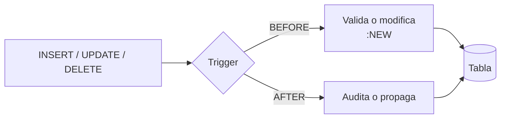

# 24. Triggers

> [!info] Al terminar este capítulo tenés que poder
> - Explicar qué es un trigger y cuándo se dispara.
> - Diferenciar `BEFORE`/`AFTER` y fila/sentencia.
> - Escribir un trigger de auditoría y uno de validación.
> - Justificar cuándo **no** conviene usarlo.

> [!abstract] Qué debés saber (nivel 1)
> - **Trigger:** código que se ejecuta **automáticamente** ante `INSERT`, `UPDATE` o `DELETE`.
> - `BEFORE` valida o modifica; `AFTER` audita o propaga.
> - `FOR EACH ROW` = por fila; sin eso, por sentencia.
> - `:NEW` y `:OLD` acceden a los valores nuevos y anteriores.
> - Ocultar lógica en la base tiene costo: usalo para auditoría e integridad técnica.

## 24.1 Qué es un trigger



| Clasificación | Valores |
|---|---|
| Momento | `BEFORE`, `AFTER`, `INSTEAD OF` (vistas) |
| Nivel | `FOR EACH ROW` (fila) o sentencia (sin `FOR EACH ROW`) |
| Evento | `INSERT`, `UPDATE`, `DELETE` (pueden combinarse) |

## 24.2 Dos triggers típicos

### Trigger de auditoría

```sql
CREATE TABLE auditoria_alerta (
    id_auditoria   INT AUTO_INCREMENT PRIMARY KEY,
    id_alerta      INT NOT NULL,
    prioridad_old  TINYINT,
    prioridad_new  TINYINT,
    usuario        VARCHAR(60),
    fecha          DATETIME
);
```

```sql
-- Oracle
CREATE OR REPLACE TRIGGER trg_alerta_aud
AFTER UPDATE OF prioridad ON alerta
FOR EACH ROW
BEGIN
    INSERT INTO auditoria_alerta
        (id_alerta, prioridad_old, prioridad_new, usuario, fecha)
    VALUES
        (:OLD.id, :OLD.prioridad, :NEW.prioridad, USER, SYSDATE);
END;
/
```

```sql
-- MySQL
DELIMITER //

CREATE TRIGGER trg_alerta_aud
AFTER UPDATE ON alerta
FOR EACH ROW
BEGIN
    IF OLD.prioridad <> NEW.prioridad THEN
        INSERT INTO auditoria_alerta
            (id_alerta, prioridad_old, prioridad_new, usuario, fecha)
        VALUES
            (OLD.id, OLD.prioridad, NEW.prioridad, USER(), NOW());
    END IF;
END //

DELIMITER ;
```

| Seudoregistro | Significado |
|---|---|
| `:NEW` / `NEW` | Valores nuevos (en `INSERT` y `UPDATE`) |
| `:OLD` / `OLD` | Valores anteriores (en `UPDATE` y `DELETE`) |

> [!note] La tabla de auditoría
> El `CREATE TABLE` de arriba es de **MySQL** (`AUTO_INCREMENT`). En Oracle 12c+ se usa `GENERATED BY DEFAULT AS IDENTITY`, o una secuencia con trigger. El cuerpo del trigger cambia solo en esa parte.

> [!warning] `:NEW` en un `DELETE`
> No existe. En `DELETE` solo hay `:OLD`. Usarlo da error de compilación.

### Trigger de validación

```sql
-- Oracle: impedir prioridades fuera de rango
CREATE OR REPLACE TRIGGER trg_alerta_prio
BEFORE INSERT OR UPDATE OF prioridad ON alerta
FOR EACH ROW
BEGIN
    IF :NEW.prioridad < 1 OR :NEW.prioridad > 5 THEN
        RAISE_APPLICATION_ERROR(-20002, 'Prioridad inválida');
    END IF;
END;
/
```

```sql
-- MySQL equivalente
DELIMITER //

CREATE TRIGGER trg_alerta_prio
BEFORE INSERT ON alerta
FOR EACH ROW
BEGIN
    IF NEW.prioridad < 1 OR NEW.prioridad > 5 THEN
        SIGNAL SQLSTATE '45000' SET MESSAGE_TEXT = 'Prioridad inválida';
    END IF;
END //

DELIMITER ;
```

> [!important] Trigger vs. `CHECK`
> Si la regla se puede expresar con `CHECK`, usá `CHECK`: es más simple y visible. El trigger queda para reglas que cruzan tablas o requieren lógica.

### Trigger de propagación

El caso típico de regla **entre tablas**: cuando se registra una reparación, la alerta queda atendida. No se puede hacer con `CHECK` porque mira otra tabla.

```sql
CREATE OR REPLACE TRIGGER trg_reparacion_atendida
AFTER INSERT ON reparacion
FOR EACH ROW
BEGIN
    UPDATE alerta
       SET atendida = 1
     WHERE id = :NEW.id_alerta;
END;
/
```

| Decisión | Por qué |
|---|---|
| `AFTER INSERT` | La reparación ya existe: si el `UPDATE` falla, se revierte la operación completa |
| `:NEW.id_alerta` | Es la FK que indica qué alerta quedó atendida |
| Otra tabla | No hay `mutating table`: el trigger lee y escribe en `alerta`, no en la tabla que lo dispara |

> [!warning] Todo dato derivado tiene un solo dueño
> Si la aplicación también hace `UPDATE alerta SET atendida = 1`, hay dos lugares escribiendo lo mismo y tarde o temprano se contradicen. Elegí uno —trigger o procedimiento— y documentalo. En el esquema del libro `atendida` es booleana (`1`/`0`); si la modelás como `CHAR(1)`, usá `'S'`/`'N'`.

## 24.3 Cuándo **no** usar triggers

| Situación | Por qué evitarlo |
|---|---|
| Reglas centrales del negocio | Quedan ocultas: nadie las ve al leer la aplicación |
| Procesos largos o con `COMMIT` | Bloquean y complican transacciones |
| Lógica que depende de muchas tablas | Difícil de probar y depurar |
| Reemplazo de restricciones simples | `CHECK`, `UNIQUE`, `FK` son mejores |

> [!quote] Criterio de la guía del compañero
> Un trigger es apropiado para **auditoría**, **integridad técnica** y **acciones automáticas pequeñas y documentadas**.

## 24.4 Programas almacenados en MySQL (repaso)

| Objeto | Sintaxis | Uso |
|---|---|---|
| Procedimiento | `CREATE PROCEDURE ... CALL` | Tarea |
| Función | `CREATE FUNCTION ... SELECT f()` | Cálculo |
| Trigger | `CREATE TRIGGER ...` | Automatismo |
| Evento | `CREATE EVENT ...` | Tarea programada (fuera del programa) |

```sql
DELIMITER //

CREATE PROCEDURE registrar_alerta(
    IN p_dispositivo INT,
    IN p_mensaje VARCHAR(200),
    IN p_prioridad TINYINT
)
BEGIN
    IF p_prioridad < 1 OR p_prioridad > 5 THEN
        SIGNAL SQLSTATE '45000' SET MESSAGE_TEXT = 'Prioridad inválida';
    END IF;

    INSERT INTO alerta (mensaje, prioridad, id_dispositivo)
    VALUES (p_mensaje, p_prioridad, p_dispositivo);
END //

DELIMITER ;

CALL registrar_alerta(1, 'Lámpara quemada', 2);
```

## 24.5 Programa completo

```sql
-- 1. Tabla de auditoría (MySQL)
CREATE TABLE IF NOT EXISTS auditoria_reparacion (
    id            INT AUTO_INCREMENT PRIMARY KEY,
    id_reparacion INT NOT NULL,
    costo_old     DECIMAL(10,2),
    costo_new     DECIMAL(10,2),
    usuario       VARCHAR(60),
    fecha         DATETIME
);

-- 2. Trigger
DELIMITER //

CREATE TRIGGER trg_reparacion_aud
AFTER UPDATE ON reparacion
FOR EACH ROW
BEGIN
    IF OLD.costo <> NEW.costo THEN
        INSERT INTO auditoria_reparacion
            (id_reparacion, costo_old, costo_new, usuario, fecha)
        VALUES
            (OLD.id, OLD.costo, NEW.costo, USER(), NOW());
    END IF;
END //

DELIMITER ;

-- 3. Probar
UPDATE reparacion SET costo = costo + 1000 WHERE id = 1;

SELECT * FROM auditoria_reparacion;
```

Salida:

```text
+----+---------------+-----------+-----------+---------+---------------------+
| id | id_reparacion | costo_old | costo_new | usuario | fecha               |
+----+---------------+-----------+-----------+---------+---------------------+
|  1 |             1 |  15000.00 |  16000.00 | root    | 2026-11-18 10:30:00 |
+----+---------------+-----------+-----------+---------+---------------------+
```

## Cómo trazar un trigger

| Paso | Acción | `OLD` | `NEW` | Auditoría |
|---|---|---|---|---|
| 1 | `UPDATE reparacion SET costo = 16000 WHERE id = 1` | costo 15000 | costo 16000 | — |
| 2 | Se dispara `AFTER UPDATE` | 15000 | 16000 | — |
| 3 | `IF OLD.costo <> NEW.costo` | — | — | verdadero |
| 4 | `INSERT` | — | — | nueva fila |

## Errores que suelen tomar

| Error | Corrección |
|---|---|
| `:NEW` en `DELETE` | Usar `:OLD` |
| Trigger `BEFORE` que consulta la tabla que modifica | `mutating table` en Oracle |
| Olvidar `FOR EACH ROW` | Se ejecuta una vez por sentencia, no por fila |
| Trigger sin condición de cambio | Audita aunque no cambie nada |
| Lógica de negocio en el trigger | Moverla a la aplicación o a un procedimiento |
| `DELIMITER` sin restaurar | El cliente interpreta mal lo siguiente |

## Ejercicios

> [!example]- 1. Trigger
> **Enunciado:** escribí un trigger que impida insertar alertas con prioridad mayor a 5.
> **Solución:** ver `trg_alerta_prio` en 24.2.

> [!example]- 2. `:OLD` / `:NEW`
> **Enunciado:** en un `UPDATE`, ¿dónde ves el valor anterior y el nuevo?
> **Solución:** `:OLD.columna` y `:NEW.columna` (Oracle); `OLD.columna` y `NEW.columna` (MySQL).

> [!example]- 3. Diseño
> **Enunciado:** ¿usarías un trigger para calcular el total de una factura?
> **Solución:** no es lo ideal: es una regla central. Conviene calcularla en la aplicación o en un procedimiento explícito; el trigger se reserva para auditoría o integridad técnica.

> [!example]- 4. a papel
> **Enunciado:** escribí el trigger de auditoría de `prioridad` en Oracle.
> **Solución:** ver `trg_alerta_aud` en 24.2.

## Lo que sigue

[[bd25_paquetes|25. Paquetes]].

#libro2 #basededatos #triggers
