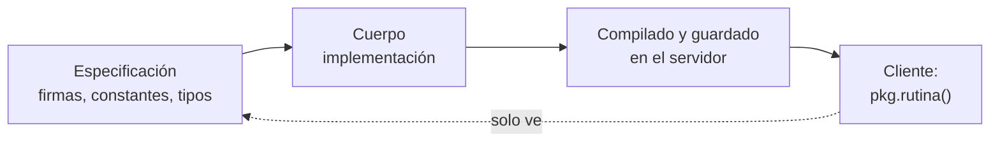

# 25. Paquetes

> [!info] Al terminar este capítulo tenés que poder
> - Explicar qué es un paquete y qué problema resuelve.
> - Distinguir especificación de cuerpo.
> - Crear un paquete con procedimientos, funciones, constantes y estado de sesión.
> - Decidir cuándo conviene un paquete y cuándo no.

> [!abstract] Qué debés saber (nivel 1)
> - **Paquete:** agrupación con nombre de procedimientos, funciones, variables, cursores y tipos.
> - Tiene **especificación** (lo público) y **cuerpo** (la implementación).
> - Es la forma de **encapsular** lógica en la base.
> - Oracle lo compila una vez y lo mantiene en memoria por sesión.
> - MySQL no tiene paquetes: se agrupa por convención de nombres o se usan procedimientos sueltos.

## 25.1 Qué es un paquete



```sql
-- Especificación: lo que se ve desde afuera
CREATE OR REPLACE PACKAGE pkg_alertas AS
    PROCEDURE registrar (p_dispositivo IN NUMBER, p_mensaje IN VARCHAR2, p_prioridad IN NUMBER);
    FUNCTION  cantidad (p_dispositivo IN NUMBER) RETURN NUMBER;
    c_max_prioridad CONSTANT NUMBER := 5;
END pkg_alertas;
/
```

```sql
-- Cuerpo: la implementación
CREATE OR REPLACE PACKAGE BODY pkg_alertas AS

    PROCEDURE registrar (p_dispositivo IN NUMBER, p_mensaje IN VARCHAR2, p_prioridad IN NUMBER) IS
    BEGIN
        IF p_prioridad < 1 OR p_prioridad > c_max_prioridad THEN
            RAISE_APPLICATION_ERROR(-20001, 'Prioridad fuera de rango');
        END IF;

        INSERT INTO alerta (mensaje, prioridad, id_dispositivo)
        VALUES (p_mensaje, p_prioridad, p_dispositivo);
    END registrar;

    FUNCTION cantidad (p_dispositivo IN NUMBER) RETURN NUMBER IS
        v NUMBER;
    BEGIN
        SELECT COUNT(*) INTO v FROM alerta WHERE id_dispositivo = p_dispositivo;
        RETURN v;
    END cantidad;

END pkg_alertas;
/
```

```sql
-- Uso
BEGIN
    pkg_alertas.registrar(1, 'Semáforo apagado', 2);
    DBMS_OUTPUT.PUT_LINE('Cantidad: ' || pkg_alertas.cantidad(1));
END;
/
```

| Parte | Contiene | Visible |
|---|---|---|
| Especificación | Firmas, constantes, tipos | Sí |
| Cuerpo | Implementación y elementos privados | No |
| Variables de paquete | Estado persistente por sesión | Según se declaren |

> [!important] Por qué se usan paquetes
> **Encapsulamiento en la base**: el cliente ve la interfaz, no la implementación. Además, Oracle compila el paquete una vez y lo mantiene en memoria.

### Permisos sobre el paquete

El permiso se otorga **una vez por paquete**, no rutina por rutina: alcanza con `EXECUTE` sobre la especificación.

```sql
GRANT EXECUTE ON pkg_alertas TO operador;
```

> [!important] Por qué conviene
> Si mañana agregás `pkg_alertas.cerrar` a la especificación, el usuario ya la puede ejecutar sin un `GRANT` nuevo. Esa es la “administración centralizada de permisos” que se cita entre las ventajas del paquete.

> [!warning] Estado del paquete
> Una variable declarada en el cuerpo **persiste durante la sesión**. Es útil para cachés, pero puede sorprender si esperás que se reinicie en cada llamada.

## 25.2 Equivalente en MySQL

MySQL no tiene paquetes. Las alternativas son:

| Alternativa | Cómo |
|---|---|
| Prefijo de nombre | `pkg_alertas_registrar()`, `pkg_alertas_cantidad()` |
| Un procedimiento que llama a otros | `CALL alertas_registrar(...)` |
| Lógica en la aplicación | Servicio o DAO en Java |

```sql
DELIMITER //
CREATE PROCEDURE alertas_registrar(
    IN p_dispositivo INT, IN p_mensaje VARCHAR(200), IN p_prioridad INT)
BEGIN
    IF p_prioridad < 1 OR p_prioridad > 5 THEN
        SIGNAL SQLSTATE '45000' SET MESSAGE_TEXT = 'Prioridad fuera de rango';
    END IF;
    INSERT INTO alerta (mensaje, prioridad, id_dispositivo)
    VALUES (p_mensaje, p_prioridad, p_dispositivo);
END //
DELIMITER ;
```

> [!tip] Si te toca Oracle en el oral
> “El paquete separa interfaz de implementación y permite estado por sesión; en MySQL eso se resuelve con convenciones de nombre o desde la aplicación.”

## 25.3 Cuándo conviene

| Situación | Conviene |
|---|---|
| Varias rutinas relacionadas | Sí: un paquete por dominio |
| Necesitás ocultar rutinas auxiliares | Sí: van en el cuerpo |
| Constantes compartidas | Sí |
| Una sola rutina simple | No: procedimiento suelto |
| MySQL | No existe: usá prefijos |

## Errores que suelen tomar

| Error | Corrección |
|---|---|
| Confundir especificación con cuerpo | La especificación declara; el cuerpo implementa |
| Poner la implementación en la especificación | No compila o queda pública |
| Esperar que la variable se reinicie por llamada | Persiste por sesión |
| Buscar paquetes en MySQL | No existen |
| Usar un paquete para una sola función | Sobra indirección |

## Ejercicios

> [!example]- 1. Partes
> **Enunciado:** ¿qué va en la especificación y qué en el cuerpo?
> **Solución:** firmas, constantes y tipos públicos en la especificación; implementación y auxiliares privados en el cuerpo.

> [!example]- 2. Estado
> **Enunciado:** ¿por qué una variable de paquete puede dar resultados distintos entre llamadas?
> **Solución:** porque persiste durante la sesión y conserva el valor anterior.

> [!example]- 3. MySQL
> **Enunciado:** ¿cómo agruparías `registrar` y `cantidad` en MySQL?
> **Solución:** con prefijo común (`alertas_registrar`, `alertas_cantidad`) o desde la capa de servicio.

> [!example]- 4. a papel
> **Enunciado:** escribí la especificación de un paquete `pkg_alertas` con dos rutinas.
> **Solución:** ver 25.1.

> [!example]- 5. Paquete
> **Enunciado:** ¿qué diferencia hay entre especificación y cuerpo?
> **Solución:** la especificación declara la interfaz pública (firmas y constantes); el cuerpo implementa y puede tener elementos privados.

## Lo que sigue

[[bd_Cierre_parte4|Cierre de la Parte 4]].

#libro2 #paquetes
