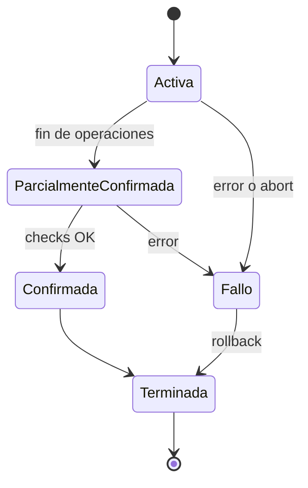
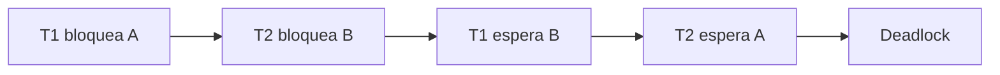
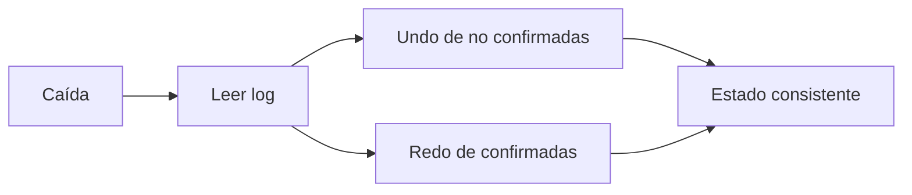

# E. Transacciones (anexo opcional)

> [!warning] ¿Entra en el EFIP?
> El programa de **Siglo 21** para el Módulo 3 (sub-ejes 5.1 a 5.4) **no incluye transacciones**. La cátedra **UTN** sí las dicta (clase 11) y son un tema clásico de oral en bases de datos.
>
> **Decisión:** este anexo es **contingencia**. Estudiálo si te sobra tiempo o si el tribunal pregunta por concurrencia. No reemplaza los cuatro sub-ejes.

## E.1 Qué es una transacción

> [!quote] Definición
> **Transacción:** unidad lógica de procesamiento de la base de datos que incluye una o más operaciones de acceso (inserción, eliminación, modificación o recuperación).

```sql
-- Transferencia: dos operaciones que deben ocurrir juntas
START TRANSACTION;
UPDATE cuenta SET saldo = saldo - 1000 WHERE id = 1;
UPDATE cuenta SET saldo = saldo + 1000 WHERE id = 2;
COMMIT;
```

| Concepto | Significado |
|---|---|
| `BEGIN TRANSACTION` | Marca el inicio |
| `READ(X)` / `WRITE(X)` | Operaciones básicas |
| `COMMIT` | Confirma: los cambios son permanentes |
| `ROLLBACK` / `ABORT` | Deshace todo lo hecho |
| **Read-set** | Elementos que la transacción lee |
| **Write-set** | Elementos que escribe |
| **Granularidad** | Tamaño del elemento: campo, registro, bloque |

> [!important] Un programa puede tener varias transacciones
> La transacción es una unidad **lógica**, no todo el programa. Una aplicación puede abrir y cerrar varias.

## E.2 Propiedades ACID

| Propiedad | Significado | Quién la garantiza |
|---|---|---|
| **Atomicidad** | Todo o nada | El gestor de recuperación (`COMMIT`/`ROLLBACK`) |
| **Consistencia** | Pasa de un estado válido a otro válido | Las restricciones + la lógica |
| **Aislamiento** | Una transacción no ve estados intermedios de otra | El control de concurrencia |
| **Durabilidad** | Lo confirmado sobrevive a una caída | El log y el disco |

> [!tip] Cómo recordarlas
> **A**tomicidad, **C**onsistencia, **A**islamiento, **D**urabilidad → ACID.

## E.3 Estados de una transacción



| Estado | Qué significa |
|---|---|
| **Activa** | Ejecutando; puede leer y escribir |
| **Parcialmente confirmada** | Terminó sus operaciones; falta validar |
| **Confirmada** | Pasó las validaciones; efecto permanente |
| **Fallo** | Error o aborto; hay que deshacer |
| **Terminada** | Salió del sistema |

> [!important] Punto de confirmación
> La transacción alcanza el **commit point** cuando todas sus operaciones se ejecutaron y el efecto quedó registrado en el **log**. Desde ahí, es durable.

## E.4 El log

El gestor de recuperación registra:

```text
[start_transaction, T]
[read_item, T, X]
[write_item, T, X, valor_antiguo, valor_nuevo]
[commit, T]
[abort, T]
```

| Entrada | Uso |
|---|---|
| `start` / `commit` / `abort` | Saber qué transacciones terminaron |
| `write_item` con valor antiguo y nuevo | Deshacer (`undo`) o rehacer (`redo`) |

## E.5 Problemas de concurrencia

| Problema | Qué pasa | Ejemplo |
|---|---|---|
| **Actualización perdida** | Dos transacciones leen el valor viejo; la segunda pisa a la primera | Dos retiros simultáneos de $100 sobre $150 |
| **Lectura sucia** | T1 lee un dato escrito por T2 que **no confirmó** y después T2 aborta | Se opera sobre un valor que nunca existió |
| **Análisis inconsistente** | T1 lee un dato mientras T2 modifica otros de la misma operación | El total no cierra |
| **Lectura no repetible** | T1 lee dos veces y T2 cambia el valor entre lecturas | Dos valores distintos del mismo dato |

> [!warning] La lectura sucia es la más grave
> Viola el aislamiento: T1 ve algo que la base nunca confirmó. Se evita con bloqueos o con nivel de aislamiento `READ COMMITTED` o superior.

## E.6 Bloqueos

| Tipo | Para qué | Efecto |
|---|---|---|
| **Compartido (S)** | Leer sin modificar | Varios pueden leer; nadie escribe |
| **Exclusivo (X)** | Escribir | Nadie más lee ni escribe ese dato |

| Compatibilidad | S | X |
|---|---|---|
| **S** | ✅ | ❌ |
| **X** | ❌ | ❌ |

**Protocolo de bloqueo en dos fases (2PL):**

1. **Fase de crecimiento:** se piden bloqueos, no se liberan.
2. **Fase de decrecimiento:** se liberan, no se piden nuevos.

Garantiza **serializabilidad**, pero no evita el deadlock.

### Interbloqueo (deadlock)



| Estrategia | Cómo |
|---|---|
| **Prevención** | Ordenar los recursos y pedirlos siempre en el mismo orden; timestamps |
| **Detección** | Grafo de espera; si hay ciclo, se aborta una víctima |
| **Timeout** | Si espera demasiado, se aborta |

> [!important] En MySQL
> InnoDB detecta deadlocks y aborta una transacción con `ERROR 1213: Deadlock found`. La aplicación debe reintentar.

## E.7 Niveles de aislamiento

| Nivel | Lectura sucia | Lectura no repetible | Fantasma |
|---|---|---|---|
| `READ UNCOMMITTED` | Posible | Posible | Posible |
| `READ COMMITTED` | No | Posible | Posible |
| `REPEATABLE READ` (MySQL por defecto) | No | No | Posible* |
| `SERIALIZABLE` | No | No | No |

\* InnoDB evita muchos fantasmas con *next-key locks*.

```sql
-- Ver el nivel actual
SELECT @@transaction_isolation;

-- Cambiarlo en la sesión
SET SESSION TRANSACTION ISOLATION LEVEL READ COMMITTED;
```

> [!tip] La respuesta corta
> “A más aislamiento, menos anomalías y menos concurrencia. MySQL usa `REPEATABLE READ` por defecto.”

## E.8 Recuperación

| Técnica | Idea |
|---|---|
| **Actualización diferida** | Los cambios se escriben en disco recién en el `commit` |
| **Actualización inmediata** | Se escriben antes; el log permite deshacer |
| **Checkpoint** | Punto de control: suspende, fuerza buffers a disco, escribe `[checkpoint]`, reanuda |
| **Undo** | Deshacer transacciones no confirmadas al recuperar |
| **Redo** | Rehacer las confirmadas que no llegaron al disco |



## E.9 En MySQL, en la práctica

```sql
START TRANSACTION;

UPDATE cuenta SET saldo = saldo - 1000 WHERE id = 1;
SAVEPOINT despues_resta;

UPDATE cuenta SET saldo = saldo + 1000 WHERE id = 2;

-- Si algo falla:
-- ROLLBACK TO despues_resta;

COMMIT;
```

| Sentencia | Uso |
|---|---|
| `START TRANSACTION` | Inicia |
| `COMMIT` | Confirma |
| `ROLLBACK` | Deshace todo |
| `SAVEPOINT nombre` | Punto intermedio |
| `ROLLBACK TO nombre` | Deshace hasta ese punto |

> [!warning] DDL y transacciones
> En MySQL, `CREATE`, `ALTER` y `DROP` hacen **commit implícito**. No los mezcles dentro de una transacción que después querés revertir.

## Preguntas de oral (contingencia)

> [!question]- 1. ¿Qué es una transacción?
> Una unidad lógica de procesamiento que agrupa operaciones que deben ejecutarse todas o ninguna.

> [!question]- 2. ¿Qué significa ACID?
> Atomicidad, consistencia, aislamiento y durabilidad.

> [!question]- 3. ¿Qué diferencia hay entre `COMMIT` y `ROLLBACK`?
> `COMMIT` confirma los cambios de forma permanente; `ROLLBACK` los deshace.

> [!question]- 4. ¿Qué es una lectura sucia?
> Leer un dato modificado por otra transacción que todavía no confirmó.

> [!question]- 5. ¿Qué es un deadlock?
> Dos o más transacciones se esperan mutuamente y ninguna puede avanzar.

> [!question]- 6. ¿Qué garantiza el 2PL?
> Serializabilidad: el resultado equivale a alguna ejecución en serie.

> [!question]- 7. ¿Qué nivel de aislamiento usa MySQL?
> `REPEATABLE READ` por defecto.

> [!question]- 8. ¿Para qué sirve un checkpoint?
> Para acotar el trabajo de recuperación: todo lo anterior está en disco.

## Lo que sigue

Volver al [[00_Inicio_BD|índice del Libro 2]].

#libro2 #anexo #transacciones
