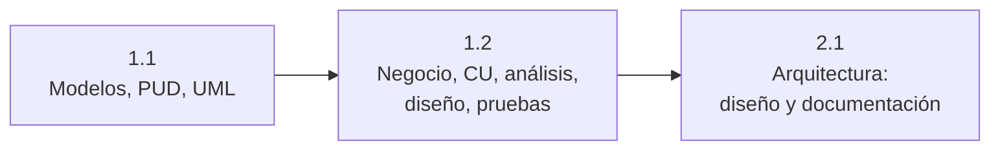

# Libro 3 — Análisis y Diseño

> [!info] Qué es este libro
> Manual para el **Módulo 1 del EFIP I** (Licenciatura en Informática, Siglo 21). Cubre los sub-ejes **1.1** (modelos, metodologías, PUD y UML), **1.2** (modelos del PUD) y **2.1** (arquitectura del software).
> Base: lecturas oficiales de INF390 y de la materia Ingeniería de Software. **Método**: cátedra UTN (Análisis de Sistemas y Diseño de Sistemas), incluidos GRASP, contratos y DCD.

## Cómo leerlo

> [!tip] Antes de empezar
> El método de estudio es el mismo de los libros anteriores: [[00_Metodo|tres niveles, respuesta en cinco pasos y correcciones]].

1. Cada capítulo abre con **lo que tenés que poder hacer**.
2. Los diagramas son Mermaid: Obsidian los renderiza.
3. Las **plantillas** y los **procedimientos** están en tablas para copiar a papel.
4. Al final hay errores típicos y ejercicios con solución plegable.
5. La práctica con casos reales está en `PRACTICA_ANALISIS_Y_DISENO/` (20 casos + 4 simulacros).

## Mapa del libro

### Parte 1 — Fundamentos y UML (1.1)
- [[ad01_ingenieria-y-metodologia|1. Ingeniería de software, proceso y metodología]]
- [[ad02_modelos-de-proceso-y-pud|2. Modelos de proceso y PUD]]
- [[ad03_uml-lenguaje|3. UML: lenguaje, bloques y reglas]]
- [[ad04_diagramas-y-vistas|4. Diagramas UML y vistas 4+1]]
- [[ad_Cierre_parte1|Cierre de la Parte 1]]

### Parte 2 — Del negocio al diseño (1.2)
- [[ad05_modelo-de-negocio|5. Modelo de negocio y modelo de dominio]]
- [[ad06_requerimientos|6. Captura de requerimientos]]
- [[ad07_casos-de-uso|7. Modelo de casos de uso]]
- [[ad08_especificacion-cu|8. Especificación de casos de uso]]
- [[ad09_prototipos|9. Prototipos de interfaz]]
- [[ad10_modelo-analisis|10. Modelo del análisis]]
- [[ad11_modelo-diseno|11. Modelo de diseño y DCD]]
- [[ad12_diagrama-de-secuencia|12. Diagrama de secuencia paso a paso]]
- [[ad13_grasp|13. GRASP: asignar responsabilidades]]
- [[ad14_implementacion|14. Modelo de implementación]]
- [[ad15_pruebas|15. Modelo de pruebas]]
- [[ad_Cierre_parte2|Cierre de la Parte 2]]

### Parte 3 — Arquitectura (2.1)
- [[ad16_arquitectura|16. Arquitectura: elementos, estilos y decisiones]]
- [[ad17_documentacion-y-testeo|17. Documentación, implementación y testeo de la arquitectura]]
- [[ad_Cierre_parte3|Cierre de la Parte 3]]

### Anexos
- [[ad_A_Plantillas|A. Plantillas para el escrito]]
- [[ad_B_Banco_preguntas|B. Banco de preguntas de oral]]
- [[ad_C_Errores|C. Errores frecuentes]]
- [[ad_D_Mapa|D. Mapa del programa y trazabilidad]]
- [[ad_E_OCL_GoF|E. OCL y patrones GoF]] — *opcional, fuera del programa S21*

## El caso que atraviesa el libro

> [!example] Caso integrador
> Un municipio contrata un sistema para gestionar **dispositivos** (semáforos y cámaras), las **alertas** que generan y las **reparaciones**.
>
> - El operador registra dispositivos y consulta alertas.
> - El técnico atiende visitas y registra reparaciones.
> - El supervisor consulta reportes por prioridad.
>
> El mismo caso se usa en `PRACTICA_ANALISIS_Y_DISENO/` para los simulacros del escrito.

## Regla de oro del módulo

> [!important] Lo que evalúa el tribunal
> No es “dibujar lindo”: es **justificar decisiones**. Cada artefacto (CU, clase, componente, nodo) tiene que poder explicarse con un “por qué”.

#libro3 #analisis #efip
