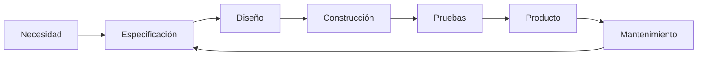
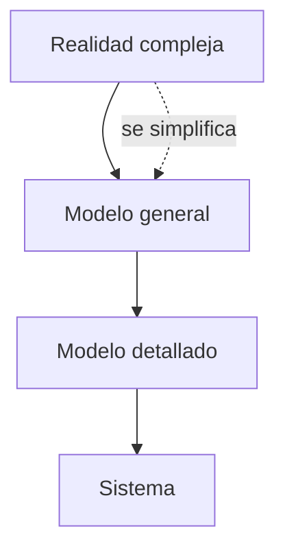
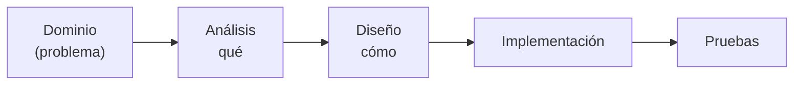

# 1. Ingeniería de software, proceso y metodología

> [!info] Al terminar este capítulo tenés que poder
> - Definir ingeniería de software, proceso y metodología.
> - Explicar por qué se modela.
> - Distinguir modelo estructural de modelo de comportamiento.
> - Diferenciar metodología estructurada de orientada a objetos.

> [!abstract] Qué debés saber (nivel 1)
> - **Ingeniería de software:** disciplina que aplica un enfoque sistemático al desarrollo.
> - **Proceso:** conjunto de actividades que transforman requisitos en software.
> - **Metodología:** filosofías + fases + procedimientos + reglas + técnicas + herramientas + documentación.
> - **Modelo:** simplificación de la realidad que da los planos del sistema.
> - Se modela para **comprender, visualizar, especificar, documentar y construir**.
> - Modelo **estructural** = organización; modelo de **comportamiento** = dinámica.

## 1.1 Qué es la ingeniería de software

> [!quote] Definición de cátedra
> **Ingeniería de software:** disciplina de la ingeniería que se interesa por todos los aspectos del desarrollo de software, desde las etapas iniciales de especificación hasta el mantenimiento, aplicando un enfoque sistemático, disciplinado y cuantificable.

Tres ideas que la definición exige:

1. **No es solo programar**: cubre especificación, diseño, construcción, pruebas y evolución.
2. **Es ingeniería**: hay métodos, mediciones y control.
3. **Es social**: participan clientes, usuarios, desarrolladores y stakeholders.

## 1.2 Proceso, modelo de proceso y metodología

| Concepto | Definición | Ejemplo |
|---|---|---|
| **Proceso de software** | Conjunto de actividades que transforman requisitos en un sistema | Especificar, diseñar, construir, probar |
| **Modelo de proceso** | Organización de esas actividades en el tiempo | Cascada, incremental, PUD |
| **Metodología** | Filosofías, fases, procedimientos, reglas, técnicas, herramientas, documentación y formación | PUD con UML; estructurada con DFD |

> [!important] No son sinónimos
> El **proceso** es *qué* actividades; el **modelo de proceso** es *cómo se ordenan*; la **metodología** agrega técnicas, herramientas y reglas. En el oral, definí los tres.

### Componentes de una metodología

| Componente | Qué aporta |
|---|---|
| Filosofía | Principios y paradigma |
| Fases | Etapas del ciclo |
| Procedimientos | Pasos concretos |
| Reglas | Restricciones de aplicación |
| Técnicas | Diagramas, notaciones |
| Herramientas | CASE, IDE |
| Documentación | Artefactos |
| Formación | Capacitación del equipo |

## 1.3 Por qué modelar

> [!quote] Cátedra
> **Modelo:** simplificación de la realidad que proporciona los planos de un sistema. Puede ser general o detallado.

Un modelo permite:

| Objetivo | Pregunta que responde |
|---|---|
| Comprender | ¿Cómo funciona el dominio? |
| Visualizar | ¿Qué forma tiene el sistema? |
| Especificar | ¿Qué debe hacer exactamente? |
| Documentar | ¿Qué decisiones se tomaron? |
| Construir | ¿Qué se implementa? |
| Comunicar | ¿Todos entienden lo mismo? |

> [!warning] Un modelo no es la realidad
> Omite detalles a propósito. Si el modelo intenta reflejar todo, deja de ser útil. La abstracción es una decisión de diseño.

## 1.4 Modelo estructural y de comportamiento

| Modelo | Qué resalta | Diagramas típicos |
|---|---|---|
| **Estructural** | Organización estática: clases, objetos, componentes, nodos | Clases, objetos, componentes, despliegue |
| **De comportamiento** | Dinámica: interacciones, estados, actividades | Casos de uso, secuencia, comunicación, estados, actividades |

> [!important] Se complementan
> Uno sin el otro es incompleto: la clase `Alerta` (estructura) no dice nada de cómo cambia de estado (comportamiento).

## 1.5 Metodologías estructuradas vs. orientadas a objetos

| Aspecto | Estructurada | Orientada a objetos |
|---|---|---|
| Unidad | Función / proceso | Objeto / clase |
| Datos y procesos | Separados | Integrados |
| Modelado | DFD, diccionario de datos | UML: clases, CU, secuencia |
| Cambio | Se propaga entre módulos | Se encapsula en el objeto |
| Reutilización | Baja | Alta |

> [!quote] Cátedra
> **Modelo de objetos:** marco de referencia conceptual compuesto por abstracción, encapsulamiento, modularidad y jerarquía.

### Los cuatro principios, con ejemplo

| Principio | Qué hace | Dónde se ve en UML |
|---|---|---|
| **Abstracción** | Se queda con lo esencial y descarta el detalle | `Dispositivo` sin marca ni modelo |
| **Encapsulamiento** | Oculta el estado y expone una interfaz | Atributos `-` y operaciones `+` |
| **Modularidad** | Agrupa lo relacionado con bajo acoplamiento | Paquetes y componentes |
| **Jerarquía** | Ordena por generalización/especialización y por todo/parte | Herencia y composición |

> [!important] Objeto = estado + comportamiento + identidad
> `S-102` y `S-103` pueden estar los dos en rojo y seguir siendo **objetos distintos**: la identidad no se deduce de los valores. La **clase** describe lo común (atributos, operaciones, relaciones); el **objeto** es una instancia concreta.
>
> Esa distinción ordena el resto del libro: en **análisis** se habla de responsabilidades, en **diseño** de operaciones con firma y en **implementación** de métodos.

> [!warning] El material de Siglo 21 lo dice explícito
> La programación estructurada **no desaparece**: se aplica **dentro de los métodos** de las clases. No es “una u otra”; es “una dentro de la otra”.

## 1.6 El principio que ordena todo el módulo

> [!important] Separar el problema de la solución
> - **Análisis** responde **qué** debe hacer el sistema, sin decidir tecnología.
> - **Diseño** responde **cómo** se implementa: clases, componentes, nodos, decisiones tecnológicas.
>
> Confundirlos es el error conceptual más caro del EFIP.

## Método: cómo encarar un enunciado

| Paso | Pregunta | Producto |
|---|---|---|
| 1 | ¿Quién pide el sistema y para qué? | Objetivo y alcance |
| 2 | ¿Qué procesos del negocio lo rodean? | Modelo de negocio |
| 3 | ¿Qué debe hacer el sistema? | RF / CU |
| 4 | ¿Qué restricciones tiene? | RNF |
| 5 | ¿Qué información maneja? | Modelo de dominio |
| 6 | ¿Cómo se estructura la solución? | Análisis y diseño |
| 7 | ¿Cómo se verifica? | Pruebas |

## Errores que suelen tomar

| Error | Corrección |
|---|---|
| Decir “metodología” cuando hablan de proceso | Definir los tres conceptos |
| Creer que modelar es dibujar | Es abstraer para decidir |
| Mezclar análisis con diseño | Qué vs. cómo |
| Decir que OO reemplaza a la estructurada | Conviven: la estructurada vive en los métodos |
| Presentar un solo modelo como suficiente | Estructural + comportamiento |

## Ejercicios

> [!example]- 1. Definiciones
> **Enunciado:** diferenciá proceso, modelo de proceso y metodología.
> **Solución:** proceso = actividades; modelo = orden de esas actividades (cascada, PUD); metodología = filosofía + fases + procedimientos + reglas + técnicas + herramientas + documentación + formación.

> [!example]- 2. Modelos
> **Enunciado:** ¿un diagrama de clases es estructural o de comportamiento? ¿Y uno de estados?
> **Solución:** clases = estructural; estados = comportamiento.

> [!example]- 3. Análisis vs. diseño
> **Enunciado:** “El sistema debe registrar alertas con prioridad” ¿es análisis o diseño? ¿Y “la alerta se guarda en la tabla `alerta`”?
> **Solución:** lo primero es **análisis** (qué); lo segundo es **diseño/implementación** (cómo).

> [!example]- 4. a papel
> **Enunciado:** escribí en 5 líneas por qué se modela antes de programar.
> **Solución:** porque permite comprender el dominio, comunicar decisiones, detectar errores temprano (más baratos), especificar con precisión y documentar la solución. El código es la última consecuencia del modelo, no el punto de partida.

## Lo que sigue

[[ad02_modelos-de-proceso-y-pud|Modelos de proceso y PUD]].

#libro3 #fundamentos
