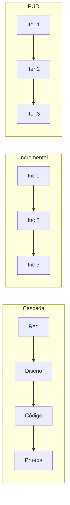
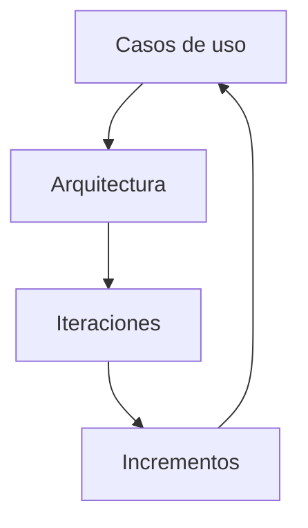
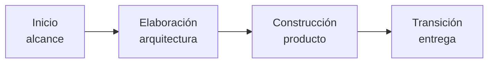

# 2. Modelos de proceso y PUD

> [!info] Al terminar este capítulo tenés que poder
> - Comparar cascada, incremental y espiral.
> - Explicar las tres características del PUD.
> - Nombrar las cuatro fases, sus objetivos y sus hitos.
> - Distinguir fase, iteración e incremento.

> [!abstract] Qué debés saber (nivel 1)
> - **Cascada:** secuencial; cada fase empieza cuando termina la anterior.
> - **Incremental:** se entrega por partes; cada incremento agrega funcionalidad.
> - **Espiral:** iterativo con análisis de riesgos.
> - **PUD/RUP:** iterativo e incremental, **dirigido por casos de uso**, **centrado en la arquitectura**.
> - Fases: **Inicio → Elaboración → Construcción → Transición**.
> - Fase ≠ iteración ≠ incremento.

## 2.1 Por qué un modelo de proceso

Un proceso ordena el trabajo: qué se hace primero, qué se entrega y cuándo. Sin modelo, el equipo improvisa y el riesgo se descubre tarde.

| Modelo | Forma | Ventaja | Riesgo |
|---|---|---|---|
| **Cascada** | Secuencial | Simple, fácil de contratar | Los cambios son caros; el cliente ve el producto al final |
| **Incremental** | Por incrementos | Entregas tempranas | Requiere buena priorización |
| **DRA (desarrollo rápido)** | Incremental acelerado, por componentes | Entrega muy rápida y mucha participación del usuario | Exige equipo disponible y alcance modularizable |
| **Prototipos** | Versión preliminar que se evalúa y se descarta | Descubre requisitos que el usuario no sabe explicar | Se confunde el prototipo con el producto final |
| **Espiral** | Iterativo + riesgos | Gestiona riesgos | Complejo de administrar |
| **PUD** | Iterativo, por fases | Arquitectura temprana y entregas | Requiere disciplina |

> [!warning] El error de “cascada con iteraciones”
> Un proceso no se vuelve iterativo por repetir reuniones. Lo es cuando **cada iteración produce un incremento ejecutable** y **refina la arquitectura**.

> [!important] DRA no es “programar rápido”
> El **desarrollo rápido de aplicaciones** es una variante del incremental: ciclos muy cortos, construcción basada en componentes y usuarios disponibles de verdad. Fracasa cuando el alcance no se puede modularizar o no hay quién valide.

## 2.2 El PUD

> [!quote] Definición de cátedra
> **PUD/RUP:** proceso de desarrollo de software que utiliza UML para preparar los esquemas de un sistema y fue propuesto por los creadores de UML.

### Las tres características

| Característica | Qué significa | Consecuencia |
|---|---|---|
| **Dirigido por casos de uso** | Los CU guían requisitos, diseño, implementación y prueba | El CU es el hilo conductor |
| **Centrado en la arquitectura** | La arquitectura se define temprano y se valida en cada iteración | Se mitiga el riesgo técnico |
| **Iterativo e incremental** | Se construye en iteraciones cortas que producen incrementos | Entregas tempranas y feedback |

> [!important] Cómo se relacionan
> Los casos de uso **definen** qué construir; la arquitectura **sostiene** lo construido; las iteraciones **verifican** ambos. Si falta uno, el PUD deja de ser PUD.

> [!tip] Si el tribunal agrega “orientado a riesgos”
> Es correcto como **consecuencia**, no como cuarta característica: las iteraciones tempranas atacan primero los riesgos importantes y así estabilizan la arquitectura. Decilo así y no perdés el marco de las tres.

## 2.3 Las cuatro fases

| Fase | Objetivo | Hito | Pregunta que responde |
|---|---|---|---|
| **Inicio** | Alcance y viabilidad | *Lifecycle Objective* | ¿Vale la pena? |
| **Elaboración** | Arquitectura base y riesgos | *Lifecycle Architecture* | ¿Podemos construirlo? |
| **Construcción** | Producto completo | *Initial Operational Capability* | ¿Está terminado? |
| **Transición** | Entrega al usuario | *Product Release* | ¿Funciona en producción? |

### Qué se hace en cada fase

| Fase | Actividades típicas | Artefactos |
|---|---|---|
| Inicio | Visión, alcance, casos de uso principales, riesgos | Documento de visión, modelo de CU preliminar |
| Elaboración | Arquitectura candidata, CU críticos, prototipos | Línea base de arquitectura, modelo de análisis/diseño |
| Construcción | Implementar el resto, integrar, probar | Construcciones ejecutables, manuales |
| Transición | Beta, correcciones, capacitación | Versión de producción |

> [!warning] “Todas las fases hacen todo”
> En cada fase se recorren **todas** las disciplinas, pero con distinto énfasis. En Inicio casi no hay implementación; en Construcción casi no hay modelado de negocio.

## 2.4 Fase, iteración e incremento

| Concepto | Definición | Ejemplo |
|---|---|---|
| **Fase** | Etapa del ciclo con un objetivo e hito | Elaboración |
| **Iteración** | Miniproyecto que recorre flujos de trabajo y produce un incremento | Iteración 2 de Elaboración |
| **Incremento** | Crecimiento del producto al terminar la iteración | “Alta de dispositivos + consulta de alertas” |

> [!important] La confusión que se pregunta
> Una fase contiene **varias** iteraciones; cada iteración produce **un** incremento. No son sinónimos.

## 2.5 Disciplinas del PUD

| Disciplina | Qué produce |
|---|---|
| Modelado de negocio | Modelo de negocio |
| Requisitos | Modelo de casos de uso |
| Análisis y diseño | Modelo de análisis y de diseño |
| Implementación | Componentes y construcciones |
| Pruebas | Modelo y plan de pruebas |
| Despliegue | Versión instalada |
| Gestión de configuración | Versiones y cambios |
| Gestión de proyecto | Planes y seguimiento |
| Entorno | Herramientas y proceso |

> [!tip] Para el oral
> “El PUD tiene flujos de trabajo **principales** (negocio, requisitos, análisis, diseño, implementación, pruebas, despliegue) y **de apoyo** (configuración, proyecto, entorno). Cada fase recorre todos, con énfasis distinto.”

## 2.6 Método: ubicar una actividad en la fase correcta

| Pregunta | Si la respuesta es… | Va en… |
|---|---|---|
| ¿Estamos definiendo alcance y riesgos? | Sí | Inicio |
| ¿Estamos estabilizando la arquitectura? | Sí | Elaboración |
| ¿Estamos completando funcionalidad? | Sí | Construcción |
| ¿Estamos corrigiendo en el cliente? | Sí | Transición |
| ¿Es una actividad de requisitos? | Sí | Todas las fases, con énfasis en Inicio/Elaboración |

## 2.7 Comparación final

| Criterio | Cascada | PUD |
|---|---|---|
| Entrega | Al final | Por iteraciones |
| Cambios | Caros | Esperados |
| Arquitectura | Se define al principio y se congela | Se define y **se valida** temprano |
| Riesgo | Se descubre tarde | Se ataca en Elaboración |
| Documentación | Exhaustiva por fase | Viva, por artefactos |

## Errores que suelen tomar

| Error | Corrección |
|---|---|
| Confundir fase con iteración | La fase contiene iteraciones |
| Decir que el PUD es cascada | Es iterativo e incremental |
| Nombrar las fases en otro orden | Inicio, Elaboración, Construcción, Transición |
| Decir que UML es una metodología | UML es lenguaje; el PUD es proceso |
| Creer que en Elaboración no se programa | Se hacen prototipos y se valida la arquitectura |
| Olvidar el hito de cada fase | Cada fase termina en un hito |

## Ejercicios

> [!example]- 1. Fases
> **Enunciado:** ¿en qué fase se define la línea base de la arquitectura?
> **Solución:** Elaboración, cuyo hito es *Lifecycle Architecture*.

> [!example]- 2. Fase vs. iteración
> **Enunciado:** “Iteración 3 de Construcción” ¿es una fase?
> **Solución:** no: es una iteración dentro de la fase Construcción.

> [!example]- 3. Características
> **Enunciado:** nombrá las tres características del PUD y explicá una.
> **Solución:** dirigido por casos de uso, centrado en la arquitectura, iterativo e incremental. Los CU guían todo el ciclo: de ellos salen los requisitos, las realizaciones de diseño y los casos de prueba.

> [!example]- 4. Modelos
> **Enunciado:** ¿cuándo conviene cascada?
> **Solución:** cuando los requisitos son estables y el riesgo es bajo; por ejemplo, un sistema reglamentado con alcance cerrado.

> [!example]- 5. a papel
> **Enunciado:** dibujá las cuatro fases con su hito y una frase de objetivo.
> **Solución:** ver 2.3. Debe incluir Inicio → Objetivo del ciclo; Elaboración → Arquitectura; Construcción → Capacidad operativa inicial; Transición → Release.

## Lo que sigue

[[ad03_uml-lenguaje|UML: lenguaje, bloques y reglas]].

#libro3 #pud
