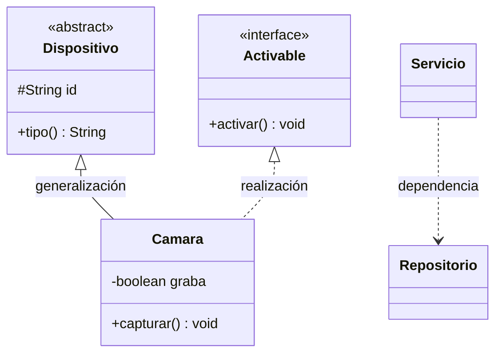
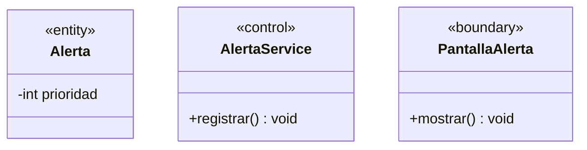

# 3. UML: lenguaje, bloques y reglas

> [!info] Al terminar este capítulo tenés que poder
> - Explicar por qué UML es lenguaje y no metodología.
> - Nombrar los bloques de construcción y las relaciones.
> - Aplicar las reglas de nombres, alcance y visibilidad.
> - Usar estereotipos, restricciones y notas.

> [!abstract] Qué debés saber (nivel 1)
> - **UML:** lenguaje estándar para visualizar, especificar, construir y documentar artefactos de software.
> - **No es un método**: no dice qué hacer primero ni cuándo.
> - Bloques: **cosas**, **relaciones**, **diagramas**.
> - Relaciones: dependencia, asociación, generalización, realización.
> - Mecanismos comunes: especificaciones, adornos, divisiones comunes y extensibilidad.

## 3.1 Qué es UML

> [!quote] Definición de cátedra
> **UML:** lenguaje estándar para escribir los planos de un software, visualizarlos, especificarlos, construirlos y documentar los artefactos de un sistema.

| UML **es** | UML **no es** |
|---|---|
| Un lenguaje de modelado | Una metodología |
| Una notación estándar | Un proceso |
| Independiente del proceso | Una herramienta |
| Extensible | Un lenguaje de programación |

> [!important] La trampa clásica
> “Usamos UML como metodología” → **mal**. UML dice **cómo se dibuja**; el PUD dice **qué hacer y en qué orden**. Se complementan, no se sustituyen.

### Las tres características que la cátedra destaca

1. **Es un lenguaje**: tiene vocabulario (bloques) y reglas (cómo combinarlos).
2. **Es independiente del proceso**: sirve para cascada, PUD o ágil.
3. **Permite modelar sistemas complejos**: desde un CU hasta el despliegue.

## 3.2 Bloques de construcción

### Cosas

| Tipo | Qué representa | Ejemplo |
|---|---|---|
| **Estructurales** | La parte estática | Clase, interfaz, componente, nodo, caso de uso |
| **De comportamiento** | La parte dinámica | Interacción, máquina de estados |
| **De agrupación** | Organización | Paquete |
| **De anotación** | Explicación | Nota |

### Relaciones

| Relación | Notación | Significado | Ejemplo |
|---|---|---|---|
| **Dependencia** | flecha discontinua `..>` | Un elemento usa a otro | `Servicio ..> Repositorio` |
| **Asociación** | línea `—` | Comunicación estructural | `Cliente — Pedido` |
| **Generalización** | triángulo hueco `<|--` | “Es un” | `Camara --|> Dispositivo` |
| **Realización** | triángulo hueco discontinuo `<|..` | Implementa un contrato | `Camara ..|> Activable` |



> [!important] Asociación vs. dependencia
> La **asociación** es estructural y duradera (un atributo). La **dependencia** es de uso puntual (un parámetro, una variable local, una llamada).

### Adornos de la asociación

| Adorno | Qué indica | Ejemplo |
|---|---|---|
| **Rol** | Qué papel cumple ese extremo | `Persona` es *titular* en `Póliza` |
| **Multiplicidad** | Cuántas instancias participan | `1..1`, `0..*`, `1..*` |
| **Navegabilidad** | Desde qué clase se puede llegar a la otra | `Pedido → LineaPedido` |

### Agregación y composición

Son dos intensidades del “todo/parte”. La diferencia es **quién sobrevive**:

| Relación | Notación | Vida de la parte | Ejemplo |
|---|---|---|---|
| **Asociación** | línea `—` | Independiente | `Técnico — Reparación` |
| **Agregación** | rombo hueco `◇—` | Independiente: la parte existe sin el todo | `Equipo ◇— Técnico` |
| **Composición** | rombo relleno `◆—` | Dependiente: la parte no existe sin el todo | `Alquiler ◆— Cuota` |

> [!important] La prueba para decidir
> Preguntá: “si borro el todo, ¿la parte sigue teniendo sentido?”. Si sigue → **agregación**; si no → **composición**. Y si el vínculo es solo de uso (un parámetro, una llamada) → **dependencia**, no asociación.

## 3.3 Reglas de UML

UML define reglas para que un modelo sea **bien formado**:

| Regla | Pregunta | Ejemplo |
|---|---|---|
| **Nombres** | ¿Cómo se llama? | Clase en `UpperCamelCase`; atributo en `lowerCamelCase` |
| **Alcance** | ¿Dónde es visible? | Público, privado, protegido, paquete |
| **Visibilidad** | ¿Quién accede? | `+` público, `-` privado, `#` protegido, `~` paquete |
| **Integridad** | ¿Las relaciones son coherentes? | Una especialización no puede ser circular |
| **Ejecución** | ¿El comportamiento es consistente? | Un estado inicial y uno final |

> [!warning] Modelo “bien formado” no es “modelo correcto”
> UML verifica la **sintaxis** del modelo, no que el modelo resuelva el problema. Eso lo decide el análisis.

## 3.4 Mecanismos comunes

| Mecanismo | Qué es | Ejemplo |
|---|---|---|
| **Especificación** | La semántica detrás del símbolo | La clase `Alerta` además de su dibujo tiene su contrato |
| **Adornos** | Detalles agregados al símbolo | `{ordered}`, `{unique}`, multiplicidad |
| **Divisiones comunes** | Clasificación vs. instancia | Clase vs. objeto |
| **Extensibilidad** | Mecanismos para agregar semántica | Estereotipo, valor etiquetado, restricción |

### Estereotipos y restricciones



| Elemento | Notación | Uso |
|---|---|---|
| Estereotipo | `<<nombre>>` | Clasificar un elemento con semántica propia |
| Valor etiquetado | `{autor = "equipo"}` | Agregar propiedad |
| Restricción | `{prioridad entre 1 y 5}` | Regla que debe cumplirse |

## 3.5 Lo que UML no decide

| Pregunta | Quién la responde |
|---|---|
| ¿Qué se modela primero? | El proceso (PUD) |
| ¿Qué casos de uso hay? | El análisis del negocio y los requisitos |
| ¿Qué clase tiene cada responsabilidad? | Los patrones de diseño (GRASP) |
| ¿Qué tecnología se usa? | La arquitectura y el entorno |

> [!important] Para el oral
> “UML aporta la notación; el método aporta el orden y los criterios. Un diagrama puede ser UML válido y, aun así, ser un mal diseño.”

## 3.6 Método: leer un diagrama UML en 4 pasos

| Paso | Pregunta |
|---|---|
| 1 | ¿Qué tipo de diagrama es y qué vista representa? |
| 2 | ¿Qué elementos y relaciones aparecen? |
| 3 | ¿Qué reglas o restricciones están anotadas? |
| 4 | ¿Qué decisión de diseño explica? |

> [!example] Aplicación
> Un diagrama de clases con `Dispositivo` abstracta, `Semaforo` y `Camara` como subclases, y una interfaz `Activable`:
> 1. Estructural, vista lógica.
> 2. Dos generalizaciones y una realización.
> 3. `{prioridad 1..5}` en `Alerta`.
> 4. Se decidió modelar “es un” y un contrato de activación.

## Errores que suelen tomar

| Error | Corrección |
|---|---|
| Decir que UML es una metodología | Es un lenguaje |
| Usar un diagrama para todo | Cada diagrama responde una pregunta |
| Mezclar niveles (clase con objeto) | Un diagrama, un nivel |
| Poner todos los miembros públicos | Aplicar visibilidad |
| Olvidar la multiplicidad | Toda asociación la lleva |
| Confundir generalización con realización | Herencia vs. contrato |

## Ejercicios

> [!example]- 1. Clasificar
> **Enunciado:** ¿qué relación es `Camara ..|> Activable`?
> **Solución:** realización (implementa un contrato).

> [!example]- 2. Bloques
> **Enunciado:** nombrá un elemento estructural, uno de comportamiento y uno de agrupación.
> **Solución:** clase; máquina de estados; paquete.

> [!example]- 3. Estereotipo
> **Enunciado:** ¿para qué sirve `<<entity>>`?
> **Solución:** para marcar que la clase representa información del dominio, siguiendo el análisis de Jacobson.

> [!example]- 4. a papel
> **Enunciado:** dibujá una clase `Alerta` con dos atributos privados, un método público y una restricción.
> **Solución:**
> ```mermaid
> classDiagram
>     class Alerta {
>         -int prioridad
>         -String mensaje
>         +atender() void
>     }
>     note for Alerta "prioridad 1..5"
> ```

## Lo que sigue

[[ad04_diagramas-y-vistas|Diagramas UML y vistas 4+1]].

#libro3 #uml
