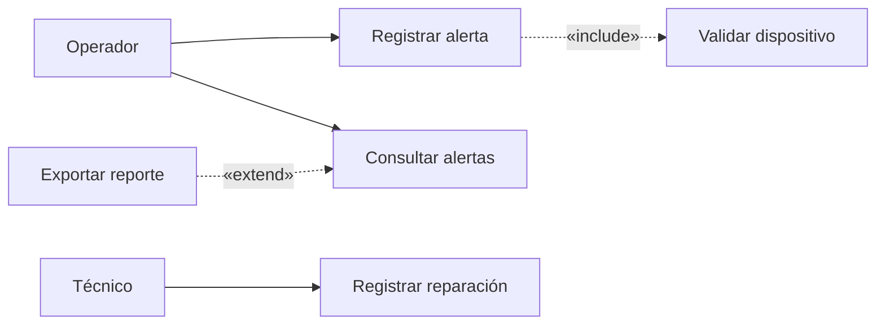
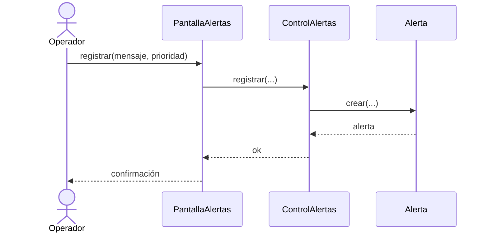
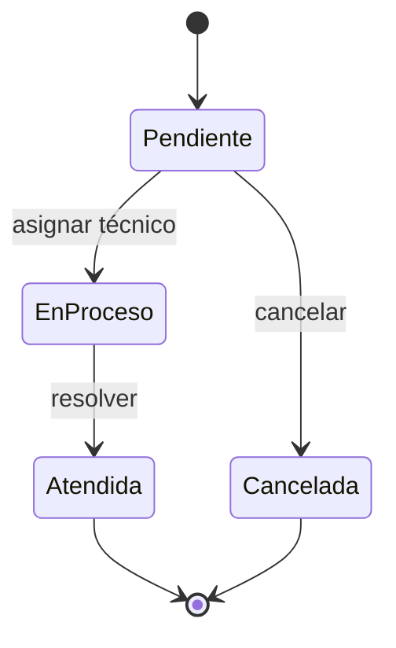
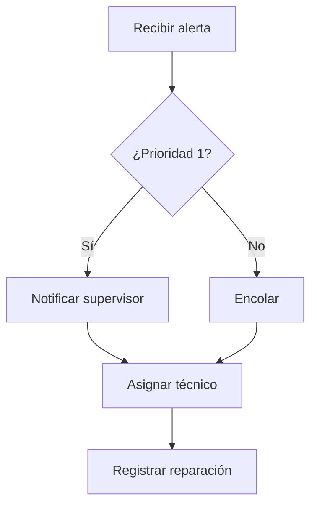
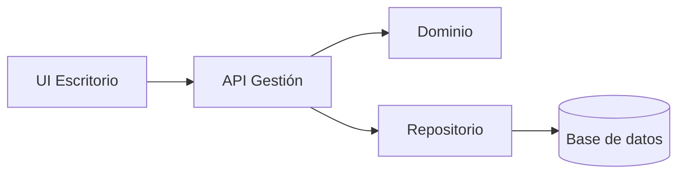
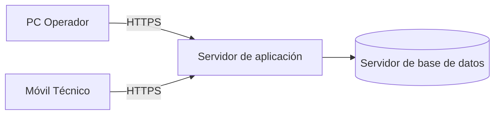
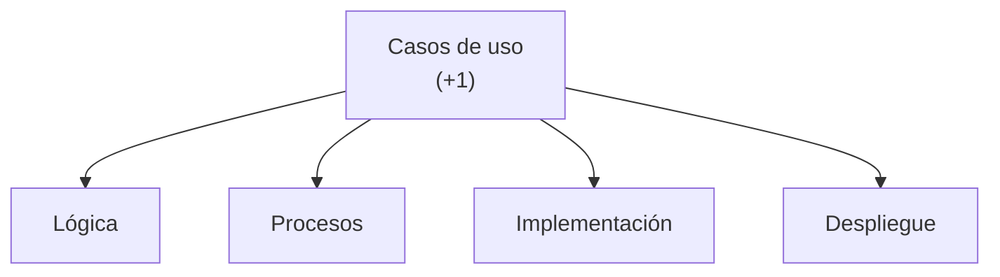

# 4. Diagramas UML y vistas 4+1

> [!info] Al terminar este capítulo tenés que poder
> - Clasificar los diagramas en estructurales y de comportamiento.
> - Elegir el diagrama correcto para cada pregunta.
> - Explicar las cinco vistas del modelo 4+1.
> - Dibujar los diagramas que pide el EFIP.

> [!abstract] Qué debés saber (nivel 1)
> - UML 2 tiene **14 tipos** de diagrama; el EFIP usa unos pocos.
> - **Estructurales:** clases, objetos, paquetes, componentes, despliegue.
> - **De comportamiento:** casos de uso, actividad, estados, secuencia, comunicación.
> - **4+1:** lógica, procesos, implementación, despliegue + casos de uso.
> - Cada vista responde una pregunta distinta; no se reemplazan.

## 4.1 Clasificación

| Estructurales (estática) | De comportamiento (dinámica) |
|---|---|
| Clases | Casos de uso |
| Objetos | Actividad |
| Paquetes | Máquina de estados |
| Componentes | Secuencia |
| Estructura compuesta | Comunicación |
| Despliegue | Interacción general |
| Perfil | Tiempos |

> [!tip] Lo que entra en el EFIP
> Clases, objetos, paquetes, componentes, despliegue (estructurales); casos de uso, actividad, estados, secuencia y comunicación (comportamiento). El resto se menciona.

## 4.2 Qué responde cada diagrama

| Diagrama | Pregunta que responde | Ejemplo |
|---|---|---|
| **Casos de uso** | ¿Qué hace el sistema y para quién? | Operador registra alerta |
| **Actividad** | ¿Cómo es el flujo de un proceso? | Flujo de atención de una alerta |
| **Estados** | ¿Cómo cambia un objeto en el tiempo? | Alerta: pendiente → atendida |
| **Secuencia** | ¿Cómo colaboran los objetos en el tiempo? | Pantalla → controlador → entidad |
| **Comunicación** | ¿Qué objetos colaboran y con qué mensajes? | Misma información, otra vista |
| **Clases** | ¿Qué clases hay y cómo se relacionan? | Dispositivo, Alerta |
| **Objetos** | ¿Cómo es una instancia concreta? | `s1: Semaforo` |
| **Paquetes** | ¿Cómo se agrupa el modelo? | `dominio`, `aplicacion`, `ui` |
| **Componentes** | ¿Qué piezas de software hay? | `gestor-alertas.jar` |
| **Despliegue** | ¿Dónde se ejecuta? | Servidor, PC, red |

## 4.3 Ejemplos mínimos

### Casos de uso

### Secuencia

> [!tip] La receta completa
> Este es un ejemplo mínimo. El **método de 5 pasos**, el orden obligatorio de las líneas de vida, los tres tipos de flecha y los marcos `alt/opt/loop` están en [[ad12_diagrama-de-secuencia|12. Diagrama de secuencia paso a paso]].

### Estados

### Actividad

### Componentes

### Despliegue

## 4.4 El modelo 4+1

Kruchten propone describir la arquitectura con **cuatro vistas** y **un conjunto de escenarios** que las valida.

| Vista | Qué muestra | Diagramas típicos | Stakeholder |
|---|---|---|---|
| **Lógica** | Estructura de clases y objetos | Clases, objetos, paquetes | Desarrolladores |
| **Procesos** | Concurrencia y actividades en ejecución | Actividad, secuencia | Integradores |
| **Implementación** | Componentes y su organización | Componentes, paquetes | Programadores |
| **Despliegue** | Nodos físicos y distribución | Despliegue | Operaciones |
| **Casos de uso** (+1) | Escenarios que validan las vistas | Casos de uso | Usuarios y cliente |

> [!important] Por qué “+1”
> Las cuatro vistas no se validan solas: los **escenarios** (casos de uso) verifican que la arquitectura soporta lo que el usuario necesita. Si un CU crítico no se puede realizar con la arquitectura, la arquitectura está mal.

## 4.5 Método: elegir el diagrama

| Si la pregunta es… | Usá… |
|---|---|
| ¿Quién usa el sistema y para qué? | Casos de uso |
| ¿Cómo se comporta un objeto según su estado? | Estados |
| ¿Cómo colaboran los objetos para un CU? | Secuencia |
| ¿Qué clases y relaciones hay? | Clases |
| ¿Cómo se agrupa el modelo? | Paquetes |
| ¿Qué piezas de software se entregan? | Componentes |
| ¿En qué máquinas corre? | Despliegue |
| ¿Cómo es el proceso de negocio? | Actividad |

> [!warning] No mezcles vistas
> Un diagrama de despliegue no lleva atributos de clase; un diagrama de clases no lleva servidores. Cada vista tiene su nivel.

## 4.6 Del diagrama al argumento

> [!example] Cómo justificar
> “Para el flujo de atención uso un **diagrama de actividad** porque necesito mostrar decisiones y paralelismo del proceso. Para la colaboración de objetos en el CU uso **secuencia**, porque importa el orden temporal de los mensajes. Para la estructura estática, **clases**.”
>
> Eso es lo que el tribunal quiere: **no** “dibujé los tres”.

## Errores que suelen tomar

| Error | Corrección |
|---|---|
| Usar secuencia para mostrar estructura | Es comportamiento |
| Poner lógica de negocio en el diagrama de CU | El CU muestra funcionalidad, no flujo interno |
| Confundir componente con nodo | Componente = software; nodo = hardware |
| Olvidar la vista de despliegue | La arquitectura también es física |
| Presentar 4+1 como “cuatro diagramas” | Son vistas, con varios diagramas cada una |

## Ejercicios

> [!example]- 1. Clasificar
> **Enunciado:** ¿estructural o de comportamiento? Clases, estados, componentes, secuencia, despliegue.
> **Solución:** estructurales: clases, componentes, despliegue. Comportamiento: estados, secuencia.

> [!example]- 2. Elegir
> **Enunciado:** necesitás mostrar que una alerta pasa por pendiente, en proceso y atendida. ¿Qué diagrama?
> **Solución:** máquina de estados.

> [!example]- 3. Vistas
> **Enunciado:** ¿qué vista describe los servidores?
> **Solución:** despliegue.

> [!example]- 4. 4+1
> **Enunciado:** ¿por qué los casos de uso son el “+1”?
> **Solución:** porque validan las otras cuatro vistas: si un CU crítico no se puede realizar, la arquitectura falla.

> [!example]- 5. a papel
> **Enunciado:** dibujá un diagrama de secuencia para “registrar alerta” con actor, pantalla, control y entidad.
> **Solución:** ver 4.3. Debe tener el actor a la izquierda, mensajes en orden y retorno.

## Lo que sigue

[[ad_Cierre_parte1|Cierre de la Parte 1]].

#libro3 #uml #vistas
