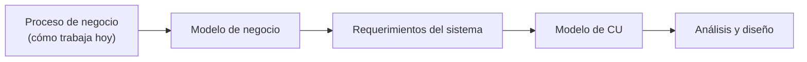
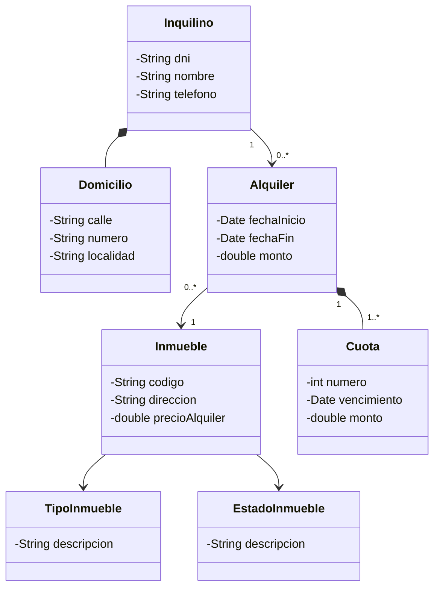

# 5. Modelo de negocio y modelo de dominio

> [!info] Al terminar este capítulo tenés que poder
> - Modelar el negocio antes del sistema.
> - Distinguir actor, trabajador y entidad de negocio.
> - Construir un modelo de dominio con las reglas de la cátedra.
> - Decidir cuándo un atributo debe ser una clase.

> [!abstract] Qué debés saber (nivel 1)
> - **Modelo de negocio:** describe los procesos del negocio para entenderlos y derivar requisitos.
> - **Caso de uso de negocio:** secuencia que produce un resultado de valor para un actor del negocio.
> - **Trabajador:** rol interno que ejecuta el proceso.
> - **Entidad de negocio:** objeto que los trabajadores usan o producen.
> - **Modelo de dominio:** clases conceptuales del problema, con atributos y asociaciones.
> - **No se modela la empresa cliente como clase.**

## 5.1 Por qué empezar por el negocio

El sistema no existe en el vacío: automatiza (o cambia) un proceso que ya existe. Si no entendés el negocio, modelás la solución equivocada.



| Pregunta | Artefacto |
|---|---|
| ¿Quién hace qué en el negocio? | Casos de uso de negocio |
| ¿Qué roles internos intervienen? | Trabajadores |
| ¿Qué información se produce o consume? | Entidades de negocio |
| ¿Qué debe hacer el sistema? | Casos de uso del sistema |

## 5.2 Elementos del modelo de negocio

| Elemento | Definición | Ejemplo (municipio) |
|---|---|---|
| **Actor de negocio** | Rol externo al negocio | Vecino, proveedor |
| **Trabajador de negocio** | Rol interno que ejecuta el proceso | Operador de monitoreo, técnico |
| **Entidad de negocio** | Objeto que se toma, inspecciona, produce o usa | Alerta, reparación |
| **Caso de uso de negocio** | Secuencia que produce valor | Atender una alerta |
| **Unidad organizacional** | Área responsable | Centro de monitoreo |

> [!important] Actor de negocio ≠ actor del sistema
> El **actor de negocio** está fuera del negocio. El **actor del sistema** interactúa con el software. Un trabajador de negocio puede ser actor del sistema (el operador usa la pantalla), pero no son el mismo concepto.

## 5.3 Modelo de dominio

> [!quote] Cátedra
> El **modelo de dominio** es un modelo de objetos conceptual que muestra las clases del problema, sus atributos y sus relaciones, sin decidir todavía la implementación.

### Clases conceptuales, no clases de software

| Es | No es |
|---|---|
| `Inmueble`, `Alquiler`, `Cuota` | `InmuebleDAO`, `AlquilerService` |
| Vocabulario del negocio | Vocabulario técnico |
| Atributos y asociaciones | Métodos y herencia de implementación |

### Reglas de la cátedra (UTN)

Son las que hay que aplicar en el escrito:

| # | Regla | Ejemplo |
|---|---|---|
| 1 | **Sustantivos** → clases o atributos; **verbos** → relaciones | “El inquilino alquila un inmueble” → `Inquilino — Alquiler — Inmueble` |
| 2 | Si un atributo **tiene atributos propios**, es clase | `domicilio` con calle, número, piso → clase `Domicilio` |
| 3 | **Nunca** la empresa cliente como clase | Si es para una inmobiliaria, no va `Inmobiliaria` |
| 4 | Siempre modelar **lo que se vende o gestiona** | `Inmueble`, `Curso`, `Producto` |
| 5 | **Tipos y estados** con valores predefinidos → clases simples | `TipoInmueble(descripcion)`, `EstadoAlerta(descripcion)` |
| 6 | Tipos/estados llevan **solo** un atributo descriptivo | `TipoInmueble { descripcion }` |
| 7 | Atributos **primitivos** van dentro; **complejos**, como clase | `edad:int`; `Domicilio` |
| 8 | Relación M:N con atributos → **clase asociativa** | `CobranzaDetalle` |
| 9 | **Estados** se modelan con enumeraciones si son finitos e influyen | `PENDIENTE`, `ATENDIDA` |
| 10 | **Transacciones de negocio** son clases | `Alquiler`, `Venta`, `Cobranza` |
| 11 | **Histórico de precios** → clase `ListaDePrecios` | Producto con precios vigentes |
| 12 | Relaciones **recursivas** son válidas | `Empleado` es jefe de `Empleado` |
| 13 | “Etcétera” en un atributo → probablemente sea clase | “y otros datos del inmueble” |

> [!example] Tipos y estados
> `Inmueble` tiene `tipo`. Como los tipos son un conjunto finito con descripción, se modela:
>
> ```mermaid
> classDiagram
>     class Inmueble {
>         -String codigo
>         -String direccion
>         -double precioAlquiler
>     }
>     class TipoInmueble {
>         -String descripcion
>     }
>     Inmueble --> TipoInmueble : "1..1"
>     TipoInmueble --> Inmueble : "0..*"
> ```
>
> Un inmueble tiene **exactamente un** tipo; un tipo clasifica **cero o muchos** inmuebles. El “muchos” está del lado de la cosa tipificada.

### El patrón de precios

> [!important] Si hay precios y querés histórico
> No pongas `precio` suelto en el producto. Modelá `ListaDePrecios`:
>
> ```mermaid
> classDiagram
>     class Producto
>     class ListaDePrecios {
>         -Date vigenciaDesde
>         -double precio
>     }
>     Producto "1" --> "0..*" ListaDePrecios
> ```
>
> Así podés responder “cuánto costaba en marzo” sin perder el precio actual.

## 5.4 Método: construir el modelo de dominio en 6 pasos

| Paso | Acción | Resultado |
|---|---|---|
| 1 | Subrayar **sustantivos** del enunciado | Candidatos a clase o atributo |
| 2 | Subrayar **verbos** | Candidatos a asociación |
| 3 | Descartar la empresa cliente y lo que no tiene identidad | Lista limpia |
| 4 | Convertir en clase los atributos **complejos**, tipos y estados | Clases simples |
| 5 | Agregar atributos **primitivos** a cada clase | Modelo con datos |
| 6 | Agregar asociaciones y **multiplicidades** | Modelo completo |

### Preguntas de decisión

| Pregunta | Si sí → | Si no → |
|---|---|---|
| ¿Tiene identidad propia? | Clase | Atributo |
| ¿Tiene atributos propios? | Clase | Atributo |
| ¿Es un tipo o estado finito? | Clase simple | Atributo |
| ¿Es una transacción de negocio? | Clase | — |
| ¿Es la empresa para la que trabajo? | **No modelar** | — |

## 5.5 Ejemplo completo

**Enunciado:** “La inmobiliaria administra inmuebles de distintos tipos (casa, departamento, local). De cada inmueble se conoce código, dirección, precio de alquiler y estado. Los inquilinos se registran con nombre, DNI, domicilio y teléfono. Un inquilino alquila inmuebles; de cada alquiler se registra fecha de inicio, fecha de fin y monto. El alquiler se paga en cuotas.”



| Decisión | Justificación |
|---|---|
| `TipoInmueble` y `EstadoInmueble` son clases | Valores finitos que influyen en el sistema |
| `Domicilio` es clase | Tiene atributos propios |
| `Alquiler` es clase | Es una transacción de negocio |
| `Cuota` es composición | No existe sin el alquiler |
| No aparece `Inmobiliaria` | Es la empresa cliente |

> [!warning] Multiplicidad de `Alquiler–Inmueble`
> Un inmueble puede tener muchos alquileres a lo largo del tiempo, pero **uno vigente**. Si el negocio lo exige, se modela con estado o con una restricción, no con una multiplicidad mágica.

## Errores que suelen tomar

| Error | Corrección |
|---|---|
| Poner la empresa como clase | Nunca |
| Modelar `precio` sin histórico cuando se pide | `ListaDePrecios` |
| Dejar `tipo` como texto suelto | Clase `TipoX` |
| Poner atributos complejos dentro de la clase | Clase aparte |
| Confundir actor de negocio con actor del sistema | Son niveles distintos |
| Olvidar multiplicidades | Toda asociación las lleva |
| Incluir clases técnicas (`DAO`, `Service`) | Eso es diseño, no dominio |

## Ejercicios

> [!example]- 1. Clase o atributo
> **Enunciado:** en una biblioteca: libro, título, autor, editorial, socio, préstamo.
> **Solución:** clases: `Libro`, `Autor`, `Editorial`, `Socio`, `Préstamo`. `título` es atributo de `Libro`.

> [!example]- 2. Tipo o atributo
> **Enunciado:** “el curso tiene modalidad (presencial, virtual, mixta)”. ¿Cómo lo modelás?
> **Solución:** clase `Modalidad` con `descripcion`, asociada a `Curso` (1..1 del lado del curso).

> [!example]- 3. Complejo
> **Enunciado:** “dirección con calle, número, piso y localidad”. ¿Atributo o clase?
> **Solución:** clase `Domicilio` con esos atributos (y `Localidad` si tiene código postal).

> [!example]- 4. M:N con atributos
> **Enunciado:** “un alumno cursa muchas materias y una materia tiene muchos alumnos; se registra la nota”.
> **Solución:** clase asociativa `Cursada(alumno, materia, nota, fecha)`.

> [!example]- 5. a papel
> **Enunciado:** modelá “pedido” con cliente, líneas y productos, y un precio histórico.
> **Solución:** `Cliente 1—0..* Pedido`; `Pedido 1 *—1..* LineaPedido`; `LineaPedido *—1 Producto`; `Producto 1—0..* ListaDePrecios`.

## Lo que sigue

[[ad06_requerimientos|Captura de requerimientos]].

#libro3 #negocio #dominio
