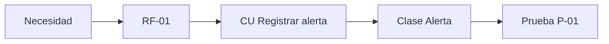

# 6. Captura de requerimientos

> [!info] Al terminar este capítulo tenés que poder
> - Diferenciar requerimiento funcional, no funcional y restricción.
> - Escribir RF y RNF verificables.
> - Usar historias de usuario con criterios de aceptación.
> - Detectar requisitos ambiguos o incompletos.

> [!abstract] Qué debés saber (nivel 1)
> - **Requerimiento:** característica o descripción de algo que el sistema debe hacer para satisfacer su propósito.
> - **RF:** qué hace el sistema (transforma entradas en salidas).
> - **RNF:** cómo lo hace (rendimiento, seguridad, usabilidad…), con métrica.
> - **Restricción:** límite impuesto (tecnología, norma, presupuesto).
> - Un requisito debe ser **verificable**.
> - RF ≈ caso de uso (regla de cátedra).

## 6.1 Qué es un requerimiento

> [!quote] Definición de cátedra
> **Requerimiento:** característica del sistema o descripción de algo que el sistema es capaz de hacer para satisfacer el propósito de este. Incluye servicios, restricciones y mejoras posibles respecto del sistema actual.

| Tipo | Responde | Ejemplo |
|---|---|---|
| **Funcional (RF)** | ¿Qué hace? | Registrar una alerta con prioridad |
| **No funcional (RNF)** | ¿Con qué calidad? | Responder en menos de 2 s con 50 usuarios |
| **De dominio** | ¿Qué regla del negocio lo origina? | Después del rojo debe venir rojo-amarillo |
| **Restricción** | ¿Con qué límite? | Debe ejecutarse sobre MySQL 8 |

> [!important] La regla que separa todo
> Si podés escribir un caso de prueba que diga “pasa / no pasa” sin mirar la interfaz, es **RF**. Si necesitás medir un atributo de calidad, es **RNF**.

> [!tip] Requerimiento de dominio ≠ restricción
> El **de dominio** es una regla del negocio que el sistema debe respetar (“un turno no puede superponerse”). La **restricción** es un límite impuesto desde afuera: tecnología, norma o presupuesto.

## 6.2 Requerimientos funcionales

### Plantilla

```text
El sistema debe <verbo en infinitivo> <objeto> [<condición>].
```

| Parte | Ejemplo |
|---|---|
| Verbo | registrar, consultar, calcular, notificar, asignar |
| Objeto | una alerta, las reparaciones del mes |
| Condición | para los dispositivos activos |

### Ejemplos correctos

```text
RF-01: El sistema debe registrar una alerta con mensaje, prioridad y dispositivo,
       asignando la fecha y hora automáticamente.
RF-02: El sistema debe listar las alertas pendientes ordenadas por prioridad.
RF-03: El sistema debe asignar un técnico a una reparación y cambiar su estado.
```

### Ejemplos incorrectos

| Mal | Por qué | Corrección |
|---|---|---|
| “El sistema debe ser rápido” | No es funcional ni verificable | RNF con métrica |
| “El sistema debe gestionar alertas y reportes y usuarios” | Tres funciones en una | Un RF por función |
| “El operador aprieta el botón rojo” | Es interfaz, no funcionalidad | “El sistema debe registrar la alerta” |
| “El sistema debe tener una base de datos” | Es diseño | No es requisito |

## 6.3 Requerimientos no funcionales

### Categorías y ejemplos medibles

| Categoría | Ejemplo verificable |
|---|---|
| **Rendimiento** | El 95 % de las consultas responde en ≤ 2 s con 50 usuarios concurrentes |
| **Disponibilidad** | El sistema está operativo el 99,5 % del horario de atención (7–19) |
| **Seguridad** | Solo usuarios autenticados acceden; toda modificación queda auditada |
| **Usabilidad** | Un operador nuevo registra una alerta en ≤ 3 minutos sin ayuda |
| **Mantenibilidad** | Un cambio en una regla de prioridad afecta a ≤ 2 módulos |
| **Portabilidad** | Funciona en Chrome, Firefox y Edge (últimas 2 versiones) |
| **Capacidad** | Soporta 10 000 dispositivos y 1 000 000 de alertas históricas |
| **Legal** | Cumple la Ley 25.326 de protección de datos personales |

### Plantilla

```text
RNF-<n>: <categoría>. El sistema debe <métrica> bajo <condición>,
         verificable mediante <método>.
```

> [!warning] “Amigable”, “rápido”, “robusto” no son requisitos
> Son deseos. Sin número y sin método de verificación, no se pueden evaluar ni testear.

## 6.4 Restricciones

| Restricción | Ejemplo |
|---|---|
| Tecnológica | Backend en Java 17 y MySQL 8 |
| Organizacional | Debe integrarse con el sistema de legajo existente |
| Legal | Los datos personales no pueden salir del país |
| De plazo | Primera versión operativa en 6 meses |
| De presupuesto | Sin licencias pagas |

> [!important] No las mezcles con RNF
> Una restricción **limita la solución**; un RNF **define una calidad medible**. “Usar MySQL” es restricción; “responder en 2 s” es RNF.

## 6.5 Técnicas de elicitación

| Técnica | Cuándo | Riesgo |
|---|---|---|
| Entrevista | Conocer el proceso y las excepciones | El usuario omite lo que considera obvio |
| Observación | Ver el trabajo real | El usuario cambia su comportamiento |
| Análisis de documentos | Formularios, normas, reportes | Documentos desactualizados |
| Taller (workshop) | Acordar alcance con varios actores | Dominan los más extrovertidos |
| Prototipo | Validar interfaz y flujo | El usuario se enfoca en lo visual |
| Cuestionario | Muchos usuarios dispersos | Poco profundidad |

## 6.6 Historias de usuario (regla UTN)

Son otra forma de especificar requerimientos, más ligera.

### Las tres partes

| Parte | Contenido |
|---|---|
| **Tarjeta** | `Como <rol> necesito <funcionalidad> para <beneficio>` |
| **Conversación** | Preguntas que completan la información faltante |
| **Criterios de aceptación** | `Si <condición> entonces <acción>` |

```text
Como operador de monitoreo necesito ver las alertas pendientes
ordenadas por prioridad para atender primero las críticas.
```

> [!important] Si no podés definir el “para”
> La funcionalidad no aporta valor. Reescribila o descartala.

### Criterios de aceptación

```text
- Solo se muestran alertas en estado PENDIENTE.
- El orden es prioridad ascendente y, a igual prioridad, fecha ascendente.
- La lista se actualiza al registrar una alerta nueva.
```

> [!tip] Diferencia con el CU
> La historia es **un recordatorio** para conversar; el CU es una **especificación** completa con escenarios. En el EFIP podés usar cualquiera, pero no mezcles: si te piden CU, especificá el CU.

## 6.7 Método: de la entrevista al requisito

| Paso | Acción | Producto |
|---|---|---|
| 1 | Identificar actores y objetivos | Lista de actores |
| 2 | Describir el proceso actual | Flujo (actividad) |
| 3 | Detectar qué hará el sistema | Lista de RF |
| 4 | Detectar calidades exigidas | Lista de RNF |
| 5 | Detectar límites | Restricciones |
| 6 | Priorizar | Alta / media / baja |
| 7 | Verificar con el usuario | Requisitos validados |

### Cómo verificar un requisito

| Criterio | Pregunta |
|---|---|
| Correcto | ¿Representa una necesidad real y sin errores? |
| Necesario | ¿Si falta, el sistema sirve? |
| No ambiguo | ¿Dos personas lo interpretan igual? |
| Verificable | ¿Puedo escribir una prueba? |
| Completo | ¿Incluye condiciones y excepciones? |
| Consistente | ¿Contradice otro requisito? |
| Realista | ¿Se puede lograr con los recursos y la tecnología disponibles? |
| Rastreable | ¿Sé de dónde salió y qué lo implementa? |

## 6.8 Trazabilidad



| Qué se traza | Para qué |
|---|---|
| Necesidad → RF | Justificar por qué existe |
| RF → CU | Verificar cobertura |
| CU → clase | Verificar que se diseñó |
| RF → prueba | Verificar que se probó |

> [!important] La matriz de trazabilidad
> Es la herramienta que evita “requisitos huérfanos” (sin CU) y “funcionalidad intrusa” (sin requisito). En el oral, mencionarla suma.

## Errores que suelen tomar

| Error | Corrección |
|---|---|
| RNF sin métrica | Agregar número y método |
| RF con dos verbos | Un requisito por función |
| RF que describe la interfaz | Describir la función |
| Confundir restricción con RNF | Límite vs. calidad medible |
| Omitir al actor que origina el RF | Indicarlo |
| Requisito no verificable | Reescribir con criterio de prueba |
| Historia sin “para” | No aporta valor |

## Ejercicios

> [!example]- 1. Clasificar
> **Enunciado:** (a) registrar reparación; (b) 99,5 % de disponibilidad; (c) usar MySQL; (d) listar alertas por prioridad.
> **Solución:** (a) y (d) RF; (b) RNF de disponibilidad; (c) restricción tecnológica.

> [!example]- 2. Reescribir
> **Enunciado:** “El sistema debe ser fácil de usar”. Reescribilo como RNF.
> **Solución:** “Un operador nuevo debe registrar una alerta en ≤ 3 minutos sin ayuda, verificado con 5 usuarios en prueba de usabilidad.”

> [!example]- 3. Tres RF
> **Enunciado:** escribí 3 RF del caso municipio.
> **Solución:**
> ```text
> RF-01: registrar un dispositivo con código único, tipo y ubicación.
> RF-02: registrar una alerta asociada a un dispositivo, con prioridad 1..5.
> RF-03: consultar las alertas pendientes ordenadas por prioridad y fecha.
> ```

> [!example]- 4. Tres RNF
> **Enunciado:** escribí 3 RNF medibles.
> **Solución:**
> ```text
> RNF-01 (rendimiento): 95 % de las consultas ≤ 2 s con 50 usuarios.
> RNF-02 (seguridad): solo usuarios autenticados; auditoría de cambios.
> RNF-03 (usabilidad): alta de alerta en ≤ 3 min por un operador nuevo.
> ```

> [!example]- 5. Historia
> **Enunciado:** convertí “consultar alertas” en historia de usuario con criterios.
> **Solución:**
> ```text
> Como supervisor necesito consultar las alertas pendientes por prioridad
> para asignar primero los recursos a las críticas.
>
> Criterios:
> - Solo muestra estado PENDIENTE.
> - Orden: prioridad ascendente, luego fecha ascendente.
> - Permite filtrar por dispositivo.
> ```

## Lo que sigue

[[ad07_casos-de-uso|Modelo de casos de uso]].

#libro3 #requerimientos
