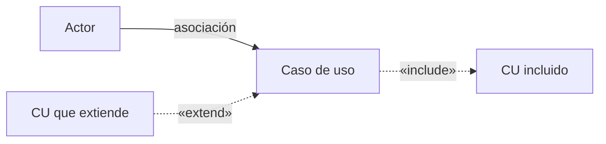
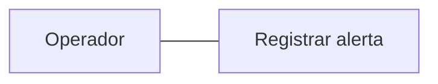
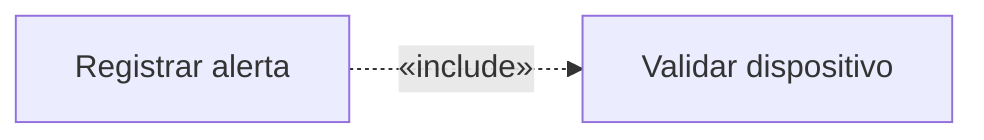
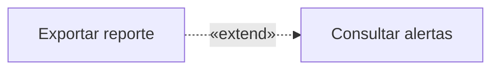
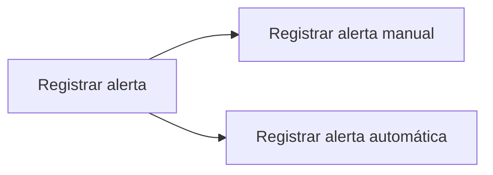
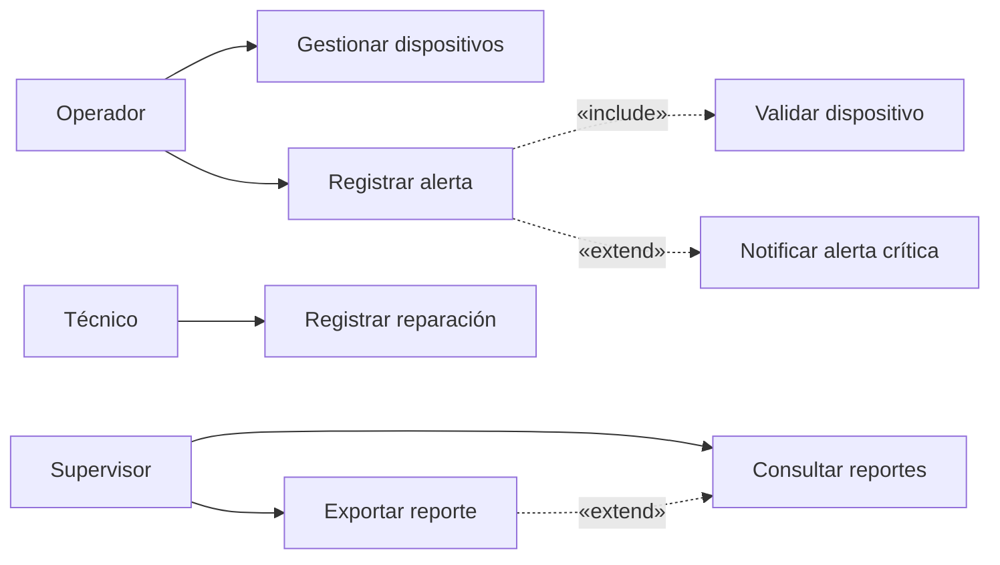
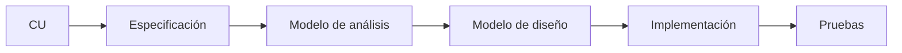

# 7. Modelo de casos de uso

> [!info] Al terminar este capítulo tenés que poder
> - Identificar actores primarios y secundarios.
> - Escribir casos de uso con verbo en infinitivo.
> - Decidir entre asociación, `include`, `extend` y generalización.
> - Aplicar las reglas de la cátedra sin inventar relaciones.

> [!abstract] Qué debés saber (nivel 1)
> - **Caso de uso:** unidad funcional completa que da un resultado de valor a un actor.
> - **Actor:** todo lo externo al sistema; **nunca** el sistema mismo.
> - **No hay CU sin actor**.
> - `include`: obligatorio, siempre ocurre.
> - `extend`: opcional, bajo condición, con punto de extensión.
> - **RF ≈ CU**: son dos formas de modelar requerimientos.

## 7.1 Qué es un caso de uso

> [!quote] Cátedra
> Un caso de uso describe **qué cosas debe hacer el sistema** para satisfacer las necesidades de los usuarios; es un diálogo entre un usuario y el sistema que representa una **unidad funcional completa**.

Objetivos:

| Objetivo | Producto |
|---|---|
| Definir y modelar los RF | Modelo de CU |
| Describir qué hará el sistema | Acuerdo con el cliente |
| Dar base a las pruebas | Casos de prueba derivados |
| Guiar análisis, diseño e implementación | Realizaciones |

## 7.2 Actores

| Regla | Detalle |
|---|---|
| Es **externo** al sistema | Persona, rol, organización, sensor, sistema externo |
| **Nunca** el sistema es actor | El sistema no se usa a sí mismo |
| **Primario** | Inicia el CU y obtiene el valor |
| **Secundario** | Se ve afectado o participa sin iniciar |

> [!example] Primario vs. secundario
> Si el proveedor carga la mercadería en el sistema, el proveedor es **primario**. Si solo recibe el aviso de pago, es **secundario**.

> [!warning] El error de poner al sistema como actor
> “El sistema notifica al sistema” no es un actor. Si hay dos sistemas, el otro sistema **sí** es actor externo; el nuestro, no.

## 7.3 Relaciones

### Asociación

Comunica un actor con un CU. Es la conversación.

### `include`

Comportamiento **obligatorio** que siempre se ejecuta. La flecha va **del CU base al incluido**.

- Se usa para **reutilizar** un comportamiento común.
- El CU base **depende** del incluido: si el incluido falla, el base no termina.

### `extend`

Comportamiento **opcional** que se agrega bajo una condición. La flecha va **del que extiende al base**.

- Requiere un **punto de extensión** con condición verdadero/falso.
- El base **funciona sin** el extend.

> [!important] La dirección, que se confunde siempre
> `include`: **base → incluido**.
> `extend`: **extendido → base**.
> Si invertís la flecha, el diagrama dice lo contrario.

### Generalización

El CU hijo **es un tipo** del padre y hereda su comportamiento.

Se usa cuando hay variantes con comportamiento común. **No** es lo mismo que `extend`: acá hay especialización, no opcionalidad.

## 7.4 Reglas de la cátedra (UTN)

| # | Regla |
|---|---|
| 1 | Generalmente **un RF = un CU** |
| 2 | El **CU base** es el que tiene relación con un actor |
| 3 | Normalmente **no hay include/extend anidados** |
| 4 | Las **actividades del workflow** suelen ser CU |
| 5 | Un **nodo de decisión** que lleva a una acción suele ser un **extend** |
| 6 | Si el workflow tiene 3 carriles, probablemente haya 3 actores |
| 7 | **Todo lo que se usa** en el sistema debe tener **ABM** (alta, baja, modificación) |
| 8 | No hace falta detallar de más un CU de ABM |
| 9 | En ventas hay un patrón: **lo que se vende + el cliente + el vínculo** (venta) |
| 10 | En el **escenario principal no hay errores**; los errores van en los alternativos |
| 11 | Si el CU se relaciona con otro por include/extend, se **referencia**, no se repite |
| 12 | Las **postcondiciones** pueden ser estados (“la póliza queda vigente”) |
| 13 | Si aparece un **“etcétera”**, probablemente sea una clase |

> [!example] El patrón de ventas
> “Se vende un producto a un cliente.” → `Producto`, `Cliente` y `Venta` (el vínculo). Se repite en otros dominios: `Inmueble`, `Inquilino`, `Alquiler`; `Curso`, `Alumno`, `Inscripción`.

## 7.5 Método: construir el modelo en 6 pasos

| Paso | Acción | Resultado |
|---|---|---|
| 1 | Identificar **actores** (personas, roles, sistemas, sensores) | Lista |
| 2 | Para cada actor, listar **objetivos** | Funciones candidatas |
| 3 | Nombrar cada CU con **verbo en infinitivo** | Lista de CU |
| 4 | Detectar **include** (obligatorio) y **extend** (opcional) | Relaciones |
| 5 | Dibujar el diagrama con actores, CU y relaciones | Diagrama |
| 6 | Validar: ¿todo CU tiene actor? ¿todo RF está cubierto? | Modelo completo |

### Preguntas de decisión

| Pregunta | Si sí → | Si no → |
|---|---|---|
| ¿Siempre se ejecuta? | `include` | Asociación o `extend` |
| ¿Ocurre solo bajo condición? | `extend` | Asociación |
| ¿Es una variante del mismo objetivo? | Generalización | CU separado |
| ¿Lo inicia el actor? | Actor primario | Secundario |

## 7.6 Ejemplo completo

**Enunciado:** el municipio quiere que el operador registre dispositivos y alertas, que el técnico registre reparaciones y que el supervisor consulte reportes. Las alertas críticas deben notificar al supervisor. Se debe poder exportar el reporte.

| Decisión | Justificación |
|---|---|
| `Validar dispositivo` es include | Toda alerta requiere un dispositivo válido: siempre ocurre |
| `Notificar alerta crítica` es extend | Solo ocurre si la prioridad es 1 |
| `Exportar` es extend de `Consultar` | Es opcional; el reporte se ve sin exportar |
| `Gestionar dispositivos` incluye ABM | Todo lo que se usa debe poder administrarse |

> [!warning] No abuses de `include`
> Si un CU solo tiene un paso, no lo conviertas en include. Un modelo con 20 include es ilegible y no aporta.

## 7.7 Del CU al resto del proceso

| Artefacto | Qué toma del CU |
|---|---|
| Especificación | Flujo principal y alternativos |
| Análisis | Clases boundary/entity/control |
| Diseño | Realizaciones (diagramas de secuencia) |
| Pruebas | Escenarios como casos de prueba |

## Errores que suelen tomar

| Error | Corrección |
|---|---|
| Poner el sistema como actor | Solo actores externos |
| CU sin actor | Todo CU tiene al menos uno |
| Invertir la flecha de `include`/`extend` | Ver 7.3 |
| Usar `extend` para lo obligatorio | Es `include` |
| Nombrar CU con sustantivo | Verbo en infinitivo |
| Un CU que hace todo | Dividir por objetivo |
| Especificar el CU incluido dentro del base | Solo referenciarlo |
| Poner errores en el escenario principal | Van en alternativos |

## Ejercicios

> [!example]- 1. Actores
> **Enunciado:** en un sistema de biblioteca, ¿quiénes son actores?
> **Solución:** socio, bibliotecario y, si existe, el sistema de gestión de socios. La biblioteca **no** es actor.

> [!example]- 2. Include o extend
> **Enunciado:** “Registrar préstamo” siempre valida el socio. ¿Include o asociación?
> **Solución:** `include` (siempre ocurre, reutilizable).

> [!example]- 3. Include o extend
> **Enunciado:** “Consultar préstamos” permite, opcionalmente, imprimir el listado.
> **Solución:** `extend` de `Consultar` a `Imprimir listado`, con punto de extensión “usuario solicita impresión”.

> [!example]- 4. Nombrar
> **Enunciado:** corrige: “Alta de alertas”, “Gestión”, “Pantalla de reportes”.
> **Solución:** “Registrar alerta”, “Gestionar dispositivos” (mejor dividir), “Consultar reportes”.

> [!example]- 5. a papel
> **Enunciado:** dibujá el modelo de CU del caso municipio con 3 actores y al menos un include y un extend.
> **Solución:** ver 7.6.

## Lo que sigue

[[ad08_especificacion-cu|Especificación de casos de uso]].

#libro3 #casos-de-uso
