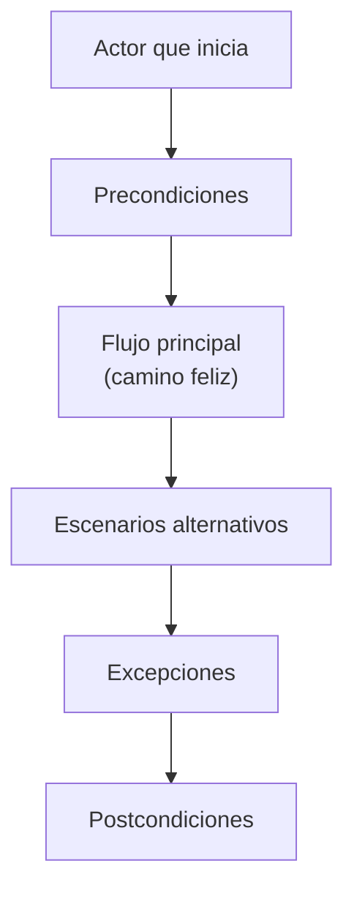

# 8. Especificación de casos de uso

> [!info] Al terminar este capítulo tenés que poder
> - Completar la plantilla de especificación de la cátedra.
> - Escribir escenarios principal y alternativos.
> - Redactar precondiciones y postcondiciones.
> - Referenciar include/extend sin duplicar funcionalidad.

> [!abstract] Qué debés saber (nivel 1)
> - **Sin especificación, el CU queda incompleto.**
> - La plantilla tiene datos de gestión, actores y **escenarios**.
> - El **escenario principal no admite errores**.
> - Los **alternativos** describen desvíos y errores.
> - Las **postcondiciones** pueden ser estados.
> - Si el CU incluye o extiende a otro, solo se **referencia**.

## 8.1 Por qué especificar

El diagrama dice **qué** CU hay; la especificación dice **cómo se comporta**. Sin ella:

- El programador inventa el flujo.
- El tester no sabe qué probar.
- El cliente no puede validar.

> [!quote] Regla de cátedra
> “Sin su especificación, el caso de uso queda incompleto.”

## 8.2 La plantilla

| Campo | Qué se escribe | Ejemplo |
|---|---|---|
| **ID** | Identificador | `CU-02` |
| **Paquete** | Agrupación | `Alertas` |
| **Prioridad** | Urgencia (1 a 5) | `1` |
| **Categoría** | Esencial / soporte | `Esencial` |
| **Complejidad** | Cantidad de datos a completar | `Media` |
| **Actores** | Principales y secundarios | Operador (principal) |
| **Stakeholders** | Interesados que no operan | Supervisor |
| **Tipo** | Abstracto / concreto | `Concreto` |
| **Objetivo** | Descripción breve | Registrar una alerta |
| **Precondiciones** | Estado del sistema previo | El dispositivo existe |
| **Postcondiciones** | Estado posterior | La alerta queda `PENDIENTE` |
| **Escenarios** | Principal y alternativos | Ver 8.3 |
| **Reglas de negocio** | Reglas asociadas | Prioridad 1..5 |
| **RNF asociados** | Calidades del CU | Registro en ≤ 3 min |
| **Incluye** | CU obligatorios | `Validar dispositivo` |
| **Extiende** | CU opcionales | `Notificar crítica` |

> [!important] Prioridad y complejidad no son lo mismo
> **Prioridad** = urgencia para el negocio. **Complejidad** = cantidad de datos o pasos para el usuario. Un CU puede ser prioritario y simple.

### La anatomía de una especificación



> [!important] El orden no es decorativo
> Las precondiciones dicen **qué debe ser cierto antes**; las postcondiciones, **qué quedó cierto después**. Si no podés escribirlas, todavía no entendiste el caso de uso.

## 8.3 Escenarios

### Escenario principal

Describe el camino **feliz**: todo sale bien, sin errores del sistema ni del usuario.

```text
1. El operador selecciona "Nueva alerta".
2. El sistema muestra el formulario.
3. El operador ingresa mensaje, prioridad y dispositivo.
4. El sistema valida los datos y el dispositivo.
5. El sistema registra la alerta en estado PENDIENTE.
6. El sistema confirma el alta.
```

> [!warning] “No se admiten errores” en el principal
> Si en el paso 4 el dispositivo no existe, eso **no** va en el principal: va en un alternativo.

### Escenarios alternativos

| ID | Condición | Acción |
|---|---|---|
| A1 | Faltan datos obligatorios | El sistema muestra el error y no registra |
| A2 | El dispositivo no existe | El sistema informa y cancela la operación |
| A3 | La prioridad está fuera de 1..5 | El sistema rechaza el valor |
| A4 | El operador cancela | El sistema descarta y vuelve al inicio |

> [!tip] Cómo numerarlos
> `A1`, `A2`… y referenciarlos desde el paso del principal donde ocurren (“en el paso 4, si…”). Así el lector sigue el hilo.

## 8.4 Precondiciones y postcondiciones

| Tipo | Qué expresa | Ejemplo |
|---|---|---|
| **Precondición** | Lo que debe cumplirse antes | El usuario está autenticado |
| **Postcondición** | Lo que queda verdadero después | La alerta existe en estado `PENDIENTE` |

> [!important] Las postcondiciones pueden ser estados
> No hace falta describir tablas ni campos: “la póliza queda **vigente**”, “el turno queda **reservado**”. Es vocabulario del dominio, no de la base.

### Diferencia con el flujo

| Precondición | Flujo principal |
|---|---|
| Es un **hecho** que se cumple antes | Es una **secuencia de acciones** |
| “El dispositivo existe” | “El operador selecciona…” |

## 8.5 Include y extend en la especificación

| Situación | Qué escribir |
|---|---|
| El CU **incluye** otro | “Incluye: `Validar dispositivo` (ver CU-05)” |
| El CU **extiende** otro | “Extiende: `Consultar alertas` en el punto *exportar*” |
| El otro CU es obligatorio | Se referencia en el paso correspondiente |
| El otro CU es opcional | Se referencia como extensión |

> [!warning] No copies la funcionalidad del otro CU
> Si `Registrar alerta` incluye `Validar dispositivo`, no escribas los pasos de validación: escribí “el sistema ejecuta `Validar dispositivo`”. La especificación se mantiene una sola vez.

## 8.6 Ejemplo completo: `Registrar alerta`

```text
ID: CU-02
Paquete: Alertas
Prioridad: 1
Categoría: Esencial
Complejidad: Media
Actores: Operador (principal), Supervisor (secundario)
Stakeholders: Municipio
Tipo: Concreto
Objetivo: Registrar una alerta asociada a un dispositivo, con prioridad.

Precondiciones:
- El operador está autenticado.
- El dispositivo existe y está activo.

Postcondiciones:
- La alerta queda registrada en estado PENDIENTE.
- Si la prioridad es 1, el supervisor recibe una notificación.

Escenario principal:
1. El operador selecciona "Nueva alerta".
2. El sistema muestra el formulario.
3. El operador ingresa mensaje, prioridad y código de dispositivo.
4. El sistema ejecuta CU-05 Validar dispositivo.
5. El sistema registra la alerta en estado PENDIENTE con fecha y hora.
6. Si la prioridad es 1, el sistema ejecuta CU-07 Notificar alerta crítica.
7. El sistema confirma el alta.

Alternativos:
A1. En el paso 3, si faltan datos obligatorios:
    el sistema informa el campo faltante y vuelve al paso 2.
A2. En el paso 4, si el dispositivo no existe:
    el sistema informa y cancela la operación.
A3. En el paso 3, si la prioridad está fuera de 1..5:
    el sistema rechaza el valor y vuelve al paso 2.
A4. En cualquier paso, si el operador cancela:
    el sistema descarta los datos y vuelve al inicio.

Reglas de negocio:
- La prioridad es un entero de 1 a 5.
- Una alerta pertenece a un único dispositivo.

RNF asociados:
- El alta completa se realiza en ≤ 3 minutos por un operador entrenado.
- Toda alerta registrada queda auditada.

Incluye: CU-05 Validar dispositivo.
Extiende: —
```

> [!important] Fijate en los detalles que suman
> - Los alternativos están **referenciados al paso**.
> - El include se **ejecuta** en un paso, no se copia.
> - La postcondición es un **estado**.
> - Hay **reglas de negocio** y **RNF** asociados.

## 8.7 Método: escribir una especificación

| Paso | Acción |
|---|---|
| 1 | Completar los datos de gestión (ID, paquete, prioridad) |
| 2 | Identificar actores y stakeholders |
| 3 | Escribir el objetivo en una línea |
| 4 | Listar precondiciones (hechos) |
| 5 | Escribir el escenario principal **sin errores** |
| 6 | Agregar los alternativos con condición y acción |
| 7 | Definir postcondiciones (estados) |
| 8 | Referenciar include/extend, reglas y RNF |

> [!tip] Cómo saber que está completa
> Si un programador puede implementarlo y un tester puede escribir los casos de prueba **sin preguntarte nada**, está completo.

## Errores que suelen tomar

| Error | Corrección |
|---|---|
| Poner errores en el escenario principal | Van en alternativos |
| Describir la interfaz con lujo de detalles | Describir el comportamiento |
| Postcondición como lista de tablas | Usar estados del dominio |
| Copiar el CU incluido | Referenciarlo |
| Precondición como acción | Debe ser un hecho |
| Omitir actores secundarios | Incluirlos |
| Prioridad y complejidad iguales | Son dimensiones distintas |
| Alternativos sin condición | “Si… entonces…” |

## Ejercicios

> [!example]- 1. Precondición o paso
> **Enunciado:** “El sistema valida el dispositivo” ¿es precondición o paso?
> **Solución:** es un **paso** (acción). La precondición sería “el dispositivo existe”.

> [!example]- 2. Alternativo
> **Enunciado:** escribí el alternativo para “el operador ingresa una prioridad inválida”.
> **Solución:** “A3. En el paso 3, si la prioridad no está entre 1 y 5: el sistema muestra el error y vuelve al paso 2.”

> [!example]- 3. Postcondición
> **Enunciado:** escribí la postcondición de “Registrar reparación”.
> **Solución:** “La reparación queda registrada en estado REGISTRADA; la alerta asociada pasa a ATENDIDA.”

> [!example]- 4. Include
> **Enunciado:** ¿cómo referenciás `Validar dispositivo`?
> **Solución:** “4. El sistema ejecuta CU-05 Validar dispositivo.” Sin copiar sus pasos.

> [!example]- 5. a papel
> **Enunciado:** especificá “Consultar alertas pendientes” con un alternativo.
> **Solución:** datos de gestión + precondición “usuario autenticado” + principal (filtra, ordena, muestra) + A1 “si no hay alertas, muestra mensaje” + postcondición “no modifica datos”.

## Lo que sigue

[[ad09_prototipos|Prototipos de interfaz]].

#libro3 #especificacion
