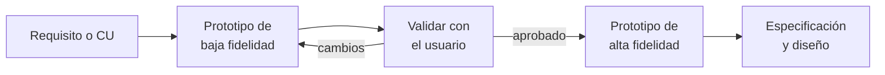

# 9. Prototipos de interfaz

> [!info] Al terminar este capítulo tenés que poder
> - Explicar para qué sirve un prototipo y qué NO resuelve.
> - Elegir el tipo de prototipo según el objetivo.
> - Diseñar un prototipo de pantalla para un CU.
> - Evitar los riesgos clásicos del prototipado.

> [!abstract] Qué debés saber (nivel 1)
> - **Prototipo:** versión inicial de software para demostrar conceptos, probar opciones y precisar requisitos.
> - Se usa **temprano**, con **participación del usuario**.
> - Sirve para **validar requisitos**, no para validar el diseño técnico.
> - Tipos: parcheado, no operacional, primero de una serie.
> - **No** reemplaza la especificación.

## 9.1 Para qué sirve

> [!quote] Cátedra
> **Prototipo de interfaz:** versión inicial de software utilizada para demostrar conceptos, probar opciones de diseño y profundizar el conocimiento del problema y de las soluciones.

Objetivos (los enumera UTN):

| Objetivo | Qué se obtiene |
|---|---|
| Reacciones iniciales | Qué entiende el usuario |
| Nuevas necesidades | Requisitos no detectados |
| Detectar ambigüedad | Requisitos malentendidos |
| Preferencias | Cómo quiere trabajar |
| Actitudes | Resistencia o aceptación |
| Innovaciones | Nuevas capacidades |
| Prioridades | Qué es urgente |
| Redirigir el plan | Ajustar alcance |

> [!important] El prototipo es una herramienta de requisitos
> No es la primera versión del producto (salvo que sea evolutivo y esté pensado así). Si el usuario cree que ya está hecho, el proyecto se complica.



> [!tip] Prototipar es conversar
> El primer prototipo no busca verse bien: busca que el usuario diga “esto no es lo que necesito”. Cada iteración es más barata que un cambio después de programar.

## 9.2 Tipos

| Tipo | Característica | Ventaja | Riesgo |
|---|---|---|---|
| **Parcheado** | Operacional, funcionalidad recortada, código sin calidad | El usuario interactúa de verdad | Se puede querer “aprovechar” ese código |
| **No operacional** | No corre: maqueta, esquemas, bosquejos | Rápido y barato | No valida comportamiento real |
| **Primero de una serie** | Proyecto piloto, primera instalación | Valida en contexto real | Costo alto |

También se clasifican por fidelidad:

| Fidelidad | Qué muestra | Cuándo |
|---|---|---|
| **Baja** | Cajas, textos, navegación | Etapas tempranas |
| **Alta** | Apariencia y comportamiento casi final | Validación con usuarios |

> [!warning] El prototipo parcheado no se entrega
> Se construye para aprender y se **descarta**. Si se entrega, arrastra código sin calidad y deuda técnica.

## 9.3 Principios de diseño y estilos de interacción

Antes de dibujar la pantalla, estos seis criterios evitan la mayoría de los reclamos:

| Principio | Qué exige | Ejemplo |
|---|---|---|
| **Familiaridad** | Vocabulario del trabajo real | “Alerta”, no “Registro entidad 4” |
| **Consistencia** | Lo parecido se opera parecido | “Guardar” siempre en el mismo lugar |
| **Mínima sorpresa** | Nada cambia sin avisar | Mostrar “guardando…” |
| **Recuperabilidad** | Poder deshacer o cancelar | Confirmar antes de borrar |
| **Guía** | Mensajes que dicen qué hacer | “La prioridad va de 1 a 5” |
| **Diversidad** | Distintos perfiles y dispositivos | Técnico en móvil, supervisor en PC |

| Estilo | Conviene cuando | Límite |
|---|---|---|
| **Manipulación directa** | Hay objetos visibles que mover | No toda tarea tiene representación |
| **Menús** | El usuario no recuerda comandos | Lento para expertos |
| **Formularios** | Carga estructurada de datos | Sobrecarga la pantalla |
| **Lenguaje de comandos** | Usuarios expertos, tareas repetitivas | Requiere aprendizaje y memoria |
| **Lenguaje natural** | Usuarios ocasionales | Ambigüedad |

## 9.4 Cuándo usarlo (y cuándo no)

| Sí | No |
|---|---|
| Requisitos ambiguos | Requisitos claros y estables |
| Usuarios poco disponibles para leer documentos | El riesgo es técnico, no de interfaz |
| Interfaz compleja o innovadora | El prototipo retrasa una entrega crítica |
| Hay que validar prioridades | No hay quién lo evalúe |

> [!important] Requisito de éxito
> El prototipo sirve si hay **interacción real con el usuario** y **ciclo de retroalimentación**. Sin eso, es un dibujo.

## 9.5 Método: prototipar un CU en 6 pasos

| Paso | Acción | Producto |
|---|---|---|
| 1 | Elegir un CU de alta prioridad o alta incertidumbre | Alcance |
| 2 | Listar datos de entrada y salida | Campos y acciones |
| 3 | Dibujar la pantalla (baja fidelidad) | Wireframe |
| 4 | Recorrer el flujo con el usuario | Observaciones |
| 5 | Registrar cambios y requisitos nuevos | Lista de ajustes |
| 6 | Actualizar especificación y modelo de CU | Artefactos |

### Checklist de una pantalla

- [ ] Título que dice qué hace.
- [ ] Campos obligatorios marcados.
- [ ] Validaciones visibles (formato, rango).
- [ ] Acciones principales y secundarias diferenciadas.
- [ ] Mensajes de error claros.
- [ ] Confirmación antes de acciones destructivas.
- [ ] Navegación de vuelta.
- [ ] Accesibilidad: etiquetas, contraste, teclado.

## 9.6 Ejemplo: pantalla de alta de alerta

```text
┌──────────────────────────────────────────────┐
│  Nueva alerta                                │
├──────────────────────────────────────────────┤
│  Dispositivo *  [ S-01 ▾ ]                   │
│  Prioridad *    ( ) 1  ( ) 2  (•) 3  ( ) 4 5 │
│  Mensaje *      ┌──────────────────────────┐ │
│                 │ Lámpara quemada          │ │
│                 └──────────────────────────┘ │
│                                              │
│  [ Cancelar ]                  [ Registrar ] │
└──────────────────────────────────────────────┘
```

| Decisión | Motivo |
|---|---|
| Prioridad con opciones, no texto libre | Evita valores inválidos (1..5) |
| Dispositivo como lista | Evita códigos inexistentes |
| Mensaje con área de texto | Texto libre acotado |
| “Registrar” destacado | Acción principal |
| `*` en obligatorios | Claridad |

> [!tip] El prototipo revela requisitos ocultos
> “¿Qué pasa si el dispositivo está inactivo?” → aparece un alternativo que no estaba en el enunciado. Ese es el valor del prototipo.

## 9.7 Riesgos

| Riesgo | Mitigación |
|---|---|
| El usuario cree que está terminado | Aclarar que es un prototipo |
| Se entrega el código parcheado | Descartarlo o refactorizarlo |
| “Ya que estamos, agreguemos…” | Congelar alcance por iteración |
| Se prototipa todo | Solo lo incierto o riesgoso |
| Se olvida documentar | Actualizar especificación y CU |

## Errores que suelen tomar

| Error | Corrección |
|---|---|
| Decir que el prototipo valida el diseño | Valida requisitos |
| Prototipo sin usuario | No sirve |
| Prototipo operacional entregado como producto | Es parcheado: se descarta |
| Prototipar todo el sistema | Prototipar lo incierto |
| No registrar los cambios | Se pierden los requisitos descubiertos |
| Confundir maqueta con especificación | La especificación sigue siendo necesaria |

## Ejercicios

> [!example]- 1. Tipo
> **Enunciado:** necesitás validar rápido la navegación con 5 usuarios, sin programar.
> **Solución:** prototipo **no operacional** de baja fidelidad (maqueta).

> [!example]- 2. Tipo
> **Enunciado:** querés que el usuario pruebe el alta real con datos de prueba.
> **Solución:** prototipo **parcheado** (operacional, funcionalidad recortada).

> [!example]- 3. Objetivo
> **Enunciado:** ¿qué se busca con un prototipo?
> **Solución:** obtener reacciones, detectar requisitos faltantes o ambiguos, conocer preferencias y priorizar.

> [!example]- 4. Decisión de interfaz
> **Enunciado:** ¿por qué la prioridad se elige con opciones y no con texto?
> **Solución:** porque el dominio la restringe a 1..5; la interfaz evita el error antes de que ocurra.

> [!example]- 5. a papel
> **Enunciado:** dibujá en 8 líneas la pantalla de “Consultar alertas” con filtro por dispositivo y orden por prioridad.
> **Solución:** título, filtro (lista de dispositivos), tabla con columnas código/mensaje/prioridad/estado, botón “Actualizar” y “Exportar” (opcional), mensaje “sin resultados”.

## Lo que sigue

[[ad10_modelo-analisis|Modelo del análisis]].

#libro3 #prototipos
