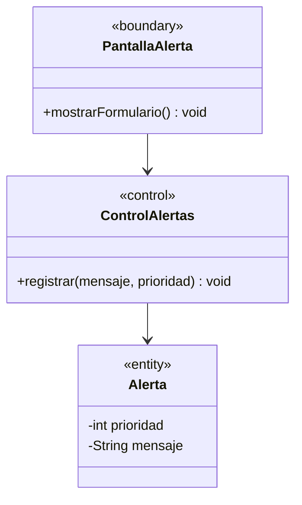
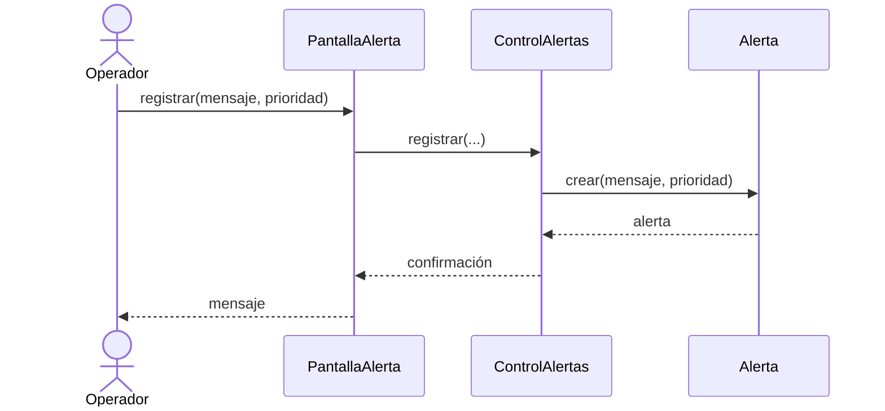
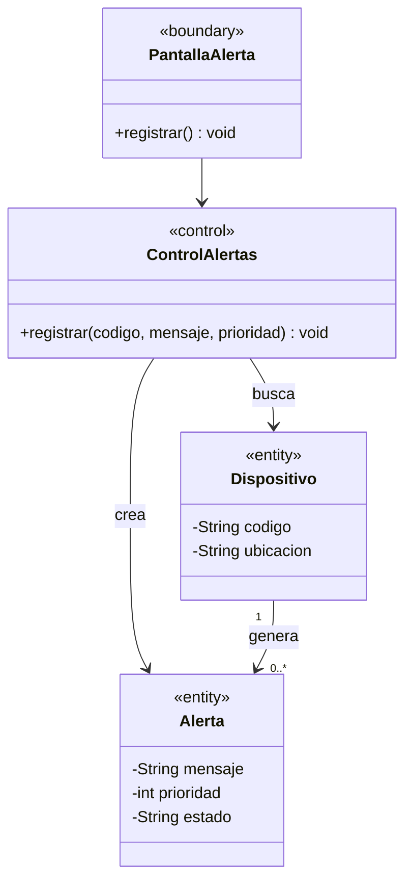

# 10. Modelo del análisis

> [!info] Al terminar este capítulo tenés que poder
> - Explicar qué refina el análisis.
> - Clasificar clases en boundary, entity y control.
> - Dibujar el diagrama de clases de análisis.
> - Realizar un CU con objetos de análisis.

> [!abstract] Qué debés saber (nivel 1)
> - **Modelo del análisis:** modelo de objetos **conceptual** que refina los requisitos.
> - **Clase de análisis:** abstracción clasificada en **entidad**, **interfaz** o **control**.
> - **Entidad:** información del dominio.
> - **Interfaz (boundary):** comunicación con el actor.
> - **Control:** coordinación de un CU.
> - No decide tecnología: no hay `DAO`, `Service`, `REST` ni tablas.

## 10.1 Qué es y para qué

> [!quote] Cátedra
> El **modelo del análisis** es un modelo de objetos conceptual que refina y estructura los requisitos para comprenderlos con precisión y facilitar el mantenimiento y la estructuración del sistema.

| Pregunta | Modelo del análisis |
|---|---|
| ¿Qué información maneja? | Clases de entidad |
| ¿Quién interactúa? | Clases de interfaz |
| ¿Quién coordina el flujo? | Clases de control |
| ¿Qué tecnología? | **Ninguna todavía** |

> [!important] El análisis no decide
> No dice si hay base de datos, ni qué framework, ni cómo se persiste. Eso es diseño.

## 10.2 Las tres clases de análisis

| Estereotipo | Responsabilidad | Ejemplo |
|---|---|---|
| `<<boundary>>` | Comunicarse con el actor | Pantalla, formulario, API |
| `<<entity>>` | Representar información del dominio | `Alerta`, `Dispositivo`, `Técnico` |
| `<<control>>` | Coordinar el flujo de un CU | `ControlAlertas` |

> [!important] La regla de Jacobson
> Para cada CU: **una** clase de control que lo coordina, **una o más** de entidad que representan lo que se manipula, y **una o más** de interfaz por cada actor que interactúa.

### Cómo reconocerlas

| Pregunta | Si sí → |
|---|---|
| ¿Es una pantalla, formulario o API con el actor? | `boundary` |
| ¿Es un concepto del dominio con datos que perduran? | `entity` |
| ¿Coordina los pasos de un CU y no representa datos? | `control` |

> [!important] Dominio ≠ análisis
> El **modelo de dominio** describe los conceptos del problema; el **modelo de análisis** agrega fronteras y controles, distribuye responsabilidades y explica cómo esos conceptos colaboran en cada CU. Una clase del dominio suele originar una entidad de análisis, pero **no hay correspondencia uno a uno**: puede dividirse, fusionarse o quedar afuera del alcance.

## 10.3 Artefactos del análisis

| Artefacto | Qué muestra |
|---|---|
| Diagrama de clases de análisis | Clases y relaciones con estereotipos |
| Diagrama de secuencia (realización) | Objetos que colaboran en un CU |
| Diagrama de comunicación | Misma información, énfasis en enlaces |
| Diagrama de paquetes | Agrupación del modelo |

### Secuencia de análisis

> [!tip] El orden de los objetos
> `boundary → control → entity`. Si en el análisis aparece `entity → boundary`, probablemente esté mal: la entidad no conoce la pantalla.

## 10.4 Método: analizar un CU en 5 pasos

| Paso | Acción | Resultado |
|---|---|---|
| 1 | Tomar el CU especificado | Escenario principal |
| 2 | Identificar el **actor** que inicia | Clase boundary |
| 3 | Identificar la **información** que se crea/consulta | Clases entity |
| 4 | Identificar quién **coordina** el flujo | Clase control |
| 5 | Dibujar la secuencia y el diagrama de clases | Modelo de análisis |

### Preguntas de control

| Pregunta | Decisión |
|---|---|
| ¿Cuántos boundary? | Uno por actor que interactúa |
| ¿Cuántos control? | Uno por CU (o por grupo cohesivo) |
| ¿Cuántas entity? | Las del dominio que participan |
| ¿Puede una entity conocer un boundary? | **No** |
| ¿Puede un control conocer varios boundary? | Sí, si coordina varios actores |

## 10.5 Ejemplo completo

**CU:** `Registrar alerta` (operador, dispositivo, prioridad).

| Clase | Estereotipo | Responsabilidad |
|---|---|---|
| `PantallaAlerta` | boundary | Recibir los datos y mostrar el resultado |
| `ControlAlertas` | control | Validar, crear la alerta y notificar |
| `Alerta` | entity | Guardar mensaje, prioridad, fecha y estado |
| `Dispositivo` | entity | Conocer el dispositivo y sus alertas |
| `Tecnico` | entity | (para reparaciones) |

> [!warning] Lo que NO va en el análisis
> `AlertaRepository`, `AlertaDAO`, `AlertaService`, `@Entity`, `REST`, `SQL`. Todo eso es diseño o implementación.

## 10.6 Del análisis al diseño

| Análisis | Diseño |
|---|---|
| Conceptual | Físico |
| `<<entity>> Alerta` | `Alerta` con tipos, visibilidad y navegabilidad |
| `<<control>> ControlAlertas` | `AlertaService` o controlador concreto |
| `<<boundary>> PantallaAlerta` | Pantalla con framework |
| Sin tecnología | Con tecnología |

> [!important] La trazabilidad
> Cada clase de análisis debe poder rastrearse a un CU y a un requisito. Si una clase no tiene CU, sobra; si un CU no tiene clases, falta análisis.

## Errores que suelen tomar

| Error | Corrección |
|---|---|
| Poner DAO/Service en análisis | Es diseño |
| Una sola clase “Sistema” que hace todo | Separar boundary/control/entity |
| Boundary que accede directo a entity | Pasa por control |
| Entity que conoce la pantalla | Dependencia invertida |
| Un control por método | Un control por CU |
| Olvidar actores secundarios | Un boundary por actor |
| Poner atributos de implementación | Solo dominio |

## Ejercicios

> [!example]- 1. Clasificar
> **Enunciado:** `PantallaReparacion`, `Reparacion`, `ControlReparaciones`.
> **Solución:** boundary, entity, control.

> [!example]- 2. Regla
> **Enunciado:** ¿puede `Alerta` conocer `PantallaAlerta`?
> **Solución:** no. La entidad no depende de la interfaz.

> [!example]- 3. Cantidad
> **Enunciado:** un CU con dos actores que interactúan. ¿Cuántos boundary como mínimo?
> **Solución:** dos, uno por actor.

> [!example]- 4. Análisis vs. diseño
> **Enunciado:** ¿`AlertaRepository` es análisis o diseño?
> **Solución:** diseño (es un mecanismo de persistencia).

> [!example]- 5. a papel
> **Enunciado:** analizá `Registrar reparación` con al menos 4 clases.
> **Solución:** `PantallaReparacion` (boundary), `ControlReparaciones` (control), `Reparacion` y `Tecnico`/`Alerta` (entity); secuencia boundary→control→entity.

## Lo que sigue

[[ad11_modelo-diseno|Modelo de diseño y DCD]].

#libro3 #analisis
