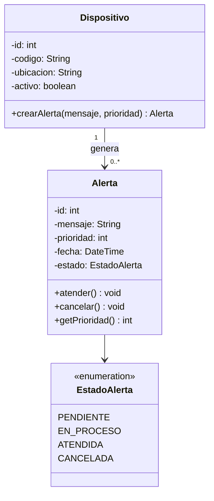
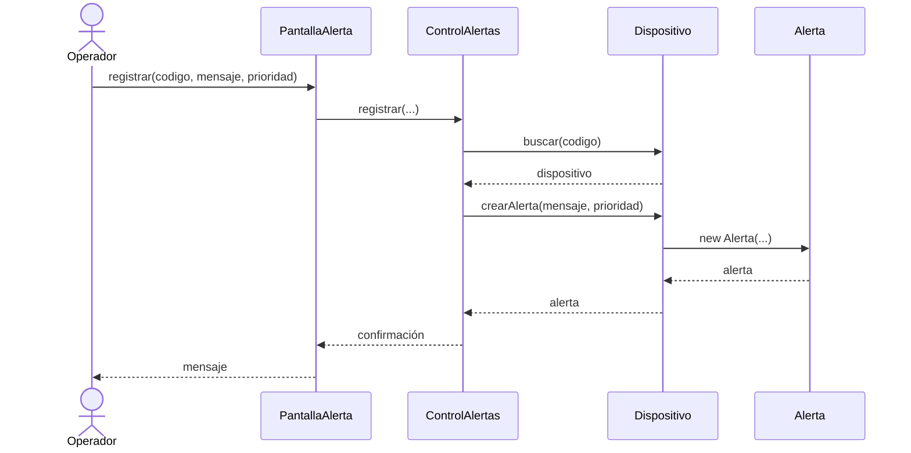
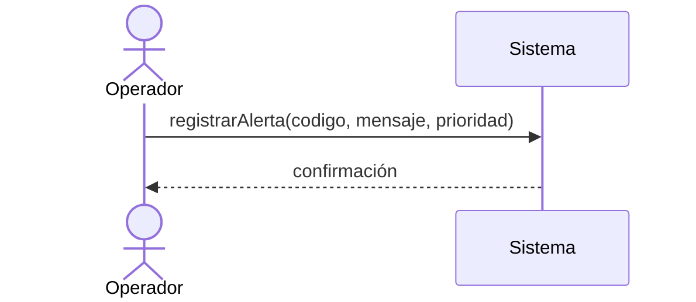

# 11. Modelo de diseño y DCD

> [!info] Al terminar este capítulo tenés que poder
> - Explicar qué agrega el diseño al análisis.
> - Escribir un contrato de operación.
> - Dibujar un diagrama de clases de diseño (DCD).
> - Pasar de un CU a una realización con objetos.

> [!abstract] Qué debés saber (nivel 1)
> - **Modelo de diseño:** describe la **realización física** de los CU.
> - Agrega tipos, visibilidad, navegabilidad, interfaces y subsistemas.
> - **DCD:** diagrama de clases de diseño, con detalle de implementación.
> - **Contrato:** pre y postcondiciones de una operación del sistema.
> - **Realización:** secuencia de diseño que muestra cómo los objetos cumplen el CU.

## 11.1 Qué agrega el diseño

> [!quote] Cátedra
> El **modelo de diseño** describe la realización física de los casos de uso y cómo impactan en él los requerimientos funcionales, no funcionales y las restricciones del entorno de implementación.

| Pregunta | Análisis | Diseño |
|---|---|---|
| ¿Qué información? | `Alerta` conceptual | `Alerta` con tipos y visibilidad |
| ¿Quién coordina? | `ControlAlertas` | `AlertaService` / controlador concreto |
| ¿Cómo se guarda? | No se decide | Repositorio, ORM, tabla |
| ¿Dónde corre? | No se decide | Nodos y componentes |
| ¿Qué tecnología? | No se decide | Framework, lenguaje, base |

> [!important] La frontera
> Si la decisión **puede cambiar si cambia la tecnología**, es diseño. Si es del dominio, es análisis.

## 11.2 Artefactos del diseño

| Artefacto | Qué muestra |
|---|---|
| **DCD** | Clases de software con atributos, métodos, tipos, visibilidad y relaciones |
| **Secuencia de diseño** | Realización de un CU con objetos concretos |
| **Contratos** | Pre/postcondiciones de las operaciones |
| **Paquetes/subsistemas** | Organización del diseño |
| **Despliegue** | Distribución física |

## 11.3 Contratos de operación

Un contrato describe **qué garantiza** una operación del sistema, sin decir cómo.

### Secciones

| Sección | Contenido |
|---|---|
| **Operación** | Nombre y parámetros |
| **Referencias cruzadas** | CU y requisitos que la originan |
| **Precondiciones** | Lo que debe cumplirse antes |
| **Postcondiciones** | Lo que queda verdadero después |

### Postcondiciones: tres categorías

1. **Creación o eliminación** de instancias.
2. **Modificación de atributos**.
3. **Creación o ruptura de asociaciones**.

### Ejemplo

```text
Operación: registrarAlerta(codigoDispositivo, mensaje, prioridad)

Referencias: CU-02 Registrar alerta; RF-02

Precondiciones:
- El dispositivo con ese código existe y está activo.
- La prioridad está entre 1 y 5.

Postcondiciones:
- Se creó una instancia de Alerta.
- Se asoció la Alerta al Dispositivo correspondiente.
- Se asignó fecha y hora a la Alerta.
- La Alerta quedó en estado PENDIENTE.
- Si la prioridad era 1, se creó una Notificación para el supervisor.
```

> [!important] Declarativas, no imperativas
> Mal: “buscar el dispositivo, crear la alerta, guardar…”. Bien: “se creó una instancia de…”, “quedó asociada a…”. Describe el **estado final**, no el algoritmo.

## 11.4 DCD (diagrama de clases de diseño)



| Elemento | Qué agrega el diseño |
|---|---|
| Tipos | `int`, `String`, `DateTime`, `EstadoAlerta` |
| Visibilidad | `-` privado, `+` público |
| Navegabilidad | Flecha en el sentido en que se puede navegar |
| Métodos | Operaciones concretas, no solo responsabilidades |
| Enumeraciones | Estados finitos |

> [!warning] El DCD no es el modelo de dominio
> El DCD tiene tipos de implementación, métodos, visibilidad y navegabilidad. El dominio solo tiene conceptos, atributos y asociaciones.

## 11.5 Realización de un CU



| Paso | Decisión de diseño |
|---|---|
| `UI → Control` | La pantalla no conoce el dominio |
| `Control → Dispositivo` | El control delega la búsqueda |
| `Dispositivo → Alerta` | **Creador** (GRASP): el dispositivo contiene sus alertas |
| `Alerta` con estado | El estado es una enumeración |

## 11.6 Método: del CU al DCD en 6 pasos

| Paso | Acción | Producto |
|---|---|---|
| 1 | Tomar el CU y su especificación | Entrada |
| 2 | Dibujar el **SSD** (actor → sistema) | Operaciones del sistema |
| 3 | Escribir el **contrato** de cada operación | Pre/post |
| 4 | Dibujar la **secuencia de diseño** aplicando GRASP | Realización |
| 5 | Derivar el **DCD** con tipos y visibilidad | Clases de diseño |
| 6 | Organizar en **paquetes/subsistemas** | Estructura |

> [!tip] SSD vs. secuencia de diseño
> El **SSD** muestra al actor y **al sistema como una caja negra**. La **secuencia de diseño** abre la caja y muestra los objetos internos.

## 11.7 Ejemplo de SSD



> [!important] Las operaciones del sistema
> Cada mensaje del actor al sistema en el SSD es una **operación del sistema** y debe tener contrato. De ahí salen los métodos del controlador.

## Errores que suelen tomar

| Error | Corrección |
|---|---|
| DCD sin tipos | Agregar tipos de atributos y retornos |
| Contrato imperativo | Escribir postcondiciones declarativas |
| Mezclar análisis y diseño | Decidir si hay tecnología |
| Poner métodos en el dominio sin lógica | El DCD es de software, no conceptual |
| Olvidar la navegabilidad | Indicar el sentido de la asociación |
| Un control por cada método | Un controlador por CU o grupo cohesivo |

## Ejercicios

> [!example]- 1. Contrato
> **Enunciado:** escribí las postcondiciones de `cancelarAlerta(id)`.
> **Solución:** “La Alerta con ese id quedó en estado CANCELADA; se registró la fecha de cancelación; no se eliminó la instancia.”

> [!example]- 2. DCD
> **Enunciado:** ¿qué agrega el DCD al diagrama de clases del dominio?
> **Solución:** tipos, visibilidad, métodos, navegabilidad, enumeraciones y decisiones de implementación.

> [!example]- 3. SSD
> **Enunciado:** ¿qué muestra el SSD que no muestra el diagrama de CU?
> **Solución:** la secuencia de operaciones del sistema para un escenario, con el sistema como caja negra.

> [!example]- 4. Categoría
> **Enunciado:** “se asoció la Alerta al Dispositivo” ¿qué categoría de postcondición es?
> **Solución:** creación de asociación.

> [!example]- 5. a papel
> **Enunciado:** dibujá el DCD de `Dispositivo`, `Alerta` y `EstadoAlerta` con tipos y multiplicidad.
> **Solución:** ver 11.4.

## Lo que sigue

[[ad12_diagrama-de-secuencia|12. Diagrama de secuencia paso a paso]].

#libro3 #diseno
