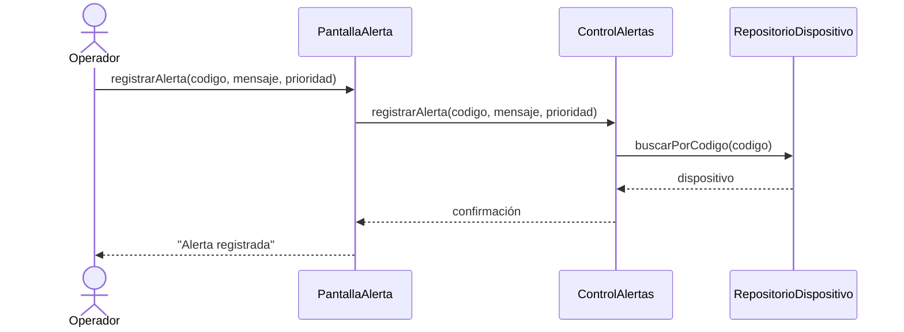
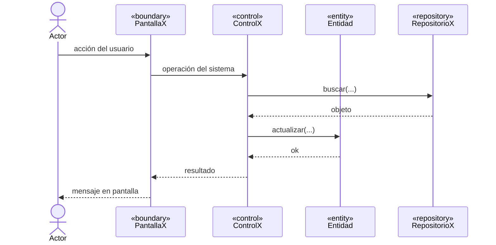
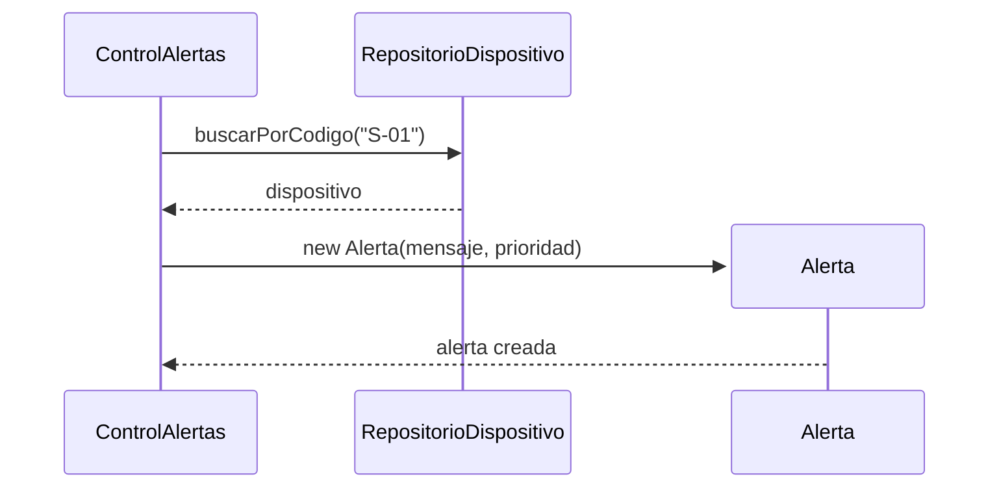
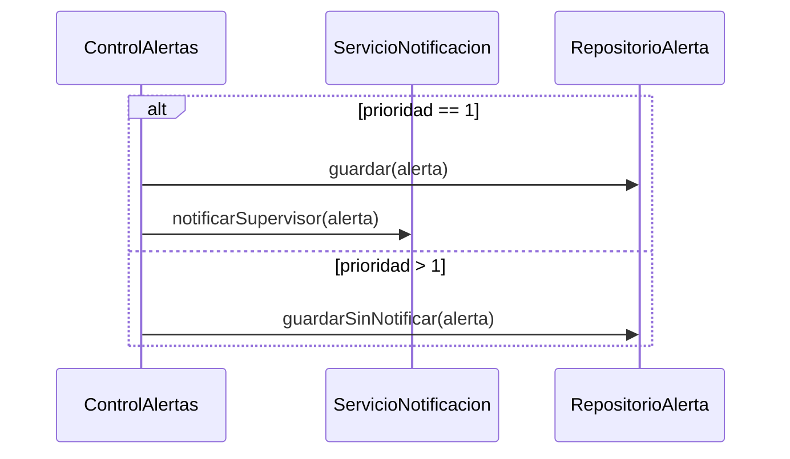
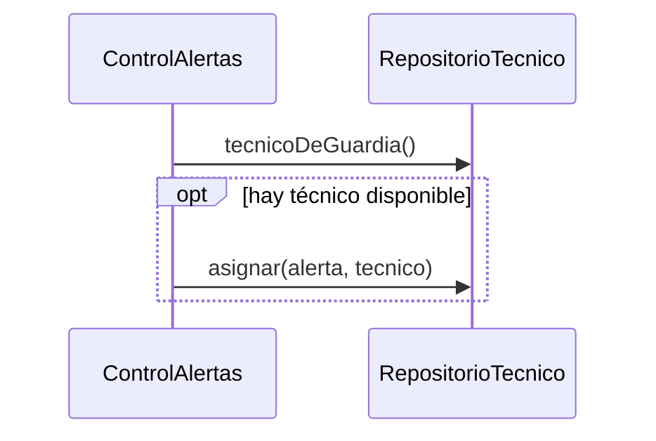
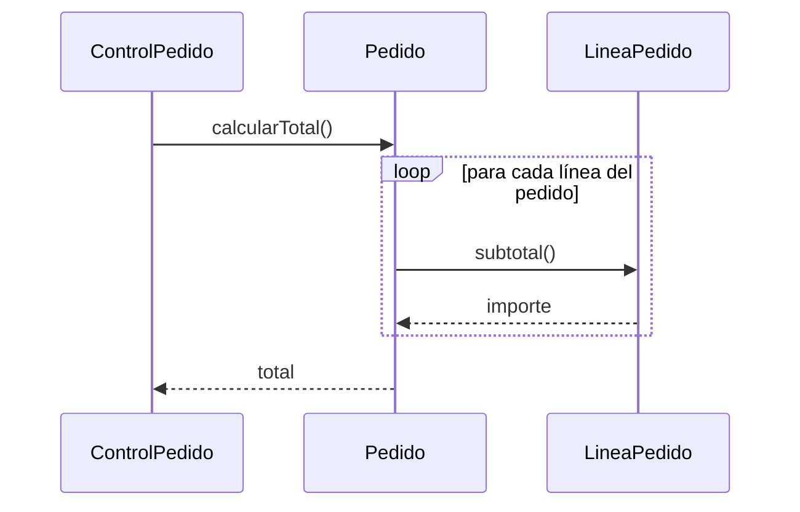
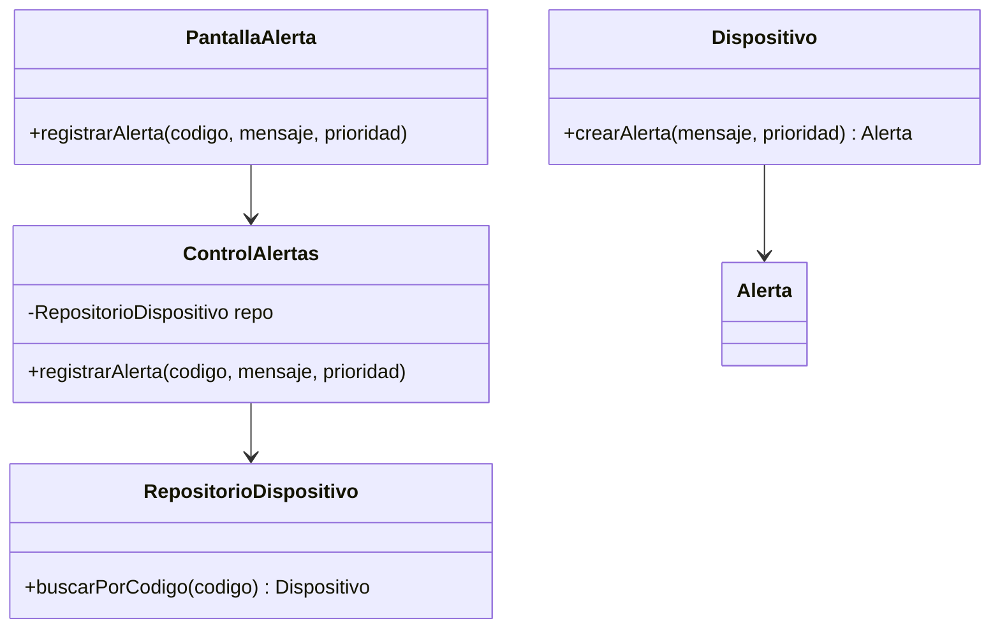
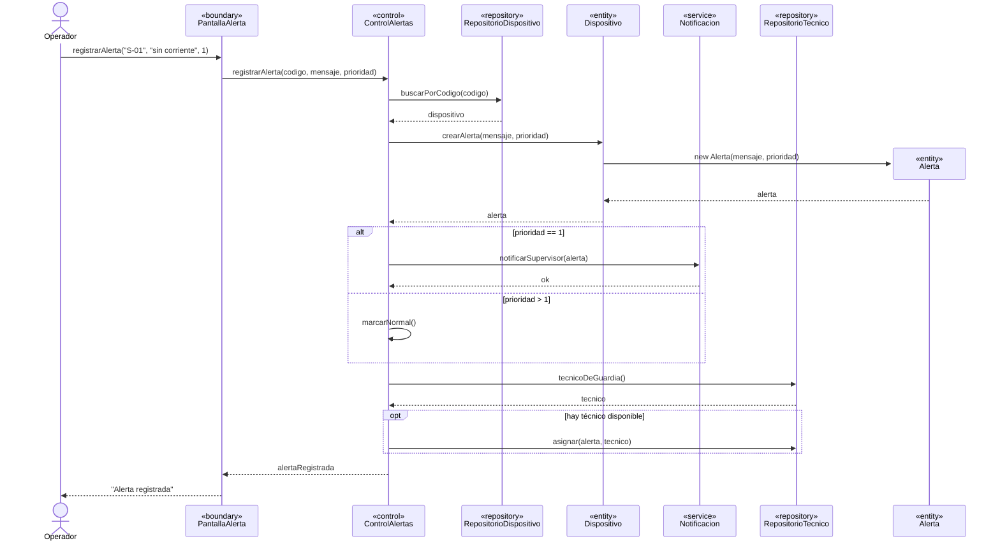

# 12. Diagrama de secuencia paso a paso

> [!info] Al terminar este capítulo tenés que poder
> - Pasar el escenario principal de un CU a un diagrama de secuencia sin dudar.
> - Ordenar las líneas de vida: actor, frontera, control, entidad.
> - Elegir la flecha correcta para llamada, retorno y creación.
> - Usar `alt`, `opt` y `loop` solo cuando el flujo lo pide.
> - Verificar cada mensaje contra el DCD antes de entregar.

> [!abstract] Qué debés saber (nivel 1)
> - **Tiempo hacia abajo, objetos hacia el costado**: cada línea de vida es un objeto.
> - Orden: **Actor → Boundary → Control → Entidad/Repositorio**.
> - La pantalla **nunca** habla directo con la entidad.
> - Tres flechas: **síncrona** (llamada), **retorno** (punteada) y **creación**.
> - `alt` = if/else, `opt` = if simple, `loop` = recorrido.
> - Todo mensaje tiene que existir como método en el **DCD**, con los mismos parámetros.

> [!quote] Cátedra (Larman, UTN)
> "Debería hacerse un diagrama de secuencia para el **escenario principal de éxito** del caso de uso, y para los escenarios alternativos complejos o frecuentes."

## 12.1 Qué es y para qué sirve

Un **diagrama de secuencia** es un diagrama de interacción de UML: muestra **qué objetos colaboran** en un caso de uso y **en qué orden** se envían los mensajes.

| Eje | Qué representa |
|---|---|
| **Horizontal** | Los objetos o participantes (líneas de vida) |
| **Vertical** | El tiempo: lo que está arriba ocurre antes |
| **Flechas** | Mensajes: llamadas, retornos, creación |



### SSD vs. secuencia de diseño

| | SSD (secuencia de sistema) | Secuencia de diseño |
|---|---|---|
| Participantes | Actor + **Sistema** (caja negra) | Actor + pantalla + control + entidades |
| Para qué | Descubrir las **operaciones del sistema** | Mostrar **cómo colaboran** los objetos |
| Momento | Análisis / contratos | Diseño |
| Mensajes | Solo actor → sistema | Mensajes internos entre objetos |

> [!important] La diferencia que se pregunta
> El **SSD** no muestra objetos internos: trata al sistema como una caja negra y sirve para detectar operaciones y contratos. La **secuencia de diseño** abre la caja y muestra la colaboración real.

> [!tip] Cuántos diagramas hacer
> Uno por el **escenario principal** de cada CU relevante, y uno extra solo para los alternativos **complejos o frecuentes**. No se hace un diagrama por cada `if`.

> [!note] De dónde sale este método
> La división en objetos de **interfaz, entidad y control** y el orden temporal de los mensajes vienen de **UP — Análisis de Sistemas** (clases 09 y 10, "Diagramas de secuencia"). La regla de hacer **un diagrama por escenario principal** y otro para los alternativos complejos viene de **Larman** (UTN, Diseño de Sistemas). Las flechas y los marcos son la notación de **UML 2.x**.

## 12.2 El orden de las líneas de vida

La regla de la cátedra es estricta:

```text
Actor → Pantalla (Boundary) → Controlador (Control) → Entidad / Repositorio
```



| Participante | Estereotipo | Responsabilidad | Ejemplo |
|---|---|---|---|
| **Actor** | — | Inicia el caso de uso | Operador, técnico |
| **Pantalla** | `«boundary»` | Recibir la acción y mostrarla; **no decide** | `PantallaAlerta` |
| **Control** | `«control»` | Coordinar el CU; aplicar reglas | `ControlAlertas` |
| **Entidad** | `«entity»` | Datos y comportamiento del dominio | `Dispositivo`, `Alerta` |
| **Repositorio** | `«repository»` | Buscar y persistir | `RepositorioDispositivo` |

> [!warning] La pantalla no habla con la entidad
> Si dibujás `PantallaAlerta -> Dispositivo`, el diagrama está mal aunque el código funcione. La pantalla solo conoce al controlador; el controlador conoce el dominio. Es la regla que más se evalúa en el oral.

> [!important] Por qué ese orden
> Porque refleja las dependencias del diseño: la interfaz depende del control, el control del dominio, y el dominio no depende de nadie. Si invertís una flecha, estás invirtiendo una dependencia y el diseño se vuelve rígido.

## 12.3 Las tres flechas de UML

| Mensaje | Notación | Significado | Mermaid |
|---|---|---|---|
| **Síncrona** | Línea continua, punta rellena | Llamada a un método; el emisor espera | `A->>B: metodo(args)` |
| **Retorno** | Línea punteada, punta abierta | Devuelve un valor u objeto | `B-->>A: resultado` |
| **Creación** | Flecha a la caja nueva, más abajo | `new Objeto(...)` | `create participant` + `->>` |
| Asíncrona | Línea continua, punta abierta | No espera respuesta | `A-)B: evento` |



> [!important] Cuándo dibujar el retorno
> No hace falta dibujarlo en métodos `void`. **Sí** cuando el objeto que recibe el dato lo necesita para el paso siguiente: si después usás `dispositivo`, tiene que verse el retorno.

> [!tip] La creación se dibuja abajo
> El objeto creado aparece **más abajo** en el eje vertical, en el momento en que se crea, no arriba junto a los que ya existían. Es el error visual más común.

## 12.4 Marcos combinados: `alt`, `opt` y `loop`

| Fragmento | Cuándo | Ejemplo de guarda |
|---|---|---|
| **`alt`** | `if / else` | `[prioridad == 1]` / `[else]` |
| **`opt`** | `if` sin else | `[hay técnico de guardia]` |
| **`loop`** | Recorrer una colección | `[para cada línea]` |

### `alt` (if / else)



### `opt` (if simple)



### `loop` (recorrido)



> [!warning] No abuses de los marcos
> Un diagrama con cinco `alt` anidados no se lee. Si el flujo es muy complejo, dividilo en dos diagramas: uno por escenario.

## 12.5 La receta de 5 pasos

> [!important] La receta completa
> Aplicala siempre en este orden. Si te trabás, volvé al paso anterior; no saltes al dibujo.

### Paso 1 — Partí del escenario principal del CU

Tomá la especificación y numerá los pasos donde **el actor interactúa con el sistema**. Cada uno es un mensaje de izquierda a derecha.

| Paso del CU | Mensaje |
|---|---|
| 1. El operador ingresa el código y la prioridad | `registrarAlerta(codigo, mensaje, prioridad)` |
| 2. El sistema confirma | retorno `confirmación` |

> [!tip] Regla práctica
> Si un paso del CU no genera un mensaje del actor al sistema, no es un mensaje: es una tarea interna del controlador.

### Paso 2 — Ordená las líneas de vida

De izquierda a derecha, siempre:

```text
Actor → PantallaX → ControlX → Entidad / Repositorio
```

Si aparece un servicio externo (notificación, pasarela de pago), va **a la derecha del control** y se llega a él **solo desde el control**.

### Paso 3 — Elegí el tipo de flecha

| Si el paso… | Usá |
|---|---|
| Llama a un método y espera | síncrona `->>` |
| Devuelve un dato que se usa después | retorno `-->>` |
| Crea un objeto | creación + `->>` a la caja nueva |
| Dispara un evento sin esperar | asíncrona `-)` |

### Paso 4 — Agregá marcos solo si hay condición o repetición

| En el flujo hay… | Marco |
|---|---|
| `if` con `else` | `alt` |
| `if` sin `else` | `opt` |
| `for` / `while` | `loop` |

### Paso 5 — Pasá el filtro del DCD

Antes de entregar, cada flecha que **entra** a una línea de vida tiene que cumplir dos condiciones:

1. El método **existe** en esa clase del DCD, con los **mismos parámetros**.
2. La clase emisora **puede ver** a la receptora: asociación navegable, parámetro recibido o instanciación dentro del método.

> [!important] El filtro que salva puntos
> Un diagrama lindo con métodos que no existen en el DCD es un diagrama **incoherente**. El tribunal compara los dos y lo ve en diez segundos.

## 12.6 Filtro de consistencia con el DCD

| Verificación | Pregunta | Si falla |
|---|---|---|
| **Método** | ¿`buscarPorCodigo(String)` está en `RepositorioDispositivo`? | Agregalo al DCD o cambiá el mensaje |
| **Parámetros** | ¿Coinciden tipo y orden? | Corregí uno de los dos |
| **Retorno** | ¿El tipo devuelto es el que usa el paso siguiente? | Ajustá el tipo en el DCD |
| **Visibilidad** | ¿Hay asociación navegable o parámetro? | Agregá la asociación o pasá el objeto |
| **Dirección** | ¿La flecha respeta las capas? | Reordená: pantalla → control → dominio |
| **Nombre** | ¿Es un verbo del dominio? | Renombrá (`registrar`, `buscar`, no `doIt`) |



> [!example] Cómo se lee la consistencia
> `ControlAlertas.registrarAlerta` recibe los mismos tres parámetros que el mensaje de la pantalla. `RepositorioDispositivo.buscarPorCodigo` devuelve `Dispositivo`, que es lo que el control usa después. `Dispositivo.crearAlerta` devuelve `Alerta`. Todo cierra.

## 12.7 Ejemplo completo: registrar alerta

**Escenario:** el operador registra una alerta; si la prioridad es 1, se notifica al supervisor; si hay técnico de guardia, se le asigna.



| Mensaje | Método en el DCD | Devuelve |
|---|---|---|
| `UI → C: registrarAlerta` | `ControlAlertas.registrarAlerta(String, String, int)` | `Alerta` |
| `C → R: buscarPorCodigo` | `RepositorioDispositivo.buscarPorCodigo(String)` | `Dispositivo` |
| `C → D: crearAlerta` | `Dispositivo.crearAlerta(String, int)` | `Alerta` |
| `D → A: new` | constructor `Alerta(String, int)` | — |
| `C → N: notificarSupervisor` | `Notificacion.notificarSupervisor(Alerta)` | `void` |
| `C → T: asignar` | `RepositorioTecnico.asignar(Alerta, Tecnico)` | `void` |

> [!important] Lo que el diagrama demuestra
> La pantalla solo habla con el control; el control coordina el dominio y los servicios; la creación de `Alerta` ocurre dentro de `Dispositivo` (GRASP **Creador**); la notificación es un servicio externo al que solo llega el control.

## Errores que suelen tomar

| Error | Corrección |
|---|---|
| Empezar a dibujar sin leer el CU | Numerá primero los pasos del escenario |
| Pantalla → Entidad | Siempre pantalla → control → entidad |
| Poner el actor a la derecha | El actor va primero, a la izquierda |
| No dibujar retornos que se usan | Si el paso siguiente usa el dato, mostralo |
| Crear el objeto arriba | La caja nueva aparece más abajo, al momento de crearse |
| Usar `alt` para un `if` sin else | Va `opt` |
| Anidar cinco marcos | Dividí en dos diagramas |
| Mensajes con métodos inexistentes en el DCD | Filtro del paso 5 |
| Nombres vagos (`procesar`, `doIt`) | Verbos del dominio con parámetros |
| Dibujar todos los escenarios en un diagrama | Uno principal + alternativos complejos |

## Ejercicios

> [!example]- 1. Orden de líneas de vida
> **Enunciado:** ordená: `RepositorioAlerta`, `Operador`, `ControlAlertas`, `PantallaAlerta`.
> **Solución:** Operador → PantallaAlerta → ControlAlertas → RepositorioAlerta.

> [!example]- 2. Tipo de flecha
> **Enunciado:** `ControlAlertas` pide `dispositivo` y luego lo usa para crear la alerta. ¿Qué flecha falta?
> **Solución:** el retorno `R-->>C: dispositivo`. Sin él, el paso siguiente no tiene de dónde sacar el objeto.

> [!example]- 3. Marco
> **Enunciado:** "si la alerta es crítica, además se notifica al supervisor". ¿Qué marco?
> **Solución:** `opt [prioridad == 1]`, porque no hay un else explícito.

> [!example]- 4. Consistencia
> **Enunciado:** el diagrama envía `buscar(codigo)` pero el DCD tiene `buscarPorCodigo(String)`. ¿Qué corregís?
> **Solución:** el mensaje, para que coincida nombre y firma; o el DCD, si el nombre correcto es el otro. Nunca dejarlos distintos.

> [!example]- 5. Creación
> **Enunciado:** ¿dónde se dibuja la caja de `Alerta`?
> **Solución:** más abajo, en el instante en que `Dispositivo` ejecuta `new Alerta(...)`, con la flecha apuntando a esa caja.

> [!example]- 6. a papel
> **Enunciado:** dibujá la secuencia de "consultar alertas por prioridad" con un `loop` sobre la lista de alertas.
> **Solución:** Operador → PantallaConsulta → ControlConsulta → RepositorioAlerta.buscarPorPrioridad(p) → retorno lista; `loop para cada alerta` → `alerta.resumen()` → retorno; pantalla muestra la lista.

## Lo que sigue

[[ad13_grasp|13. GRASP: asignar responsabilidades]].

#libro3 #uml #secuencia
