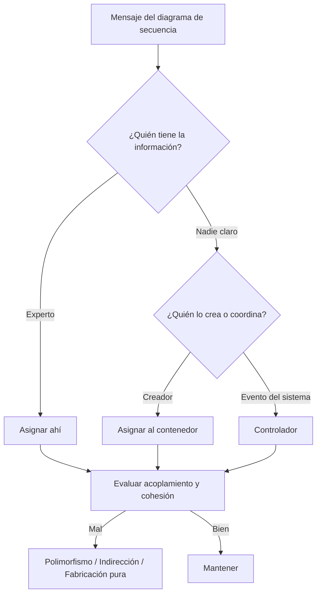
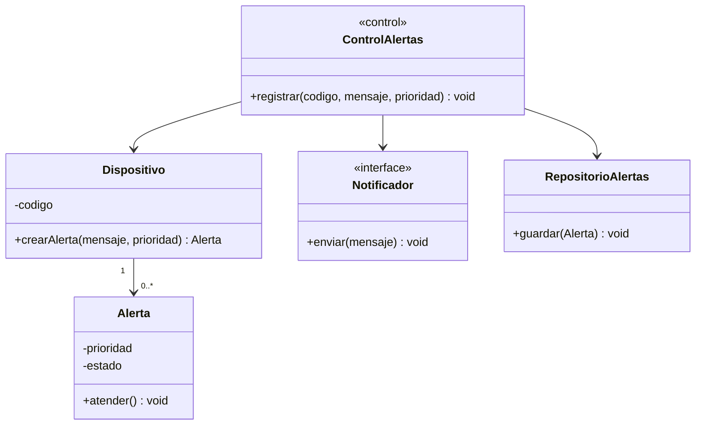

# 13. GRASP: asignar responsabilidades

> [!info] Al terminar este capítulo tenés que poder
> - Explicar qué es una responsabilidad y quién la asigna.
> - Aplicar los nueve patrones GRASP.
> - Justificar una asignación con acoplamiento y cohesión.
> - Detectar una violación de “no hables con extraños”.

> [!abstract] Qué debés saber (nivel 1)
> - **GRASP:** *General Responsibility Assignment Software Patterns*.
> - Son pares **problema–solución** con nombre para asignar responsabilidades.
> - **Experto:** quien tiene la información, hace el trabajo.
> - **Creador:** quien contiene, registra o inicializa, crea.
> - **Controlador:** un objeto que representa el sistema o el CU maneja los eventos.
> - **Bajo acoplamiento** y **alta cohesión** son los criterios de evaluación.
> - Los otros cuatro: polimorfismo, fabricación pura, indirección, variaciones protegidas.

## 13.1 Qué es una responsabilidad

| Tipo | Qué implica | Ejemplo |
|---|---|---|
| **De conocimiento** | Conocer información | `Alerta` conoce su prioridad |
| **De acción** | Hacer algo o coordinar | `ControlAlertas` registra una alerta |

> [!quote] Larman
> “La habilidad para asignar responsabilidades es extremadamente importante en el diseño. La asignación ocurre generalmente durante la creación de los diagramas de interacción.”

Un diseño se evalúa por **dos métricas**:

| Métrica | Qué mide | Buscamos |
|---|---|---|
| **Acoplamiento** | Dependencia entre objetos | Bajo |
| **Cohesión** | Fuerza con que se relacionan las responsabilidades de un objeto | Alta |

## 13.2 Los nueve patrones

### 1. Experto en información (Experto)

| | |
|---|---|
| **Problema** | ¿A quién le asigno esta responsabilidad? |
| **Solución** | A la clase que tiene la **información necesaria** para cumplirla |
| **Ejemplo** | ¿Quién conoce el total de una venta? `Venta` |
| **Cuidado** | Si la información está dispersa, puede haber “expertos parciales” |

### 2. Creador

| | |
|---|---|
| **Problema** | ¿Quién crea el objeto A? |
| **Solución** | La clase B si **contiene** A, **registra** A, **tiene los datos** para inicializarlo o **usa** A de forma exclusiva |
| **Ejemplo** | ¿Quién crea `LineaDeVenta`? `Venta` |
| **Beneficio** | Favorece el bajo acoplamiento |

### 3. Controlador

| | |
|---|---|
| **Problema** | ¿Quién maneja los eventos del sistema? |
| **Solución** | Una clase que representa el **sistema global**, un **subsistema** o un **escenario de CU** |
| **Ejemplo** | `ControlAlertas` maneja `registrarAlerta` |
| **Cuidado** | No recargar un solo objeto; mantener alta cohesión |

> [!warning] Dos variantes
> **Controlador de fachada** (representa el sistema/subsistema) o **controlador de CU** (uno por caso de uso). Para el EFIP, el de CU es el más claro.

### 4. Bajo acoplamiento

| | |
|---|---|
| **Problema** | ¿Cómo reducir dependencias? |
| **Solución** | Asignar responsabilidades de modo que el acoplamiento sea mínimo |
| **Ejemplo** | `ControlAlertas` habla con `Dispositivo`, no con la base |
| **Cuidado** | No se evalúa aislado: interactúa con Experto y Cohesión |

### 5. Alta cohesión

| | |
|---|---|
| **Problema** | ¿Cómo mantener clases enfocadas? |
| **Solución** | Asignar responsabilidades relacionadas al mismo objeto, y no muchas |
| **Ejemplo** | `Alerta` no calcula reportes ni envía correos |
| **Beneficio** | Clases más fáciles de entender, mantener y reutilizar |

### 6. Polimorfismo

| | |
|---|---|
| **Problema** | El comportamiento varía según el tipo |
| **Solución** | Asignar la responsabilidad a los tipos que varían |
| **Ejemplo** | `Pago.autorizar()` con `PagoEfectivo`, `PagoTarjeta`, `PagoCheque` |
| **Beneficio** | Evita `if`/`switch` por tipo |

### 7. Fabricación pura

| | |
|---|---|
| **Problema** | La solución no representa un concepto del dominio |
| **Solución** | Crear una clase “de conveniencia” con alta cohesión y bajo acoplamiento |
| **Ejemplo** | `RepositorioAlertas` para persistir |
| **Cuidado** | No abusar: cada fabricación pura debe justificarse |

### 8. Indirección

| | |
|---|---|
| **Problema** | Dos componentes no deben acoplarse directamente |
| **Solución** | Poner un intermediario que medie |
| **Ejemplo** | `Repositorio` entre `Alerta` y la base de datos |
| **Beneficio** | Bajo acoplamiento y posibilidad de sustituir |

### 9. Variaciones protegidas

| | |
|---|---|
| **Problema** | Los cambios futuros pueden romper el diseño |
| **Solución** | Identificar los puntos de variación y encapsularlos detrás de una interfaz estable |
| **Ejemplo** | `Notificador` con implementaciones email/SMS |
| **Beneficio** | El cambio queda localizado |

## 13.3 Cómo se aplican (método)



| Paso | Pregunta |
|---|---|
| 1 | ¿Qué mensaje hay que enviar? |
| 2 | ¿Quién tiene la información para responderlo? (Experto) |
| 3 | Si hay que crear algo, ¿quién lo contiene? (Creador) |
| 4 | Si es un evento del sistema, ¿quién lo coordina? (Controlador) |
| 5 | ¿El resultado tiene bajo acoplamiento y alta cohesión? |
| 6 | Si no, aplicar polimorfismo, indirección o fabricación pura |

## 13.4 Ejemplo aplicado

**Caso:** registrar una alerta para un dispositivo.

| Mensaje | Patrón | Asignación | Justificación |
|---|---|---|---|
| `registrarAlerta(...)` | Controlador | `ControlAlertas` | Es un evento del sistema, no del dominio |
| `buscarDispositivo(codigo)` | Experto | `ControlAlertas` con `RepositorioDispositivos` | Necesita acceso a la colección |
| `crearAlerta(mensaje, prioridad)` | **Creador** | `Dispositivo` | Contiene sus alertas y tiene los datos |
| `conocerPrioridad()` | Experto | `Alerta` | Es su atributo |
| `notificarSupervisor()` | Indirección | `Notificador` | Desacopla del medio (email/SMS) |
| `persistir(alerta)` | Fabricación pura | `RepositorioAlertas` | No es concepto del dominio |



> [!important] Lo que hay que decir en el oral
> “Asigné `crearAlerta` a `Dispositivo` porque es el **Creador**: contiene sus alertas y tiene los datos para inicializarlas. Eso mantiene **bajo acoplamiento** y **alta cohesión**, y evita que el controlador conozca los detalles de construcción.”

## 13.5 “No hables con extraños” (Ley de Demeter)

Dentro de un método solo podés enviar mensajes a:

- `self`;
- un parámetro;
- un objeto asociado a `self`;
- un elemento de una colección que sea atributo de `self`;
- un objeto creado dentro del método.

Todo lo demás es un **extraño**.

```java
// MAL: cadena de mensajes
cliente.getPedido().getUltimoItem().getProducto().getPrecio();

// BIEN: pedir el dato al objeto que lo conoce
cliente.getPrecioUltimoProducto();
```

> [!warning] Por qué importa
> Las cadenas largas acoplan al cliente con toda la estructura interna. Un cambio en el medio rompe el código.

## 13.6 GRASP no es GoF

| | GRASP | GoF |
|---|---|---|
| Nivel | Asignar responsabilidades | Soluciones de diseño probadas |
| Cantidad | 9 patrones | 23 patrones |
| Ejemplo | Experto, Creador, Controlador | Singleton, Observer, Strategy |
| En el EFIP | **Sí** (método de diseño) | **No** (fuera del programa) |

> [!important] Alcance
> GRASP entra porque es el **método** para pasar del análisis al diseño (modelo de diseño). GoF es un catálogo adicional: se menciona en el anexo E, no se evalúa.

## Errores que suelen tomar

| Error | Corrección |
|---|---|
| Asignar todo al controlador | Aplicar Experto y Creador |
| Crear una clase “Gestor” que hace todo | Baja cohesión: dividir |
| Poner persistencia en la entidad | Fabricación pura / indirección |
| `if` por tipo en el cliente | Polimorfismo |
| Encadenar `getA().getB().getC()` | Ley de Demeter |
| Justificar solo con “es más lindo” | Nombrar acoplamiento y cohesión |

## Ejercicios

> [!example]- 1. Experto
> **Enunciado:** ¿quién calcula el total de una venta?
> **Solución:** `Venta`, porque conoce sus líneas y sus precios.

> [!example]- 2. Creador
> **Enunciado:** ¿quién crea `Cuota` en un alquiler?
> **Solución:** `Alquiler`, porque contiene sus cuotas y tiene los datos para inicializarlas.

> [!example]- 3. Controlador
> **Enunciado:** ¿quién maneja `registrarReparacion`?
> **Solución:** `ControlReparaciones`, controlador del CU.

> [!example]- 4. Polimorfismo
> **Enunciado:** hay tres formas de pago con autorización distinta. ¿Cómo lo resolvés?
> **Solución:** `Pago.autorizar()` abstracto y una implementación por tipo; el cliente no usa `if`.

> [!example]- 5. Fabricación pura
> **Enunciado:** ¿`RepositorioAlertas` es del dominio?
> **Solución:** no; es una fabricación pura para separar la persistencia.

> [!example]- 6. a papel
> **Enunciado:** asigná responsabilidades para: buscar dispositivo, crear alerta, notificar, guardar.
> **Solución:** buscar → controlador + repositorio; crear → `Dispositivo` (Creador); notificar → `Notificador` (indirección); guardar → `RepositorioAlertas` (fabricación pura).

## Lo que sigue

[[ad14_implementacion|14. Modelo de implementación]].

#libro3 #grasp #patrones
