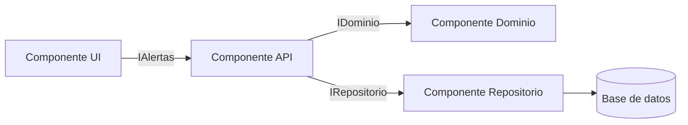
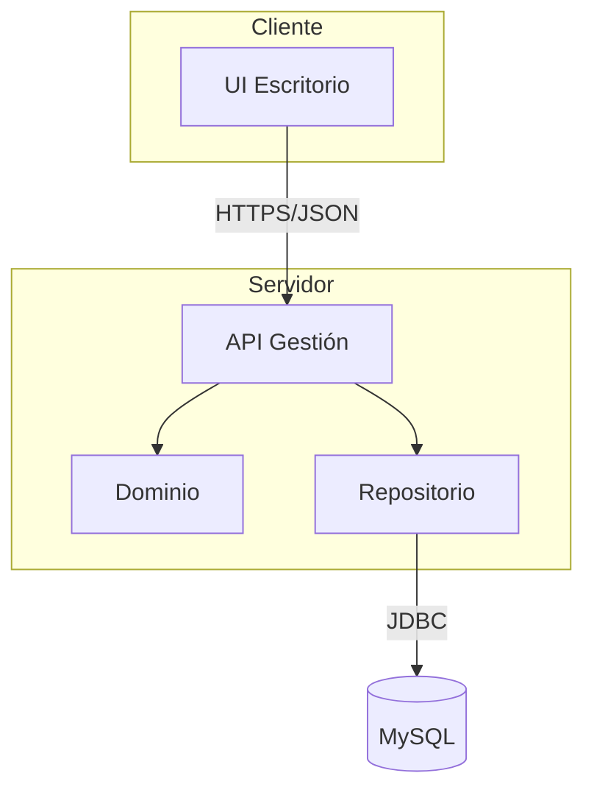
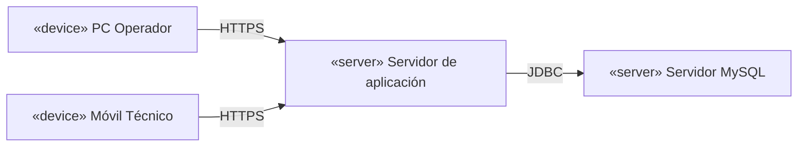
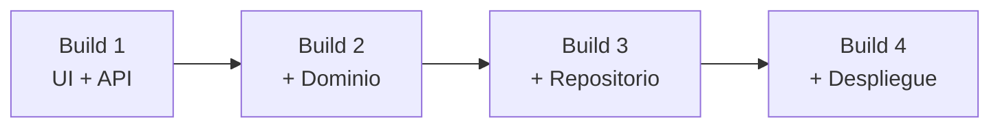

# 14. Modelo de implementación

> [!info] Al terminar este capítulo tenés que poder
> - Explicar qué es un componente, un artefacto y un nodo.
> - Armar el diagrama de componentes.
> - Distribuir componentes en nodos con un diagrama de despliegue.
> - Explicar la integración incremental.

> [!abstract] Qué debés saber (nivel 1)
> - **Componente:** parte física y reemplazable del software.
> - **Artefacto:** archivo o pieza concreta (`.jar`, `.war`, `.exe`).
> - **Nodo:** recurso físico o virtual de ejecución.
> - **Interfaz:** conjunto de operaciones que un componente ofrece.
> - **Construcción:** versión ejecutable que integra componentes.
> - **Integración incremental:** incorporar porciones pequeñas y ejecutables.

## 14.1 Del diseño a la implementación

> [!quote] Cátedra
> El **modelo de implementación** describe cómo los elementos del diseño se implementan en componentes y cómo se organizan según los mecanismos de estructuración disponibles.

| Pregunta | Artefacto |
|---|---|
| ¿Qué piezas de software hay? | Diagrama de componentes |
| ¿Qué interfaces exponen? | Interfaces y dependencias |
| ¿Dónde se ejecutan? | Diagrama de despliegue |
| ¿Cómo se integran? | Construcciones y plan de integración |

> [!important] Componente ≠ clase
> Una clase es lógica; un componente es **físico y reemplazable**. Un componente contiene varias clases.

## 14.2 Elementos

| Elemento | Definición | Ejemplo |
|---|---|---|
| **Componente** | Parte física reemplazable | `gestor-alertas` |
| **Interfaz** | Servicios que ofrece | `IAlertas` |
| **Artefacto** | Archivo concreto | `gestor-alertas.jar` |
| **Nodo** | Recurso de ejecución | Servidor de aplicaciones |
| **Conexión** | Enlace entre nodos | HTTPS, JDBC |



> [!tip] La regla de las interfaces
> Los componentes se comunican por **interfaces**, no por clases internas. Eso permite reemplazar uno sin tocar el otro.

## 14.3 Diagrama de componentes



| Decisión | Justificación |
|---|---|
| UI separada | Se reemplaza sin tocar el dominio |
| API como fachada | Un solo punto de entrada |
| Repositorio aparte | Aísla la persistencia |
| DB como nodo aparte | Recurso compartido y respaldable |

## 14.4 Diagrama de despliegue



| Nodo | Tipo | Qué aloja |
|---|---|---|
| PC Operador | Dispositivo | Cliente |
| Móvil Técnico | Dispositivo | Cliente liviano |
| Servidor de aplicación | Servidor | API, dominio, repositorio |
| Servidor MySQL | Servidor | Base de datos |

> [!warning] No confundas componente con nodo
> `API Gestión` es un **componente** (software). `Servidor de aplicación` es un **nodo** (hardware o VM). En el despliegue, los componentes se **asignan** a nodos.

## 14.5 Construcciones e integración

| Concepto | Definición |
|---|---|
| **Construcción** | Versión ejecutable del sistema integrada a partir de componentes |
| **Integración incremental** | Incorporar una porción pequeña y ejecutable sobre la anterior |
| **Build** | Proceso automático de compilar, empaquetar y probar |

> [!important] Por qué incremental
> Integrar todo al final es el mayor riesgo de un proyecto: aparecen conflictos que nadie probó. La integración incremental detecta el problema cuando todavía es barato.



## 14.6 Método: del diseño al despliegue

| Paso | Acción | Producto |
|---|---|---|
| 1 | Agrupar clases de diseño en **componentes** por responsabilidad | Componentes |
| 2 | Definir **interfaces** entre ellos | Contratos |
| 3 | Asignar artefactos a componentes | `.jar`, `.war` |
| 4 | Identificar **nodos** y conexiones | Topología |
| 5 | Asignar componentes a nodos | Despliegue |
| 6 | Definir el **plan de builds** | Integración |

### Criterios para agrupar

| Criterio | Ejemplo |
|---|---|
| Alta cohesión funcional | Todo lo de alertas junto |
| Bajo acoplamiento | UI no depende de la base |
| Equipo | Un componente por célula |
| Despliegue | Lo que se actualiza junto, va junto |

## 14.7 Programa completo: descripción de despliegue

```text
Nodo: PC Operador
  - Artefacto: cliente-escritorio.exe
  - Conexión: HTTPS a Servidor de aplicación

Nodo: Servidor de aplicación
  - Artefacto: api-gestion.jar
  - Artefacto: dominio.jar
  - Artefacto: repositorio.jar
  - Conexión: JDBC a Servidor MySQL

Nodo: Servidor MySQL
  - Artefacto: esquema municipio
```

> [!important] Lo que evalúa el tribunal
> Que sepas **asignar** componentes a nodos y **justificar** por qué la base está separada, por qué la UI es cliente liviano y qué protocolo usa cada conexión.

## Errores que suelen tomar

| Error | Corrección |
|---|---|
| Un componente por clase | Agrupar por responsabilidad |
| Poner la base como componente | Es un nodo/recurso |
| UI que accede directo a la base | Pasa por API |
| Despliegue sin protocolos | Indicar HTTPS/JDBC |
| Integrar todo al final | Integración incremental |
| Componentes sin interfaces | Definir contratos |

## Ejercicios

> [!example]- 1. Clasificar
> **Enunciado:** `dominio.jar`, `Servidor MySQL`, `IAlertas`.
> **Solución:** artefacto, nodo, interfaz.

> [!example]- 2. Componente o clase
> **Enunciado:** `Alerta` ¿es componente?
> **Solución:** no: es una clase. El componente podría ser `dominio.jar`.

> [!example]- 3. Despliegue
> **Enunciado:** ¿por qué la base en un nodo separado?
> **Solución:** por respaldo, escalabilidad y seguridad; además permite que varios servidores de aplicación la usen.

> [!example]- 4. Interfaces
> **Enunciado:** ¿por qué la UI no debe conocer las clases del dominio?
> **Solución:** para mantener bajo acoplamiento y poder cambiar la UI o el dominio sin afectar al otro.

> [!example]- 5. a papel
> **Enunciado:** dibujá componentes y nodos del caso municipio.
> **Solución:** ver 14.3 y 14.4.

## Lo que sigue

[[ad15_pruebas|15. Modelo de pruebas]].

#libro3 #implementacion
