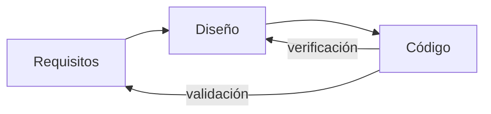
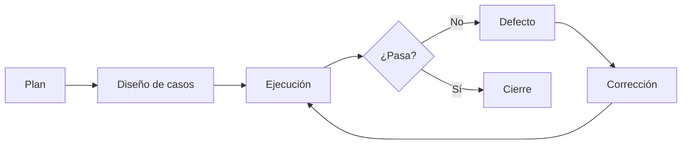

# 15. Modelo de pruebas

> [!info] Al terminar este capítulo tenés que poder
> - Diferenciar verificación de validación.
> - Distinguir los niveles de prueba.
> - Diseñar casos de prueba desde un CU.
> - Explicar el modelo y la planificación de pruebas.

> [!abstract] Qué debés saber (nivel 1)
> - **Verificación:** ¿está construido correctamente?
> - **Validación:** ¿es lo que el cliente esperaba?
> - Niveles: **unidad, integración, sistema, aceptación**.
> - Técnicas: caja negra (partición, borde), caja blanca (cobertura), regresión.
> - Un caso de prueba tiene: precondición, entrada, pasos, resultado esperado.
> - Las pruebas se derivan de los **CU y RF**.

## 15.1 Verificación y validación

| | Verificación | Validación |
|---|---|---|
| Pregunta | ¿Cumple la especificación? | ¿Cumple la expectativa? |
| Se compara con | Documento de requisitos, diseño | Necesidad del cliente |
| Técnica | Revisión, pruebas | Pruebas de aceptación, uso real |
| Frase | “Construimos el producto **bien**” | “Construimos el producto **correcto**” |



> [!important] No son sinónimos
> Un sistema puede estar perfectamente construido según su especificación (verificación OK) y no resolver el problema del cliente (validación fallida).

## 15.2 Niveles de prueba

| Nivel | Qué prueba | Quién | Ejemplo |
|---|---|---|---|
| **Unidad** | Una clase o método | Desarrollador | `Alerta.atender()` |
| **Integración** | Interacción entre componentes | Desarrollador/QA | `ControlAlertas` + `Repositorio` |
| **Sistema** | El sistema completo | QA | Flujo de alta de alerta |
| **Aceptación** | Que cumple lo pactado | Cliente | Escenarios del CU |

> [!tip] La regla de oro
> A medida que sube el nivel, la prueba es más lenta y más cara de corregir. Por eso se prueba primero en unidad.

## 15.3 Técnicas

### Caja negra

Se prueba sin ver el código, desde la entrada y la salida.

| Técnica | Idea | Ejemplo |
|---|---|---|
| **Partición de equivalencia** | Un caso por cada clase de entrada | Prioridad válida 1..5 / inválida |
| **Análisis de borde** | Probar los extremos | 0, 1, 5, 6 |
| **Tabla de decisión** | Combinaciones de condiciones | Prioridad + dispositivo activo |

### Caja blanca

Se prueba con el código.

| Técnica | Idea |
|---|---|
| Cobertura de sentencias | Ejecutar cada línea |
| Cobertura de ramas | Ejecutar cada `if` verdadero y falso |
| Cobertura de caminos | Combinaciones de ramas |

### Regresión

Se reejecutan las pruebas existentes después de un cambio, para verificar que no se rompió nada.

### Otras técnicas que se preguntan

| Técnica | Qué ejercita | Ejemplo en el municipio |
|---|---|---|
| **Basada en estados** | Todas las transiciones válidas e inválidas | `PENDIENTE → ATENDIDA` sí; `ATENDIDA → PENDIENTE` no |
| **Rendimiento / estrés** | Comportamiento bajo carga o recursos escasos | 500 dispositivos reportando a la vez |
| **Seguridad** | Accesos y acciones no autorizadas | Un técnico intenta cerrar una alerta ajena |
| **Matriz CRUD** | Qué CU crea, lee, modifica o borra cada entidad | Qué CU tocan `Alerta`, `Dispositivo` y `Reparación` |

## 15.4 El modelo de prueba

> [!quote] Cátedra
> El **modelo de pruebas** describe cómo se prueban los componentes ejecutables o construcciones mediante pruebas de integración y de sistema.

| Elemento | Contenido |
|---|---|
| **Casos de prueba** | Precondición, entrada, pasos, resultado esperado |
| **Datos de prueba** | Valores concretos |
| **Procedimiento** | Cómo se ejecuta |
| **Criterios de éxito** | Qué se considera aprobado |
| **Trazabilidad** | RF/CU que cubre |
| **Ambiente** | Dónde se ejecuta |

### Plantilla de caso

| Campo | Ejemplo |
|---|---|
| ID | `CP-02` |
| CU / RF | CU-02 / RF-02 |
| Precondición | Dispositivo `S-01` activo |
| Entrada | mensaje “Lámpara”, prioridad 1 |
| Pasos | 1. Abrir alta. 2. Completar. 3. Registrar |
| Resultado esperado | Alerta `PENDIENTE` y notificación al supervisor |
| Resultado obtenido | (al ejecutar) |
| Estado | Aprobado / Fallido |

## 15.5 De la especificación a los casos

| Escenario del CU | Caso de prueba |
|---|---|
| Principal | Camino feliz: todo válido |
| Alternativo A1 | Falta un campo obligatorio |
| Alternativo A2 | Dispositivo inexistente |
| Alternativo A3 | Prioridad fuera de rango |
| Alternativo A4 | Cancelación |

> [!important] La cobertura se mide por escenarios
> Si un CU tiene 5 escenarios y solo probaste el principal, tu cobertura funcional es del 20 %.

## 15.6 Planificación

| Paso | Acción |
|---|---|
| 1 | Listar CU y RF críticos |
| 2 | Definir niveles (unidad, integración, sistema) |
| 3 | Diseñar casos por escenario |
| 4 | Preparar datos y ambiente |
| 5 | Ejecutar y registrar |
| 6 | Corregir y volver a probar (regresión) |



## 15.7 Programa completo: plan del CU-02

```text
CU-02 Registrar alerta

Unidad:
- CP-U1: Alerta creada con prioridad válida → estado PENDIENTE.
- CP-U2: prioridad 0 y 6 → excepción.

Integración:
- CP-I1: ControlAlertas + Repositorio guardan la alerta.
- CP-I2: falla el repositorio → no queda alerta huérfana.

Sistema:
- CP-S1: operador registra alerta y la ve en la lista.
- CP-S2: prioridad 1 dispara notificación al supervisor.

Aceptación:
- CP-A1: el supervisor recibe la notificación en menos de 1 minuto.
```

> [!important] Lo que evalúa el tribunal
> Que sepas **derivar** los casos de los escenarios y **nombrar el nivel**. No que memorices una herramienta.

## Errores que suelen tomar

| Error | Corrección |
|---|---|
| Confundir verificación con validación | Ver 15.1 |
| Probar solo el camino feliz | Cubrir alternativos |
| Un caso con múltiples objetivos | Un caso, un objetivo |
| No registrar el resultado esperado | Sin expected no hay prueba |
| Olvidar la regresión | Reejecutar tras cambios |
| Probar sin trazabilidad | Cada caso cubre un RF/CU |

## Ejercicios

> [!example]- 1. Clasificar
> **Enunciado:** probar `Alerta.atender()` ¿qué nivel es?
> **Solución:** unidad.

> [!example]- 2. Técnica
> **Enunciado:** prioridad válida 1..5. ¿Qué valores probás por borde?
> **Solución:** 0, 1, 5, 6 (y un valor medio, 3).

> [!example]- 3. Escenarios
> **Enunciado:** un CU tiene principal + 3 alternativos. ¿Cuántos casos como mínimo?
> **Solución:** 4 (uno por escenario).

> [!example]- 4. Verificación/validación
> **Enunciado:** el sistema cumple el documento pero el cliente dice “no era eso”. ¿Qué falló?
> **Solución:** validación (o la captura de requisitos).

> [!example]- 5. a papel
> **Enunciado:** escribí el caso de prueba del alternativo “dispositivo inexistente”.
> **Solución:** precondición: no existe `X-99`; entrada: código `X-99`; esperado: mensaje de error, sin alta; estado: aprobado si no se crea la alerta.

## Lo que sigue

[[ad_Cierre_parte2|Cierre de la Parte 2]].

#libro3 #pruebas
