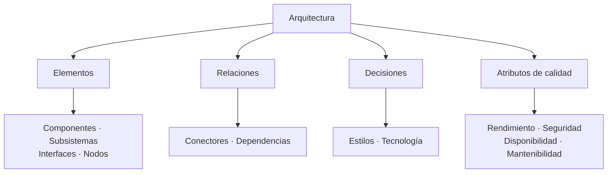
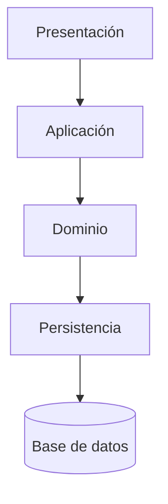
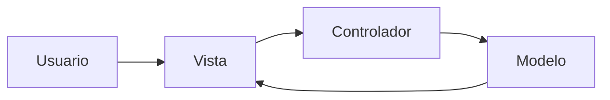
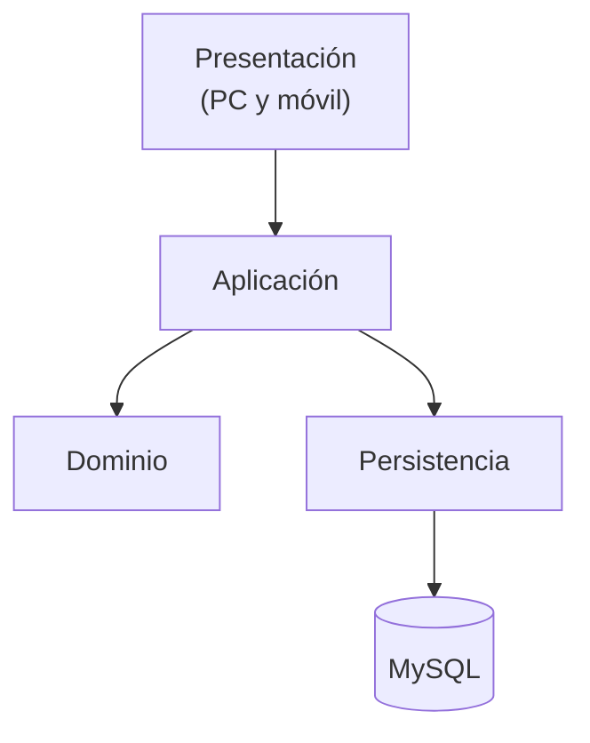

# 16. Arquitectura: elementos, estilos y decisiones

> [!info] Al terminar este capítulo tenés que poder
> - Definir arquitectura y sus elementos clave.
> - Explicar los estilos más usados y cuándo aplican.
> - Relacionar arquitectura con atributos de calidad.
> - Justificar una decisión arquitectónica.

> [!abstract] Qué debés saber (nivel 1)
> - **Arquitectura:** organización de los elementos del sistema y sus relaciones.
> - Elementos: **componentes, conectores, subsistemas, interfaces, nodos**.
> - Se decide por **atributos de calidad**, no por moda.
> - Estilos: capas, cliente-servidor, MVC, pipes-and-filters, SOA/microservicios.
> - El PUD está **centrado en la arquitectura**: se define temprano y se valida en cada iteración.
> - Documentar la arquitectura es parte del trabajo, no un extra.

## 16.1 Qué es la arquitectura

> [!quote] Cátedra
> **Arquitectura del software:** estructura del sistema que captura la organización de sus elementos y las relaciones entre ellos; durante la implementación se desarrolla como un todo.

Tres ideas:

1. **Estructura**: qué partes hay y cómo se conectan.
2. **Decisiones significativas**: las que son caras de cambiar.
3. **Atributos de calidad**: lo que la arquitectura habilita (rendimiento, seguridad, disponibilidad).

> [!important] Arquitectura ≠ diseño detallado
> La arquitectura decide **la estructura global** y las reglas; el diseño detallado decide clases y métodos. Una arquitectura puede estar bien y el diseño mal (y viceversa).

## 16.2 Elementos clave

| Elemento | Definición | Ejemplo |
|---|---|---|
| **Subsistema** | Unidad implementable y probable, con interfaz | `Gestión de alertas` |
| **Componente** | Parte física reemplazable | `api-gestion.jar` |
| **Interfaz** | Servicios que ofrece un elemento | `IAlertas` |
| **Conector** | Mecanismo de comunicación | HTTPS, JDBC, cola |
| **Nodo** | Recurso de ejecución | Servidor, PC, móvil |

> [!warning] “Elementos clave” no es una lista para recitar
> El tribunal espera que expliques **por qué** un subsistema está separado y **qué interfaz** expone. La lista sola no alcanza.

### Impulsores arquitectónicos

Los **impulsores** (*drivers*) son las fuerzas que justifican cada decisión. Si no podés nombrarlos, la arquitectura es un dibujo.

| Impulsor | Ejemplo |
|---|---|
| Casos de uso arquitectónicamente significativos | Los centrales, complejos o riesgosos |
| Requerimientos no funcionales | 99,5 % de disponibilidad, 2 s de respuesta |
| Restricciones tecnológicas y organizacionales | MySQL, equipo de tres personas |
| Sistemas heredados e integraciones | Padrón municipal, cámaras de otra marca |
| Riesgos técnicos y evolución esperada | Duplicar dispositivos en dos años |

> [!tip] El arquitecto elige, no documenta todo
> Se documentan los elementos de **impacto amplio**, difíciles de cambiar o que condicionan varios casos de uso. El resto es diseño detallado.

## 16.3 Atributos de calidad

| Atributo | Pregunta | Decisión típica |
|---|---|---|
| **Rendimiento** | ¿Responde rápido? | Caché, índice, capas delgadas |
| **Escalabilidad** | ¿Soporta más carga? | Servicios sin estado, balanceo |
| **Disponibilidad** | ¿Sigue funcionando? | Réplicas, redundancia |
| **Seguridad** | ¿Quién accede? | Autenticación, autorización, cifrado |
| **Mantenibilidad** | ¿Se puede cambiar? | Bajo acoplamiento, módulos claros |
| **Testeabilidad** | ¿Se puede probar? | Interfaces, inyección de dependencias |
| **Usabilidad** | ¿Se usa fácil? | Separar UI del dominio |

> [!important] La arquitectura es el arte de elegir
> No se maximizan todos los atributos: se priorizan. Un sistema bancario prioriza seguridad; un tablero, rendimiento; un prototipo, velocidad de cambio.

## 16.4 Estilos arquitectónicos

| Estilo | Cómo es | Ventaja | Riesgo |
|---|---|---|---|
| **Capas** | Cada capa usa solo la de abajo | Separación y mantenibilidad | Capas de más |
| **Cliente-servidor** | Cliente pide, servidor responde | Centralización | Cuello de botella |
| **MVC** | Modelo, vista, controlador | Separa UI y dominio | Sobreingeniería en apps chicas |
| **Pipes and filters** | Etapas que transforman datos | Reutilización | Difícil de depurar |
| **SOA / microservicios** | Servicios independientes | Escalado y despliegue | Complejidad operativa |

### Capas

### MVC

> [!important] MVC no es “tres carpetas”
> Es una separación de responsabilidades: el modelo no conoce la vista; la vista observa al modelo; el controlador interpreta la entrada.

### Cliente-servidor vs. capas

| Pregunta | Cliente-servidor | Capas |
|---|---|---|
| ¿Dónde corre la lógica? | En el servidor | Distribuida en capas |
| ¿Cómo se comunica? | Red | Llamadas internas |
| ¿Cuándo? | Varios clientes, datos centrales | Aplicación monolítica ordenada |

## 16.5 Decisiones arquitectónicas

> [!quote] Cátedra
> **Decisión arquitectónica:** elección estructural significativa que habilita los casos de uso y el cumplimiento de atributos de calidad.

Cada decisión debería registrarse con:

| Campo | Ejemplo |
|---|---|
| Decisión | Separar la UI del dominio con una API |
| Alternativas | UI con acceso directo a la base |
| Justificación | Seguridad, mantenibilidad y pruebas |
| Consecuencia | Más componentes y un protocolo adicional |
| Riesgo | Latencia de red |

> [!tip] La pregunta que ordena
> “¿Qué se rompe si cambio esto?” Si la respuesta es “todo”, es una decisión arquitectónica y debe documentarse.

## 16.6 Método: diseñar la arquitectura en 6 pasos

| Paso | Acción | Producto |
|---|---|---|
| 1 | Identificar CU **arquitectónicamente significativos** | Lista corta |
| 2 | Identificar atributos de calidad y restricciones | Prioridades |
| 3 | Elegir **estilo** y vistas | Capas, MVC, etc. |
| 4 | Definir **subsistemas e interfaces** | Estructura |
| 5 | Asignar componentes a **nodos** | Despliegue |
| 6 | Validar con **escenarios** y documentar | Descripción |

### Criterios para subsistemas

| Criterio | Ejemplo |
|---|---|
| Alta cohesión funcional | Todo lo de alertas junto |
| Bajo acoplamiento | UI no conoce la base |
| Equipo | Un subsistema por célula |
| Variabilidad | Lo que cambia por separado |

## 16.7 Ejemplo: arquitectura del municipio

| Subsistema | Responsabilidad | Interfaz |
|---|---|---|
| Presentación | Pantallas de operador y técnico | `IUI` |
| Aplicación | Casos de uso y transacciones | `IAlertas`, `IReparaciones` |
| Dominio | Reglas: prioridad, estados | `IDominio` |
| Persistencia | Acceso a datos | `IRepositorio` |

| Decisión | Justificación |
|---|---|
| Capas + MVC | Separar UI, coordinación y dominio |
| API única | Un punto de entrada y control de seguridad |
| Persistencia aislada | Cambiar motor sin tocar el dominio |
| Nodos separados | Respaldos y escalado |

## Errores que suelen tomar

| Error | Corrección |
|---|---|
| Elegir un estilo por moda | Justificar con atributos de calidad |
| Confundir arquitectura con despliegue | El despliegue es una vista |
| Poner lógica de negocio en la UI | Va en el dominio |
| Un subsistema por clase | Agrupar por responsabilidad |
| No documentar decisiones | Registrar alternativas y consecuencias |
| Microservicios para todo | Complejidad innecesaria |

## Ejercicios

> [!example]- 1. Definición
> **Enunciado:** ¿qué es una decisión arquitectónica?
> **Solución:** una elección estructural significativa que habilita casos de uso y atributos de calidad, y que es costosa de cambiar.

> [!example]- 2. Estilo
> **Enunciado:** ¿qué estilo usarías para separar UI, lógica y datos?
> **Solución:** capas (con MVC en la presentación).

> [!example]- 3. Atributo
> **Enunciado:** el cliente exige 99,9 % de disponibilidad. ¿Qué implica?
> **Solución:** redundancia, réplicas, monitoreo y plan de recuperación; no es solo “un servidor más”.

> [!example]- 4. Justificar
> **Enunciado:** ¿por qué separar la persistencia?
> **Solución:** para cambiar de motor, testear con dobles y evitar que el dominio dependa de SQL.

> [!example]- 5. a papel
> **Enunciado:** dibujá la arquitectura en capas del municipio con interfaces.
> **Solución:** ver 16.7.

## Lo que sigue

[[ad17_documentacion-y-testeo|17. Documentación, implementación y testeo de la arquitectura]].

#libro3 #arquitectura
