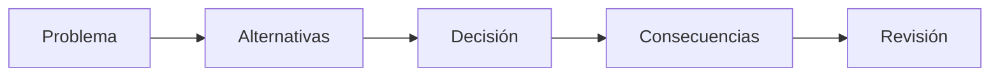
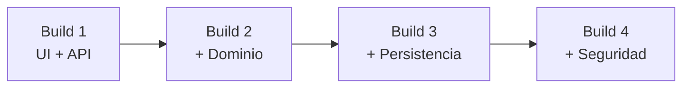

# 17. Documentación, implementación y testeo de la arquitectura

> [!info] Al terminar este capítulo tenés que poder
> - Documentar una arquitectura con vistas y decisiones.
> - Explicar la implementación incremental.
> - Planificar las pruebas de arquitectura.
> - Diferenciar prueba de integración de prueba de sistema.

> [!abstract] Qué debés saber (nivel 1)
> - **Descripción de la arquitectura:** vista del modelo de implementación con subsistemas, interfaces, dependencias y componentes clave.
> - Se documenta para **distintos stakeholders**, con varias vistas.
> - **Implementación:** se construye incrementalmente, en pasos ejecutables.
> - **Prueba de integración:** interacción entre componentes.
> - **Prueba de sistema:** el sistema completo contra requisitos.
> - **Verificación** vs. **validación**: especificación vs. expectativa.

## 17.1 Por qué documentar

| Sin documentación | Con documentación |
|---|---|
| Cada uno supone distinto | Todos leen lo mismo |
| Las decisiones se pierden | Se entiende el porqué |
| Onboarding lento | Incorporación rápida |
| Cambios riesgosos | Impacto acotado |

> [!important] Documentar no es escribir 200 páginas
> Es registrar **lo que no se deduce del código**: decisiones, restricciones, vistas e interfaces.

## 17.2 Qué documentar

| Elemento | Pregunta que responde |
|---|---|
| Contexto | ¿Con qué sistemas se integra? |
| Vistas | ¿Cómo se ve desde cada perspectiva? |
| Subsistemas e interfaces | ¿Qué piezas hay y qué ofrecen? |
| Decisiones | ¿Por qué se eligió así? |
| Atributos de calidad | ¿Qué se priorizó? |
| Riesgos | ¿Qué puede fallar? |
| Despliegue | ¿Dónde corre? |

### Las vistas (4+1)

| Vista | Documenta |
|---|---|
| Lógica | Clases, paquetes, subsistemas |
| Procesos | Concurrencia, flujos |
| Implementación | Componentes y artefactos |
| Despliegue | Nodos y conexiones |
| Casos de uso | Escenarios que validan |

> [!tip] Regla de Oro
> Cada vista se documenta para **un stakeholder**. Si una vista no le sirve a nadie, sobra.

## 17.3 Registro de decisiones (ADR)

| Campo | Contenido |
|---|---|
| ID | `ADR-01` |
| Título | Separar UI y dominio con API |
| Contexto | Varios clientes y requisitos de seguridad |
| Decisión | API REST como único acceso |
| Alternativas | Acceso directo a la base |
| Consecuencias | Más latencia, mejor control y mantenibilidad |
| Estado | Aceptada |

> [!important] Por qué un ADR y no un comentario
> El comentario desaparece; el ADR queda con fecha, alternativas y consecuencias. En el oral, “lo dejamos documentado en un ADR” es una respuesta fuerte.

## 17.4 Implementación de la arquitectura

| Concepto | Definición |
|---|---|
| **Construcción** | Versión ejecutable que integra componentes |
| **Integración incremental** | Incorporar porciones pequeñas y ejecutables |
| **Build** | Compilar, empaquetar, probar |
| **Línea base** | Versión estable de referencia |

| Buena práctica | Motivo |
|---|---|
| Integrar seguido | Detectar conflictos temprano |
| Automatizar el build | Repetibilidad |
| Probar en cada build | No acumular defectos |
| Versionar artefactos | Poder volver atrás |

> [!warning] La integración “big bang”
> Integrar todo al final es el mayor riesgo. La arquitectura se valida **construyendo**, no solo dibujando.

## 17.5 Pruebas de arquitectura

| Prueba | Qué valida | Ejemplo |
|---|---|---|
| **Integración** | Interacción entre componentes | API + repositorio |
| **Sistema** | Comportamiento completo | Alta de alerta de punta a punta |
| **Rendimiento** | Atributo de calidad | 50 usuarios concurrentes |
| **Seguridad** | Acceso y datos | Sin sesión no se accede |
| **Disponibilidad** | Recuperación | Caída de un nodo |
| **Regresión** | No romper lo anterior | Reejecutar suite |

> [!quote] Cátedra
> **Verificación:** comprobación de que el software cumple su especificación.
> **Validación:** asegurar que el software cumple las expectativas del cliente.

### Plan mínimo

| Paso | Acción |
|---|---|
| 1 | Elegir CU críticos (los que validan la arquitectura) |
| 2 | Definir pruebas de integración por interfaz |
| 3 | Definir pruebas de sistema por escenario |
| 4 | Definir pruebas de atributos (rendimiento, seguridad) |
| 5 | Automatizar y ejecutar en cada build |

## 17.6 Ejemplo: plan del municipio

| Nivel | Caso | Criterio |
|---|---|---|
| Integración | API + Repositorio al guardar alerta | Se persiste y se recupera |
| Integración | Notificador + API | Se envía y se registra |
| Sistema | Operador registra alerta | Aparece en la lista |
| Rendimiento | 50 usuarios consultando | p95 ≤ 2 s |
| Seguridad | Acceso sin token | 401 |
| Disponibilidad | Caída del nodo secundario | El sistema sigue |

> [!important] Lo que evalúa el tribunal
> Que las pruebas **validen la arquitectura**, no solo la funcionalidad. Un sistema funcional que no soporta la carga exigida no cumple.

## 17.7 Método: documentar en 5 pasos

| Paso | Acción | Producto |
|---|---|---|
| 1 | Identificar stakeholders | Lista |
| 2 | Elegir vistas por stakeholder | Vistas |
| 3 | Documentar subsistemas e interfaces | Diagramas |
| 4 | Registrar decisiones (ADR) | Registro |
| 5 | Validar con escenarios y pruebas | Evidencia |

## Errores que suelen tomar

| Error | Corrección |
|---|---|
| Documentar solo lo obvio | Registrar decisiones y restricciones |
| Una sola vista para todos | Vistas por stakeholder |
| Pruebas solo funcionales | Incluir atributos de calidad |
| Integrar al final | Integración incremental |
| ADR sin alternativas | Registrar lo descartado |
| Confundir verificación con validación | Ver 17.5 |

## Ejercicios

> [!example]- 1. Documento
> **Enunciado:** ¿qué es la descripción de la arquitectura?
> **Solución:** la vista del modelo de implementación que documenta subsistemas, interfaces, dependencias y componentes clave.

> [!example]- 2. ADR
> **Enunciado:** escribí un ADR de una decisión del municipio.
> **Solución:** decisión: API única; alternativas: acceso directo; consecuencias: control y latencia; estado: aceptada.

> [!example]- 3. Prueba
> **Enunciado:** ¿qué prueba valida que API y repositorio funcionan juntos?
> **Solución:** prueba de integración.

> [!example]- 4. Atributo
> **Enunciado:** ¿cómo probás el RNF de rendimiento?
> **Solución:** prueba de carga con 50 usuarios concurrentes, midiendo p95 ≤ 2 s.

> [!example]- 5. a papel
> **Enunciado:** armá el plan de pruebas de arquitectura en 5 líneas.
> **Solución:** integración por interfaz; sistema por CU crítico; rendimiento; seguridad; disponibilidad.

## Lo que sigue

[[ad_Cierre_parte3|Cierre de la Parte 3]].

#libro3 #arquitectura #documentacion
