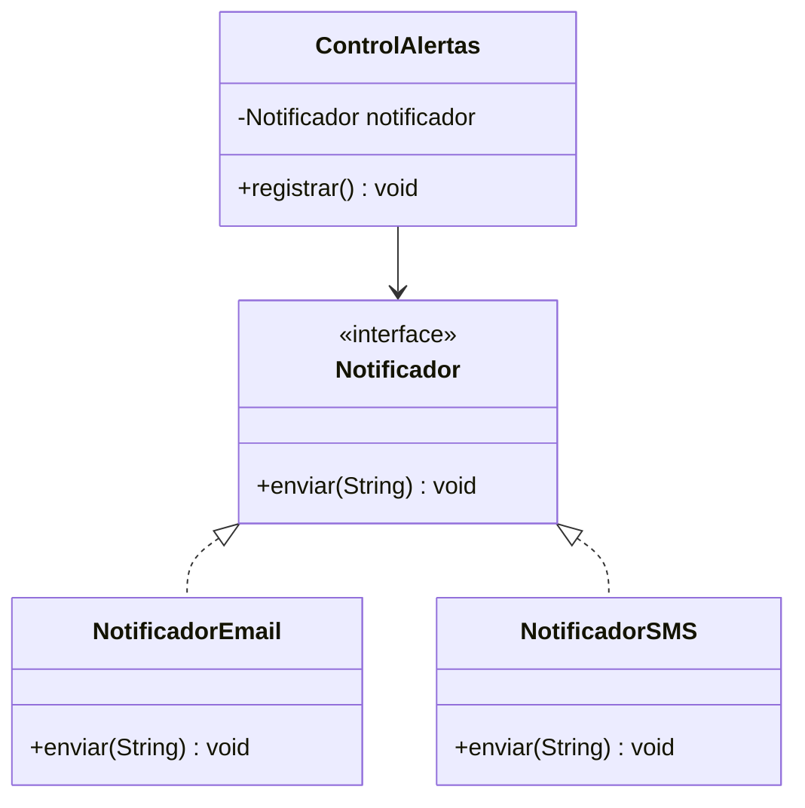

# E. OCL y patrones GoF (anexo opcional)

> [!warning] ¿Entra en el EFIP?
> **No.** El programa de Siglo 21 pide UML, PUD, modelos del PUD y arquitectura; **no** pide OCL ni el catálogo GoF. La cátedra **UTN** los dicta en Diseño de Sistemas.
>
> **Uso:** este anexo es de **contingencia para el oral**. Si el tribunal menciona “restricciones” o “patrones de diseño”, tenés con qué responder sin salir del eje.

## E.1 OCL: restricciones sobre el modelo

**OCL** (*Object Constraint Language*) permite escribir reglas que UML no puede expresar con un dibujo.

| Tipo | Para qué | Palabra |
|---|---|---|
| **Invariante** | Condición que siempre se cumple | `inv:` |
| **Precondición** | Debe cumplirse antes de una operación | `pre:` |
| **Postcondición** | Debe cumplirse después | `post:` |

### Invariante

```ocl
context Alerta
inv prioridadValida: self.prioridad >= 1 and self.prioridad <= 5
```

> “Toda alerta tiene prioridad entre 1 y 5, siempre.”

### Pre y postcondición

```ocl
context ControlAlertas::registrar(codigo: String, prioridad: Integer)
pre prioridadEnRango: prioridad >= 1 and prioridad <= 5
post alertaCreada: Alerta.allInstances()->exists(a |
    a.prioridad = prioridad and a.estado = EstadoAlerta::PENDIENTE)
```

### Colecciones

```ocl
context Dispositivo
inv tieneAlertas: self.alertas->size() >= 0
inv sinCriticasSinAviso: self.alertas->select(a | a.prioridad = 1)->forAll(a | a.notificada)
```

| Expresión | Significado |
|---|---|
| `self` | El objeto actual |
| `->size()` | Cantidad de elementos |
| `->select(...)` | Filtra |
| `->forAll(...)` | Todos cumplen |
| `->exists(...)` | Alguno cumple |
| `allInstances()` | Todas las instancias de una clase |

> [!important] Cómo mencionarlo sin excederte
> “Puedo expresar la regla de prioridad como una **invariante OCL** (`self.prioridad >= 1 and self.prioridad <= 5`), que es más precisa que una nota UML. En el modelo de diseño se implementa con un `CHECK` o una validación.”

## E.2 Patrones GoF: el catálogo

Los **GoF** (*Gang of Four*) clasifican 23 soluciones probadas.

| Categoría | Qué resuelve | Ejemplos |
|---|---|---|
| **Creacionales** | Cómo crear objetos | Singleton, Factory Method, Builder |
| **Estructurales** | Cómo componer objetos | Adapter, Decorator, Facade |
| **De comportamiento** | Cómo colaboran y se reparten responsabilidad | Observer, Strategy, State, Command |

### Los cinco que conviene reconocer

| Patrón | Problema | Idea |
|---|---|---|
| **Singleton** | Una sola instancia global | Constructor privado + instancia estática |
| **Factory Method** | Crear sin acoplar a la clase concreta | Método que devuelve una interfaz |
| **Adapter** | Interfaces incompatibles | Envoltorio que traduce |
| **Observer** | Notificar cambios a varios | Sujeto con lista de observadores |
| **Strategy** | Varias algoritmos intercambiables | Interfaz común + implementaciones |

### Strategy (ejemplo mínimo)



> “`Strategy` permite cambiar el medio de notificación sin tocar `ControlAlertas`. Es la implementación concreta de **variaciones protegidas** (GRASP) e **indirección**.”

## E.3 Cómo se relacionan con GRASP

| GRASP | GoF que lo materializa |
|---|---|
| Polimorfismo | Strategy, State |
| Indirección | Adapter, Facade, Proxy |
| Fabricación pura | Repository, Factory |
| Variaciones protegidas | Strategy, Observer |
| Bajo acoplamiento | Casi todos |

> [!important] La respuesta que no se excede
> “GRASP me dice **a quién** asignar la responsabilidad; GoF me da **soluciones concretas** cuando el problema ya es conocido. En el EFIP alcanza con GRASP; GoF es vocabulario adicional.”

## E.4 Qué NO decir

| No digas | Por qué |
|---|---|
| “Usé 10 patrones GoF” | No se pide y suena a receta |
| “Singleton es arquitectura” | Es un patrón creacional |
| “OCL es un lenguaje de programación” | Es de especificación/restricción |
| “GoF reemplaza a GRASP” | Son niveles distintos |

## Ejercicios (opcionales)

> [!example]- 1. Invariante
> **Enunciado:** escribí en OCL “el costo de una reparación no puede ser negativo”.
> **Solución:** `context Reparacion inv costoNoNegativo: self.costo >= 0`

> [!example]- 2. Precondición
> **Enunciado:** “no se puede registrar una alerta con prioridad fuera de 1..5”.
> **Solución:** `pre: prioridad >= 1 and prioridad <= 5` en `registrar`.

> [!example]- 3. Patrón
> **Enunciado:** ¿qué patrón usarías para cambiar email por SMS sin tocar el controlador?
> **Solución:** Strategy (con una interfaz `Notificador`).

## Lo que sigue

Volver al [[00_Inicio_AD|índice del Libro 3]].

#libro3 #anexo #ocl #gof
