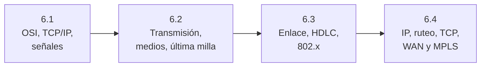

# Libro 4 — Comunicaciones

> [!info] Qué es este libro
> Manual para el **Módulo 4 del EFIP I** (Licenciatura en Informática, Siglo 21). Cubre los sub-ejes **6.1** (OSI, TCP/IP, medida de la información y señales), **6.2** (estructura física, medios, última milla), **6.3** (enlace de datos e IEEE 802.x) y **6.4** (redes, direccionamiento, enrutamiento, congestión, WAN/MPLS, móviles).
> Base: lecturas oficiales de INF395. **Método**: cátedra UTN Comunicaciones y Redes de Información (incluye las preguntas típicas de examen), complementado con UP y UNLP.

## Cómo leerlo

> [!tip] Antes de empezar
> Mismo método que los libros anteriores: [[00_Metodo|tres niveles y respuesta en cinco pasos]].

1. Cada capítulo abre con **lo que tenés que poder hacer**.
2. Las **fórmulas** están en el anexo A y repetidas donde se usan.
3. Los diagramas Mermaid muestran capas, tramas, topologías y redes.
4. Al final: errores típicos y ejercicios con solución plegable.
5. Las **preguntas típicas de UTN** están integradas en los capítulos y en el anexo B.

## Qué priorizar

> [!important] Orden de estudio (según la guía de la compañera)
> | Nivel | Temas |
> |---|---|
> | **A — Imprescindible** | OSI y TCP/IP · señales · medios · enlace de datos · topologías · switch/router · congestión |
> | **B — Muy importante** | Nyquist · modulación · HDLC/PPP/Ethernet · IEEE 802.x · LAN/WAN/MPLS |
> | **C — Complementario** | Teoría de la información y entropía · comunicaciones móviles · tendencias |

## Mapa del libro

### Parte 1 — Fundamentos y modelo de referencia (6.1)
- [[cm01_sistemas-de-comunicacion|1. Sistemas de comunicación y normalización]]
- [[cm02_modelo-osi|2. Modelo de referencia OSI]]
- [[cm03_tcp-ip|3. Arquitectura TCP/IP y encapsulamiento]]
- [[cm04_informacion-y-senales|4. Medida de la información y señales]]
- [[cm_Cierre_parte1|Cierre de la Parte 1]]

### Parte 2 — Estructura física (6.2)
- [[cm05_transmision-y-perturbaciones|5. Transmisión: ancho de banda, perturbaciones y capacidad]]
- [[cm06_codificacion-y-modulacion|6. Codificación y modulación]]
- [[cm07_medios-y-dispositivos|7. Medios de transmisión y dispositivos de nivel físico]]
- [[cm08_ultima-milla|8. Modos de transmisión y última milla]]
- [[cm_Cierre_parte2|Cierre de la Parte 2]]

### Parte 3 — Enlace de datos (6.3)
- [[cm09_nivel-enlace|9. Nivel 2: funciones, PDU y entramado]]
- [[cm10_protocolos-bit|10. Protocolos orientados al bit: HDLC y PPP]]
- [[cm11_llc-mac-802|11. Subcapas LLC/MAC e IEEE 802.x]]
- [[cm_Cierre_parte3|Cierre de la Parte 3]]

### Parte 4 — Redes (6.4)
- [[cm12_redes-y-topologias|12. Redes, conmutación y topologías]]
- [[cm13_direccionamiento-ip|13. Direccionamiento IP y subnetting]]
- [[cm14_enrutamiento|14. Enrutamiento: enrutados vs. de enrutamiento]]
- [[cm15_tcp-udp-congestion|15. TCP, UDP y control de congestión]]
- [[cm16_wan-mpls-moviles|16. WAN, MPLS y comunicaciones móviles]]
- [[cm_Cierre_parte4|Cierre de la Parte 4]]

### Anexos
- [[cm_A_Formulario|A. Formulario]]
- [[cm_B_Banco_preguntas|B. Banco de preguntas de oral]]
- [[cm_C_Errores|C. Errores frecuentes]]
- [[cm_D_Mapa|D. Mapa del programa y trazabilidad]]

## El caso que atraviesa el libro

> [!example] Caso integrador
> El municipio necesita conectar **semáforos y cámaras** con el centro de monitoreo.
>
> - Cada dispositivo se conecta por la red de la ciudad.
> - El centro recibe alertas y consulta video.
> - Hay que dimensionar el enlace, elegir medio, direccionar subredes y definir el enrutamiento.
>
> Cada parte del libro resuelve una capa de ese caso.

## Regla de oro del módulo

> [!important] El error más caro: confundir capas
> “El switch enruta” (no: conmuta), “el router arma tramas” (no: paquetes), “TCP es de la capa de red” (no: transporte). Cada concepto pertenece a una capa y a una función.

#libro4 #comunicaciones #efip
