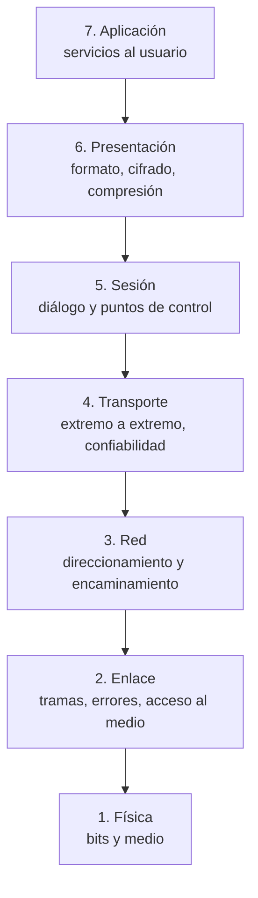
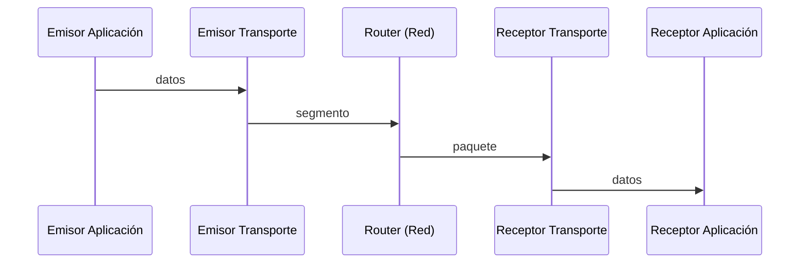

# 2. Modelo de referencia OSI

> [!info] Al terminar este capítulo tenés que poder
> - Nombrar las siete capas y su función.
> - Asociar PDU, dispositivos y protocolos a cada capa.
> - Explicar la comunicación entre capas pares.
> - Diferenciar modelo de referencia de arquitectura.

> [!abstract] Qué debés saber (nivel 1)
> - **OSI** es un **modelo de referencia**, no una arquitectura de protocolos.
> - Siete capas: Física, Enlace, Red, Transporte, Sesión, Presentación, Aplicación.
> - PDU: bits → tramas → paquetes → segmentos → datos.
> - Dispositivos: repetidor/hub (1), switch/bridge (2), router (3), gateway (7).
> - Cada capa ofrece **servicios** a la de arriba y usa los de abajo.
> - Las capas **pares** se comunican lógicamente.

## 2.1 Por qué un modelo de referencia

> [!quote] Cátedra
> **Modelo OSI:** modelo de referencia de siete capas para permitir que dos sistemas diferentes se comuniquen con independencia de la arquitectura subyacente.

Ventajas:

| Ventaja | Detalle |
|---|---|
| Divide el problema | Cada capa resuelve una parte |
| Interoperabilidad | Interfaces normalizadas |
| Independencia | Cambiar una capa no rompe las demás |
| Didáctico | Ordena el estudio y el diagnóstico |

> [!important] Modelo ≠ arquitectura
> OSI **describe qué debería hacer cada nivel**. TCP/IP es la **arquitectura que se implementa**. Por eso “OSI no se usa” es falso: se usa como referencia y vocabulario.

## 2.2 Las siete capas

| # | Capa | Función | PDU | Ejemplos |
|---|---|---|---|---|
| 7 | **Aplicación** | Servicios al usuario | Datos | HTTP, DNS, SMTP |
| 6 | **Presentación** | Formato, cifrado, compresión | Datos | TLS, JPEG, ASCII |
| 5 | **Sesión** | Diálogo, puntos de recuperación | Datos | RPC, NetBIOS |
| 4 | **Transporte** | Extremo a extremo, fiabilidad | Segmento | TCP, UDP |
| 3 | **Red** | Dirección lógica y ruta | Paquete | IP, ICMP |
| 2 | **Enlace** | Trama, errores, MAC | Trama | Ethernet, HDLC |
| 1 | **Física** | Bits, voltaje, medio | Bit | UTP, fibra, hub |

> [!warning] El orden se confunde
> De abajo hacia arriba: **Física, Enlace, Red, Transporte, Sesión, Presentación, Aplicación**. De arriba hacia abajo, al revés. Escribilo siempre en el mismo sentido en el examen.

### Funciones que se preguntan

| Capa | Palabras clave |
|---|---|
| Física | Bits, señal, medio, modulación, sincronismo |
| Enlace | Trama, MAC, CRC, control de flujo, acceso al medio |
| Red | IP, ruta, congestión, fragmentación, direccionamiento lógico |
| Transporte | Puerto, conexión, confiabilidad, extremo a extremo |
| Sesión | Diálogo, sincronización, recuperación |
| Presentación | Traducción, cifrado, compresión |
| Aplicación | Servicios: correo, web, nombres |

## 2.3 Comunicación entre capas

| Concepto | Significado |
|---|---|
| **Capa par** | La misma capa en emisor y receptor |
| **Encapsulamiento** | Cada capa agrega su cabecera |
| **Desencapsulamiento** | El receptor quita cabeceras |
| **Servicio** | Lo que ofrece una capa a la superior |
| **Interfaz** | Punto de acceso al servicio |

> [!important] Las capas pares “hablan” lógicamente
> La capa de transporte del emisor no habla con la de red del receptor: habla **lógicamente** con la de transporte del receptor. Físicamente, los datos bajan y suben por la pila.

## 2.4 Dispositivos por capa

| Capa | Dispositivo | Función |
|---|---|---|
| 1 | Repetidor, hub | Regeneran la señal |
| 2 | Switch, bridge | Conmutan por MAC |
| 3 | Router | Enrutan por IP |
| 4-7 | Gateway, proxy | Traducen protocolos/servicios |

> [!tip] Regla de memoria
> **Hub repite, switch conmuta, router enruta.** Si el dispositivo “mira” direcciones IP, es de capa 3.

## 2.5 Método: ubicar una función o un dispositivo

| Pregunta | Capa |
|---|---|
| ¿Es voltaje, bit o medio? | 1 |
| ¿Es trama, MAC o CRC? | 2 |
| ¿Es IP o ruta? | 3 |
| ¿Es puerto, conexión o retransmisión? | 4 |
| ¿Es diálogo o punto de control? | 5 |
| ¿Es formato, cifrado o compresión? | 6 |
| ¿Es un servicio al usuario? | 7 |

## Errores que suelen tomar

| Error | Corrección |
|---|---|
| “OSI es un protocolo” | Es un modelo de referencia |
| “El switch es capa 3” | Capa 2 (salvo switch capa 3) |
| “El router arma tramas” | Arma paquetes; la trama es capa 2 |
| “TCP es capa de red” | Es transporte |
| Poner HTTP en presentación | Es aplicación |
| Decir que OSI tiene 5 capas | Son 7 |

## Ejercicios

> [!example]- 1. Capas
> **Enunciado:** ¿en qué capa está el CRC?
> **Solución:** enlace (capa 2).

> [!example]- 2. Dispositivo
> **Enunciado:** ¿qué dispositivo trabaja con direcciones MAC?
> **Solución:** switch/bridge (capa 2).

> [!example]- 3. PDU
> **Enunciado:** ordená las PDU de abajo hacia arriba.
> **Solución:** bit, trama, paquete, segmento, datos.

> [!example]- 4. Función
> **Enunciado:** ¿qué capa se encarga del formato y el cifrado?
> **Solución:** presentación (6).

> [!example]- 5. a papel
> **Enunciado:** dibujá las 7 capas y escribí al lado un protocolo y un dispositivo de cada una.
> **Solución:** ver 2.2 y 2.4.

## Lo que sigue

[[cm03_tcp-ip|Arquitectura TCP/IP y encapsulamiento]].

#libro4 #osi
