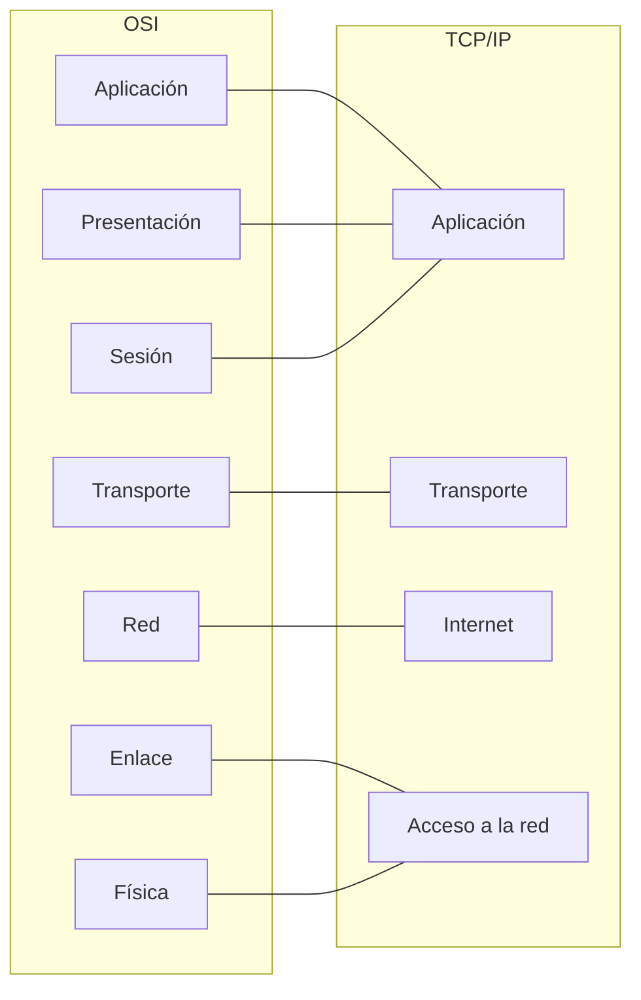
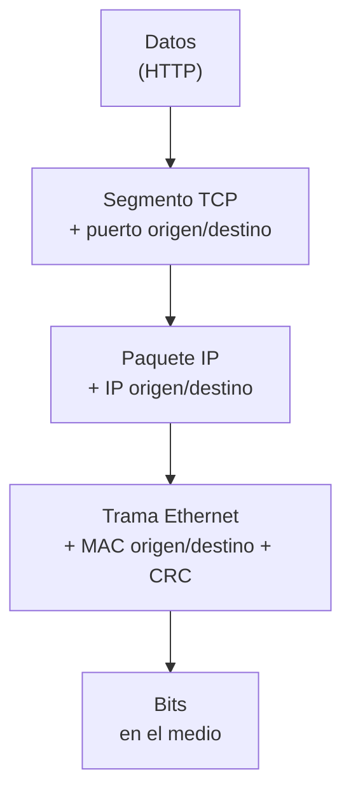
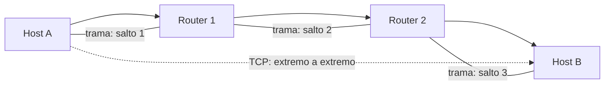

# 3. Arquitectura TCP/IP y encapsulamiento

> [!info] Al terminar este capítulo tenés que poder
> - Mapear TCP/IP contra OSI.
> - Explicar el encapsulamiento capa por capa.
> - Nombrar los protocolos de cada capa.
> - Diferenciar entrega extremo a extremo de salto a salto.

> [!abstract] Qué debés saber (nivel 1)
> - TCP/IP tiene **4 capas**: acceso a la red, internet, transporte, aplicación.
> - **IP** es no orientado a conexión y no confiable.
> - **TCP** es orientado a conexión y confiable; **UDP** no.
> - Cada capa agrega su **cabecera** (encapsulamiento).
> - El router trabaja hasta **capa 3**; el switch hasta **capa 2**.
> - TCP/IP es la arquitectura **implementada**; OSI, el modelo de referencia.

## 3.1 Las cuatro capas

| TCP/IP | Equivale en OSI | Protocolos |
|---|---|---|
| **Aplicación** | Aplicación + presentación + sesión | HTTP, DNS, SMTP, FTP, SSH |
| **Transporte** | Transporte | TCP, UDP |
| **Internet** | Red | IP, ICMP, ARP |
| **Acceso a la red** | Enlace + física | Ethernet, Wi-Fi, PPP |

> [!important] Por qué cuatro y no siete
> TCP/IP agrupa las capas de aplicación, presentación y sesión porque en la práctica los protocolos de aplicación resuelven esas funciones. No “faltan” capas: están integradas.

## 3.2 Encapsulamiento

| Capa | Agrega | Se llama |
|---|---|---|
| Aplicación | Datos | Mensaje |
| Transporte | Puertos, secuencia | Segmento (TCP) / datagrama (UDP) |
| Internet | IP origen/destino, TTL | Paquete / datagrama IP |
| Acceso a la red | MAC, CRC | Trama |
| Física | — | Bits |

> [!example] Leer una trama
> Una trama Ethernet que transporta HTTP contiene: `[MAC dst | MAC src | Tipo | IP dst | IP src | Puerto dst | Puerto src | Datos HTTP | CRC]`.
> Cada capa del receptor quita **su** cabecera y entrega el resto a la de arriba.

## 3.3 Protocolos por capa

| Capa | Protocolo | Función |
|---|---|---|
| Aplicación | HTTP/HTTPS | Web |
| | DNS | Nombres → IP |
| | SMTP/IMAP | Correo |
| | FTP/SFTP | Archivos |
| | DHCP | Configuración IP |
| Transporte | TCP | Confiable, conexión |
| | UDP | No confiable, sin conexión |
| Internet | IP | Direccionamiento y ruta |
| | ICMP | Errores y diagnóstico (`ping`) |
| | ARP | IP → MAC |
| Acceso | Ethernet | LAN cableada |
| | Wi-Fi (802.11) | LAN inalámbrica |
| | PPP | Enlace punto a punto |

> [!warning] ARP no es capa 3 pura
> ARP resuelve una IP a una MAC: puentea red y enlace. Se ubica en la frontera (capa 2/3). En el oral, decilo así y no te equivocás.

## 3.4 Extremo a extremo vs. salto a salto

| Concepto | Capa | Alcance |
|---|---|---|
| **Salto a salto** | Enlace (2) | Entre dos nodos vecinos |
| **Extremo a extremo** | Transporte (4) | Entre procesos finales |
| **Ruta** | Red (3) | Entre redes, decidida por routers |

> [!important] La frase que suma
> “La trama cambia en cada salto; el paquete IP se mantiene de extremo a extremo (salvo TTL y fragmentación); el segmento TCP solo lo entienden los extremos.”

## 3.5 Direcciones en cada nivel

| Nivel | Dirección | Ejemplo |
|---|---|---|
| Aplicación | Nombre / URL | `www.municipio.gob.ar` |
| Transporte | Puerto | 80 (HTTP), 443 (HTTPS) |
| Red | IP | `192.168.1.10` |
| Enlace | MAC | `AA:BB:CC:DD:EE:FF` |

> [!tip] Cómo recordarlo
> **Nombre → puerto → IP → MAC**: de lo más “humano” a lo más “físico”.

## 3.6 Método: seguir un paquete

| Paso | Pregunta | Respuesta |
|---|---|---|
| 1 | ¿Qué aplicación lo genera? | HTTP |
| 2 | ¿Qué puerto? | 443 |
| 3 | ¿Qué IP destino? | Resuelta por DNS |
| 4 | ¿Qué ruta? | Tabla del router |
| 5 | ¿Qué MAC en el próximo salto? | ARP |
| 6 | ¿Qué medio? | Ethernet/Wi-Fi |

## Errores que suelen tomar

| Error | Corrección |
|---|---|
| “TCP/IP tiene 7 capas” | Tiene 4 |
| “IP es confiable” | No: no confirma entrega |
| “TCP es más rápido que UDP” | No: tiene más control, no necesariamente más rápido |
| “El router cambia la IP destino” | Solo NAT; el enrutamiento normal no |
| “La MAC llega de extremo a extremo” | Cambia en cada salto |
| “DNS es capa de transporte” | Es aplicación |

## Ejercicios

> [!example]- 1. Mapeo
> **Enunciado:** ¿a qué capa TCP/IP corresponde la presentación de OSI?
> **Solución:** aplicación.

> [!example]- 2. Encapsulamiento
> **Enunciado:** ¿qué agrega la capa de transporte?
> **Solución:** puertos de origen y destino, número de secuencia y control.

> [!example]- 3. Protocolo
> **Enunciado:** `ping` usa ICMP. ¿Qué capa?
> **Solución:** internet (capa 3).

> [!example]- 4. MAC
> **Enunciado:** ¿la MAC de destino es la del host final?
> **Solución:** no necesariamente: es la del **próximo salto** (router o host en la misma red).

> [!example]- 5. a papel
> **Enunciado:** dibujá el encapsulamiento de un HTTP sobre Ethernet.
> **Solución:** ver 3.2.

## Lo que sigue

[[cm04_informacion-y-senales|Medida de la información y señales]].

#libro4 #tcpip
