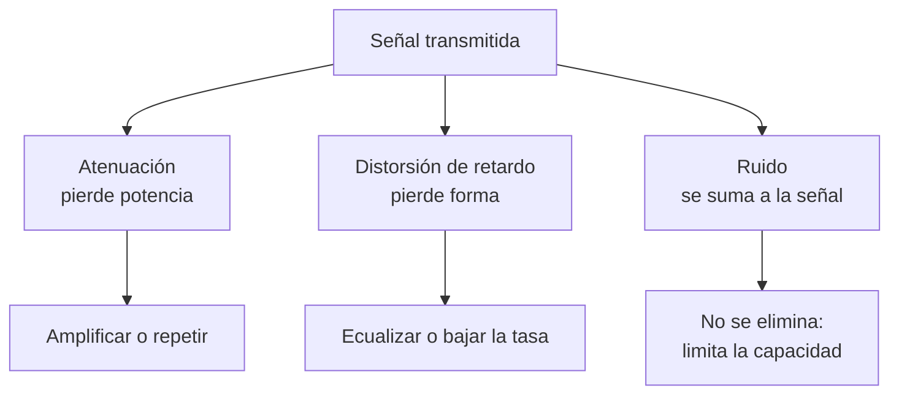

# 5. Transmisión: ancho de banda, perturbaciones y capacidad

> [!info] Al terminar este capítulo tenés que poder
> - Distinguir frecuencia, espectro y ancho de banda.
> - Calcular dB y dBm.
> - Explicar atenuación, distorsión y ruido.
> - Aplicar Nyquist y Shannon.

> [!abstract] Qué debés saber (nivel 1)
> - **Ancho de banda (AB):** rango de frecuencias donde se concentra la energía.
> - **Atenuación:** pérdida de potencia con la distancia (se mide en dB).
> - **Distorsión de retardo:** distintas frecuencias viajan a distinta velocidad.
> - **Ruido:** térmico, de intermodulación, diafonía e impulsivo.
> - **Nyquist (canal sin ruido):** `C = 2B log2 M`.
> - **Shannon (canal con ruido):** `C = B log2(1 + S/N)`.

## 5.1 Frecuencia, espectro y ancho de banda

| Concepto | Definición | Unidad |
|---|---|---|
| **Frecuencia** | Ciclos por segundo | Hz |
| **Espectro** | Conjunto de frecuencias que componen una señal | Hz |
| **Ancho de banda** | Rango de frecuencias donde se concentra la mayor parte de la energía | Hz |
| **Tasa de bits** | Bits por segundo | bps |
| **Baudios** | Símbolos por segundo | baud |

> [!quote] Pregunta típica de UTN
> “Explicar el concepto de AB.” → **Es la longitud, medida en Hz, del rango de frecuencias en el que se concentra la mayor parte de la energía de la señal.**

> [!warning] AB no es velocidad
> El ancho de banda es una **propiedad del canal**; la tasa es cuántos bits pasan por segundo. Un canal más ancho **permite** más tasa, pero no la garantiza.

## 5.2 Decibeles

$$dB = 10 \log_{10}\left(\frac{P_2}{P_1}\right)$$

| Variación | dB |
|---|---|
| ×2 | ≈ +3 dB |
| ×10 | +10 dB |
| ÷2 | ≈ −3 dB |
| ÷10 | −10 dB |

### dBm (potencia absoluta)

$$dBm = 10 \log_{10}\left(\frac{P}{1\,\text{mW}}\right)$$

| Potencia | dBm |
|---|---|
| 1 mW | 0 dBm |
| 10 mW | 10 dBm |
| 0,1 mW | −10 dBm |
| 1 W | 30 dBm |

> [!important] Por qué hay dBm negativos
> Porque la escala es logarítmica y toma como referencia 1 mW. `−10 dBm` **no** es potencia negativa: es `0,1 mW`. Un valor negativo indica una potencia **menor** que 1 mW.

### Ejemplo

Una señal de 1 mW se atenúa a 0,1 mW:

```text
dB = 10 log10(0,1/1) = -10 dB
```

## 5.3 Perturbaciones

| Perturbación | Causa | Efecto | ¿Se elimina? |
|---|---|---|---|
| **Atenuación** | Pérdida de energía en el medio | La señal llega débil | Se compensa con amplificadores/repetidores |
| **Distorsión de retardo** | La velocidad depende de la frecuencia | Los bits se solapan | Se ecualiza o se limita la tasa |
| **Ruido térmico** | Agitación de electrones | Ruido blanco de fondo | **No** se elimina: limita el canal |
| **Diafonía (crosstalk)** | Acoplamiento entre cables | Interferencia de otro par | Se reduce con trenzado y blindaje |
| **Interferencia electromagnética (EMI)** | Campos externos: motores, radio, descargas | Perturbación de la señal | Blindaje, separación de la potencia y fibra |
| **Ruido impulsivo** | Picos externos (tormentas, fallas) | Ráfagas de errores | Se mitiga con blindaje y detección |

> [!quote] Pregunta típica de UTN
> “Ruido térmico: características y ejemplos.” → Se debe a la agitación térmica de los electrones, está presente en todos los medios electrónicos, **depende de la temperatura**, está distribuido uniformemente en el espectro (por eso “ruido blanco”) y **no se puede eliminar**: impone un límite superior a las prestaciones.

> [!tip] Distorsión de retardo en una frase
> “La velocidad de propagación varía con la frecuencia; por eso las componentes de la señal llegan en instantes distintos.”

### Las tres perturbaciones en un solo mapa



> [!important] Solo una no tiene remedio
> Atenuación y distorsión se compensan; el ruido térmico **no**. Por eso Shannon es un techo: podés mejorar el equipo, pero no eliminar el ruido de fondo.

## 5.4 Capacidad del canal

### Nyquist (canal sin ruido)

$$C = 2B \log_2 M$$

- `B`: ancho de banda en Hz.
- `M`: niveles de codificación.

**Ejemplo:** `B = 3 kHz`, `M = 4` → `C = 2 · 3000 · 2 = 12.000 bps`.

> [!important] “¿Conviene tener muchos niveles?”
> En un canal **sin ruido**, más niveles aumentan la capacidad (logarítmicamente). En un canal **con ruido**, muchos niveles se confunden entre sí y el BER sube. Por eso la respuesta correcta se justifica con **Shannon**.

### Shannon (canal con ruido)

$$C = B \log_2(1 + S/N)$$

- `S/N`: relación señal-ruido (lineal).
- Si te dan `SNR_dB`: `S/N = 10^(SNR/10)`.

**Ejemplo:** `B = 3 kHz`, `SNR = 30 dB` → `S/N = 1000` → `C = 3000 · log2(1001) ≈ 29.900 bps`.

> [!example] Justificación típica
> “Con muchos niveles aumento `M`, pero el ruido hace que los niveles se confundan. Shannon me da el techo real: no puedo superar `B log2(1+S/N)` sin subir potencia o ancho de banda.”

## 5.5 Relación entre AB y tasa

| Escenario | Qué limita |
|---|---|
| Canal ideal | El ancho de banda y los niveles |
| Canal real | El ruido (Shannon) |
| Medio físico | Atenuación y distorsión |

> [!warning] La confusión clásica
> “Más ancho de banda = más velocidad” **no siempre**. Si el ruido es alto, agregar AB ayuda solo hasta cierto punto; y si el protocolo tiene mucho overhead, la tasa útil es menor.

### Métricas que no son lo mismo

| Métrica | Qué mide | Unidad |
|---|---|---|
| **Ancho de banda** | Capacidad teórica: rango de frecuencias | Hz |
| **Tasa de bits** | Bits que el emisor inyecta por segundo | b/s |
| **Throughput** | Tasa **útil** realmente lograda | b/s |
| **Latencia / RTT** | Retardo de ida, o de ida y vuelta | ms |
| **Jitter** | Variación de la latencia entre paquetes | ms |
| **BER** | Proporción de bits recibidos con error | adimensional |

> [!important] Por qué se pregunta
> Un enlace de 100 Mb/s puede entregar 60 Mb/s de throughput: cabeceras, ACK, colisiones y colas se comen el resto. “Tengo 100 megas” es ancho de banda; lo que tarda el archivo depende del throughput.

## 5.6 Método: resolver un problema de canal

| Paso | Acción |
|---|---|
| 1 | Identificar `B`, `M` o `S/N` |
| 2 | Decidir si el canal es con o sin ruido |
| 3 | Aplicar Nyquist o Shannon |
| 4 | Convertir dB a lineal si hace falta |
| 5 | Verificar unidades (bps) y coherencia |

## Errores que suelen tomar

| Error | Corrección |
|---|---|
| Confundir AB con tasa | Hz vs. bps |
| Usar `log10` en Shannon | Es `log2` |
| Olvidar convertir dB a lineal | `S/N = 10^(dB/10)` |
| Decir que el ruido térmico se elimina | No se elimina |
| Confundir diafonía con ruido térmico | La primera viene de otro par |
| Aplicar Nyquist con ruido | Nyquist es sin ruido |

## Ejercicios

> [!example]- 1. dB
> **Enunciado:** una señal pasa de 4 mW a 1 mW. ¿Atenuación en dB?
> **Solución:** `10 log10(1/4) ≈ −6 dB`.

> [!example]- 2. dBm
> **Enunciado:** ¿cuánto es 100 mW en dBm?
> **Solución:** `10 log10(100) = 20 dBm`.

> [!example]- 3. Nyquist
> **Enunciado:** `B = 4 kHz`, `M = 8`.
> **Solución:** `C = 2·4000·3 = 24.000 bps`.

> [!example]- 4. Shannon
> **Enunciado:** `B = 1 MHz`, `S/N = 63`.
> **Solución:** `C = 10^6 · log2(64) = 6 Mbps`.

> [!example]- 5. Perturbación
> **Enunciado:** ¿qué perturbación explica que un bit “se corra” y pise al siguiente?
> **Solución:** distorsión de retardo (o dispersión).

> [!example]- 6. a papel
> **Enunciado:** explicá por qué `−3 dBm` es menos potencia que `0 dBm`.
> **Solución:** porque `0 dBm = 1 mW` y `−3 dBm ≈ 0,5 mW`; el signo indica que está por debajo de la referencia.

## Lo que sigue

[[cm06_codificacion-y-modulacion|Codificación y modulación]].

#libro4 #transmision
