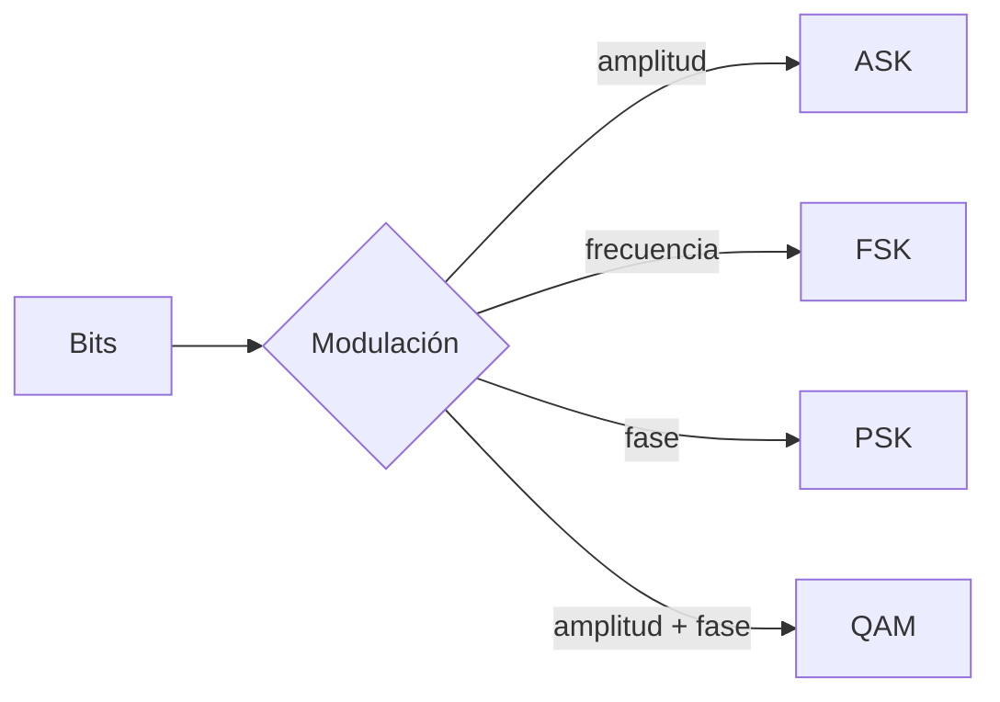

# 6. Codificación y modulación

> [!info] Al terminar este capítulo tenés que poder
> - Dibujar NRZ-L, NRZ-I, Manchester y Manchester diferencial.
> - Explicar ventajas y desventajas de cada código.
> - Distinguir ASK, FSK, PSK y QAM.
> - Explicar PCM y la tasa de 64 kbps.

> [!abstract] Qué debés saber (nivel 1)
> - **Codificación de línea:** convierte bits en señales digitales.
> - **NRZ:** no retorna a cero; simple pero pierde sincronismo en rachas.
> - **Manchester:** transición en cada bit → autosincronizado; usa el doble de AB.
> - **Modulación digital:** ASK (amplitud), FSK (frecuencia), PSK (fase), QAM (ambas).
> - **PCM:** muestreo + cuantización + codificación.
> - Voz telefónica PCM: **64 kbps**.

## 6.1 Codificación de línea

Convierte una secuencia de bits en una forma de onda.

| Código | Regla | Ventaja | Desventaja |
|---|---|---|---|
| **NRZ** | Un nivel por bit; no vuelve a cero | Simple, buen uso del AB | Pierde sincronismo en rachas largas |
| **NRZ-L** | Nivel positivo = 0, negativo = 1 (o al revés) | Simple | Igual problema de sincronismo |
| **NRZ-I** | Un 1 produce transición; un 0 no | Más inmune a ruido y errores de cableado | Sigue teniendo rachas sin transición |
| **Manchester** | Transición en la mitad de cada bit | **Autosincronizado** | Doble AB que NRZ |
| **Manchester diferencial** | Siempre transición al medio; 0 = transición al inicio, 1 = sin transición | No importa la polaridad | Doble AB |

> [!important] La pregunta típica de UTN
> “Explicar NRZ, NRZ-L, NRZ-I, Manchester y Manchester diferencial. Graficar la secuencia `0110010`.”
> Prepará la tabla de niveles y practicá el dibujo en papel.

### Secuencia `0 1 1 0 0 1 0`

**NRZ-L** (0 = +, 1 = −):

| Bit | 0 | 1 | 1 | 0 | 0 | 1 | 0 |
|---|---|---|---|---|---|---|---|
| Nivel | + | − | − | + | + | − | + |

**NRZ-I** (transición en cada 1; empezando en +):

| Bit | 0 | 1 | 1 | 0 | 0 | 1 | 0 |
|---|---|---|---|---|---|---|---|
| Nivel | + | − | + | + | + | − | − |

**Manchester** (0 = alto→bajo, 1 = bajo→alto):

| Bit | 0 | 1 | 1 | 0 | 0 | 1 | 0 |
|---|---|---|---|---|---|---|---|
| Mitad | H→L | L→H | L→H | H→L | H→L | L→H | H→L |

**Manchester diferencial** (transición al medio siempre; 0 = transición al inicio, 1 = sin transición):

| Bit | 0 | 1 | 1 | 0 | 0 | 1 | 0 |
|---|---|---|---|---|---|---|---|
| Inicio | sí | no | no | sí | sí | no | sí |
| Medio | sí | sí | sí | sí | sí | sí | sí |

> [!tip] Cómo no equivocarte al dibujar
> 1. Marcá primero los **límites de bit** (líneas verticales).
> 2. Para Manchester, marcá la **transición del medio** en todos.
> 3. Recién después agregá las transiciones de inicio (diferencial) o el nivel (NRZ).

### AMI (bipolar)

Alterna polaridad en cada 1 y deja 0 en nivel cero. Se usa para evitar componente continua. **No** es obligatorio en el EFIP, pero se menciona en la cátedra.

## 6.2 Modulación digital

Cuando los datos digitales viajan sobre una portadora analógica.

| Técnica | Qué varía | Ejemplo |
|---|---|---|
| **ASK** | Amplitud | 0 = sin portadora, 1 = portadora |
| **FSK** | Frecuencia | Una frecuencia para 0 y otra para 1 |
| **PSK** | Fase | 0° y 180° (BPSK) |
| **QAM** | Amplitud y fase | 16-QAM, 64-QAM |

| Técnica | Bits por símbolo | AB |
|---|---|---|
| ASK/FSK/PSK binaria | 1 | Menor |
| QPSK | 2 | Medio |
| 16-QAM | 4 | Mayor |
| 64-QAM | 6 | Mayor |

> [!important] La pregunta de UTN
> “¿Qué modulación ocupa menos ancho de banda: AM, FM o PM?” → **AM** (ASK) es la más eficiente en AB; FM (FSK) ocupa más. Y “QAM permite modular en… fase y amplitud”.

> [!warning] Más niveles no siempre es mejor
> A igual BER, QAM suele ser más conveniente porque aprovecha mejor el AB, pero requiere mejor relación señal/ruido. Con ruido alto, conviene una modulación más robusta (FSK/PSK) aunque sea más lenta.

### Baudios y bits

$$bits/s = baudios \cdot \log_2 M$$

**Ejemplo:** 2400 baudios con 16-QAM (`log2 16 = 4`) → 9600 bps.

## 6.3 Modulación analógica

| Técnica | Parámetro que varía | Uso |
|---|---|---|
| **AM** | Amplitud | Radio AM |
| **FM** | Frecuencia | Radio FM |
| **PM** | Fase | Datos y sincronismo |

> [!tip] La frase
> “AM modifica la amplitud, FM la frecuencia y PM la fase de la portadora.”

## 6.4 PCM: digitalizar voz

| Parámetro | Valor |
|---|---|
| Frecuencia de muestreo | 8000 Hz |
| Niveles | 256 (8 bits) |
| Tasa | 8000 × 8 = **64 kbps** |

> [!important] Por qué 8 kHz
> Por Nyquist: la voz telefónica llega hasta 4 kHz, así que `fs ≥ 2 · 4000 = 8000`.

### Modulación delta

Envía un bit por muestra indicando si la señal subió o bajó. Más simple que PCM, pero necesita más muestras para la misma calidad.

## 6.5 Códigos de canal

Además de la codificación de línea, se agregan bits para detectar/corregir errores:

| Código | Qué hace |
|---|---|
| Paridad simple | Detecta un número impar de errores |
| Paridad vertical (VRC) | Paridad por carácter |
| Paridad longitudinal (LRC) | Paridad por bloque |
| CRC | Detección robusta con polinomio |

> [!note] Alcance
> El EFIP pide “control de enlace de datos” y menciona CRC. La paridad VRC/LRC aparece en UTN; sirve para explicar detección de errores.

## 6.6 Método: elegir codificación

| Pregunta | Decisión |
|---|---|
| ¿Necesito sincronismo? | Manchester |
| ¿Importa el AB? | NRZ |
| ¿Hay inversión de polaridad posible? | Manchester diferencial |
| ¿Es un enlace óptico de larga distancia? | Codificación específica del estándar (8b/10b, etc.) |
| ¿Es sobre portadora analógica? | ASK/FSK/PSK/QAM |

## Errores que suelen tomar

| Error | Corrección |
|---|---|
| Decir que NRZ es autosincronizado | No lo es; Manchester sí |
| Confundir NRZ-L con NRZ-I | L = nivel; I = inversión en 1 |
| Decir que Manchester usa menos AB | Usa el doble |
| Confundir ASK con AM | ASK es digital sobre portadora; AM es analógica |
| Calcular PCM con 4 kHz | Se muestrea a 8 kHz |
| Confundir baudios con bps | `bps = baudios × log2 M` |

## Ejercicios

> [!example]- 1. NRZ-L
> **Enunciado:** dibujá `1010` en NRZ-L (1 = −).
> **Solución:** − + − +.

> [!example]- 2. NRZ-I
> **Enunciado:** `1100` empezando en +.
> **Solución:** − + + + (transición en cada 1).

> [!example]- 3. Manchester
> **Enunciado:** ¿qué transición representa un 0?
> **Solución:** alto→bajo (si se usa la convención IEEE).

> [!example]- 4. Modulación
> **Enunciado:** ¿qué modula QAM?
> **Solución:** amplitud y fase.

> [!example]- 5. PCM
> **Enunciado:** 8 kHz y 8 bits. ¿Tasa?
> **Solución:** 64 kbps.

> [!example]- 6. a papel
> **Enunciado:** dibujá `0110010` en Manchester y marcá las transiciones del medio.
> **Solución:** ver la tabla de 6.1.

## Lo que sigue

[[cm07_medios-y-dispositivos|Medios de transmisión y dispositivos de nivel físico]].

#libro4 #codificacion #modulacion
