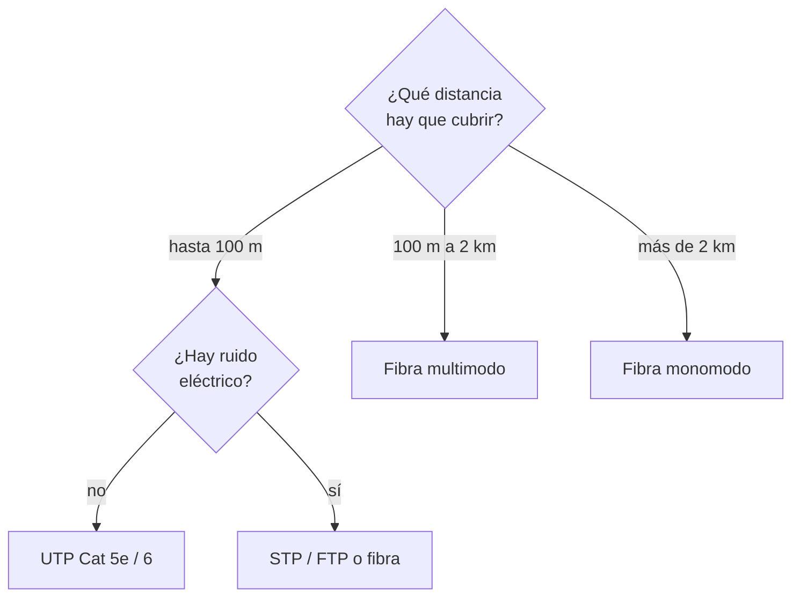

# 7. Medios de transmisión y dispositivos de nivel físico

> [!info] Al terminar este capítulo tenés que poder
> - Comparar par trenzado, coaxial y fibra.
> - Elegir el medio según distancia, ruido y costo.
> - Explicar los dispositivos de capa 1.
> - Justificar una elección con criterios técnicos.

> [!abstract] Qué debés saber (nivel 1)
> - **Guiados:** par trenzado (UTP/STP), coaxial, fibra óptica.
> - **No guiados:** radio, microondas, infrarrojo, satélite.
> - **UTP:** barato y flexible; sensible a ruido; ~100 m.
> - **Fibra:** inmune al ruido electromagnético; larga distancia; más cara.
> - **Coaxial:** mejor blindaje que UTP; en desuso en LAN.
> - Dispositivos de capa 1: repetidor, hub, módem, conversor de medio.

## 7.1 Medios guiados

### Par trenzado

Dos conductores trenzados para reducir la interferencia.

| Tipo | Blindaje | Uso |
|---|---|---|
| **UTP** | Sin blindaje | LAN, telefonía |
| **STP/FTP** | Con blindaje | Ambientes ruidosos |

| Categoría | Velocidad | Distancia típica |
|---|---|---|
| Cat 5e | 1 Gbps | 100 m |
| Cat 6 | 1–10 Gbps | 55–100 m |
| Cat 6a | 10 Gbps | 100 m |

- Conector: **RJ45**.
- Ventaja: bajo costo, fácil instalación.
- Desventaja: atenuación y sensibilidad a interferencias.

### Cable coaxial

Conductor central, dieléctrico, malla y cubierta.

| Ventaja | Desventaja |
|---|---|
| Mejor blindaje que UTP | Más rígido y caro |
| Mayor ancho de banda | Instalación más compleja |
| Usado en TV por cable | En LAN quedó obsoleto |

### Fibra óptica

Transporta luz por un núcleo de vidrio o plástico.

| Tipo | Núcleo | Distancia | Uso |
|---|---|---|---|
| **Multimodo** | Grande | Media | Edificios, datacenter |
| **Monomodo** | Muy pequeño | Larga | Enlaces metropolitanos |

| Ventaja | Desventaja |
|---|---|
| Inmune al ruido electromagnético | Costo de equipos |
| Muy alta capacidad | Instalación delicada |
| Sin diafonía | Requiere conversores |

> [!important] La comparación que se pregunta
> **UTP**: barato, 100 m, sensible a ruido. **Coaxial**: mejor blindaje, rígido, en desuso en LAN. **Fibra**: mayor distancia y capacidad, inmune al ruido, más cara.

## 7.2 Medios no guiados

| Medio | Frecuencia | Alcance | Uso |
|---|---|---|---|
| Radio | kHz–GHz | Variable | AM/FM, Wi-Fi |
| Microondas | GHz | Línea de vista | Enlaces punto a punto |
| Infrarrojo | THz | Corto | Controles, sensores |
| Satélite | GHz | Global | Cobertura remota |

> [!warning] “Inalámbrico” no es “sin medio”
> El aire (o el vacío) **es** el medio. Lo que cambia es que no está guiado.

## 7.3 Dispositivos de nivel físico

| Dispositivo | Función | Capa |
|---|---|---|
| **Repetidor** | Regenera la señal | 1 |
| **Hub** | Repite a todos los puertos | 1 |
| **Módem** | Digital ↔ analógico | 1 |
| **Conversor de medio** | UTP ↔ fibra | 1 |
| **Transceptor** | Emite y recibe | 1 |

> [!important] Repetidor vs. amplificador
> El **amplificador** amplifica también el ruido; el **repetidor** **regenera** la señal digital. Por eso se usa en enlaces largos.

## 7.4 Cómo elegir el medio

| Criterio | Pregunta | Decisión |
|---|---|---|
| Distancia | ¿Cuántos metros? | ≤100 m: UTP; más: fibra |
| Ruido | ¿Hay motores, radiofrecuencia? | Fibra o STP |
| Ancho de banda | ¿Cuántos Mbps? | Cat 6a o fibra |
| Costo | ¿Presupuesto ajustado? | UTP |
| Movilidad | ¿El usuario se mueve? | Wi-Fi |
| Exterior | ¿Enterrado o aéreo? | Fibra o coaxial |

> [!example] Pregunta típica de UTN
> “Para un ancho de datos de 50 m, ¿qué cableado conviene y por qué?”
> **Respuesta:** UTP Cat 5e/6, porque cubre hasta 100 m, es económico y suficiente para la tasa requerida. Si hubiera interferencia fuerte, STP o fibra.

### Árbol de decisión

## 7.5 Método: justificar una elección de medio

| Paso | Acción |
|---|---|
| 1 | Calcular la distancia real (con recorrido de cable) |
| 2 | Estimar la tasa necesaria |
| 3 | Identificar fuentes de ruido |
| 4 | Comparar opciones en costo y mantenimiento |
| 5 | Elegir y justificar con dos criterios |

## 7.6 Tabla comparativa final

| Criterio | UTP | Coaxial | Fibra |
|---|---|---|---|
| Costo | Bajo | Medio | Alto |
| Distancia | 100 m | 500 m | km |
| Inmunidad al ruido | Baja | Media | **Alta** |
| Ancho de banda | Medio | Medio-alto | **Muy alto** |
| Instalación | Fácil | Media | Delicada |
| Conector | RJ45 | BNC/F | LC/SC |

## Errores que suelen tomar

| Error | Corrección |
|---|---|
| Decir que UTP llega a 1 km | 100 m |
| Confundir fibra multimodo con monomodo | Multimodo: distancias medias; monomodo: larga |
| “El hub es capa 2” | Es capa 1 |
| Creer que la fibra no necesita conversores | Los necesita en los extremos |
| Elegir coaxial para una LAN nueva | UTP o fibra |
| Ignorar el ruido electromagnético | Es el criterio decisivo en industria |

## Ejercicios

> [!example]- 1. Distancia
> **Enunciado:** 80 m en una oficina sin ruido. ¿Qué medio?
> **Solución:** UTP Cat 5e/6.

> [!example]- 2. Ruido
> **Enunciado:** planta industrial con motores, 60 m. ¿Qué medio?
> **Solución:** fibra (o STP blindado), por inmunidad electromagnética.

> [!example]- 3. Larga distancia
> **Enunciado:** 2 km entre edificios. ¿Qué fibra?
> **Solución:** monomodo.

> [!example]- 4. Dispositivo
> **Enunciado:** ¿qué dispositivo regenera la señal en capa 1?
> **Solución:** repetidor (el hub también repite).

> [!example]- 5. a papel
> **Enunciado:** compará UTP, coaxial y fibra en tres criterios.
> **Solución:** ver 7.6.

## Lo que sigue

[[cm08_ultima-milla|Modos de transmisión y última milla]].

#libro4 #medios
