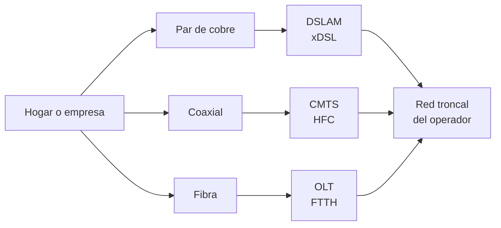

# 8. Modos de transmisión y última milla

> [!info] Al terminar este capítulo tenés que poder
> - Distinguir simplex, semi-dúplex y dúplex.
> - Diferenciar transmisión serie/paralela y síncrona/asíncrona.
> - Explicar xDSL, HFC y FTTH.
> - Justificar una tecnología de última milla.

> [!abstract] Qué debés saber (nivel 1)
> - **Simplex:** un solo sentido. **Semi-dúplex:** alternan. **Dúplex:** simultáneo.
> - **Serie:** un bit por vez. **Paralela:** varios a la vez, corta distancia.
> - **Síncrona:** reloj compartido. **Asíncrona:** carácter por carácter con bits de inicio/fin.
> - **Última milla:** tramo entre el usuario y el operador.
> - Tecnologías: **xDSL**, **HFC**, **FTTH**, inalámbrica, satelital.

## 8.1 Modos de transmisión

| Modo | Sentido | Ejemplo |
|---|---|---|
| **Simplex** | Siempre uno transmite | Radio, TV |
| **Semi-dúplex** | Alternan en el tiempo | Radioaficionados, walkie-talkie |
| **Dúplex (full)** | Simultáneo en ambos sentidos | Teléfono, Ethernet conmutada |

> [!important] Detalle de la cátedra
> En **full-dúplex digital** se usan **dos pares trenzados** (uno por sentido). En **analógico inalámbrico**, **dos frecuencias**. En **analógico alámbrico**, un solo camino físico con separación por frecuencia.

### Serie vs. paralela

| | Serie | Paralela |
|---|---|---|
| Bits | Uno por vez | Varios a la vez |
| Distancia | Larga | Corta |
| Costo | Bajo | Alto (más hilos) |
| Ejemplo | USB, Ethernet | Bus de datos interno |

### Síncrona vs. asíncrona

| | Síncrona | Asíncrona |
|---|---|---|
| Reloj | Compartido | No compartido |
| Unidad | Bloque/trama | Carácter |
| Delimitación | Patrón de sincronismo | Bit de inicio y fin |
| Eficiencia | Mayor | Menor (overhead) |
| Ejemplo | HDLC, Ethernet | RS-232 |

> [!warning] “Asíncrona” no significa “sin tiempo”
> Significa que **no comparte un reloj**: cada carácter se enmarca con bits de inicio y parada.

### Banda base y banda ancha

| | Banda base | Banda ancha |
|---|---|---|
| Qué transporta | Una sola señal digital, sin portadora | Varias portadoras en bandas distintas |
| Espectro | Ocupa el medio desde 0 Hz | Se divide en canales |
| Multiplexación | Por tiempo (TDM) | Por frecuencia (FDM) |
| Ejemplo | Ethernet de cobre, USB | Cablemódem (HFC), ADSL, TV por cable |

> [!important] La trampa
> “Banda ancha” en el lenguaje comercial significa “conexión rápida”; en el técnico, significa **varias bandas de frecuencia** sobre el mismo medio. Ethernet clásico es banda base aunque vaya a 1 Gbps.

### Enlaces y caminos

| Tipo | Qué es | Ejemplo |
|---|---|---|
| **Punto a punto** | Dos extremos con enlace dedicado o lógico | Serial entre dos routers |
| **Multipunto** | Varios dispositivos comparten el mismo medio | Wi-Fi, bus coaxial |
| **Camino indirecto** | La señal pasa por nodos intermedios obligatorios | Varios switches en serie |
| **Con alternativas** | Hay rutas redundantes ante falla o congestión | Malla, OSPF |

## 8.2 Qué es la última milla

> [!quote] Cátedra
> **Última milla o bucle de abonado:** fracción de una red de comunicaciones que enlaza a los usuarios finales con los operadores de telecomunicaciones.

Es el tramo más caro y difícil: llega a cada casa o empresa.

## 8.3 Tecnologías

### xDSL (sobre par telefónico)

| Variante | Velocidad típica | Distancia |
|---|---|---|
| ADSL | Hasta 8/1 Mbps | ~3 km |
| ADSL2+ | Hasta 24/1 Mbps | ~1,5 km |
| VDSL | Hasta 100 Mbps | ~500 m |

- Usa el par de cobre existente.
- La velocidad **baja** con la distancia.
- Requiere **módem DSL** y un **splitter** (voz/datos).

### HFC (híbrido fibra-coaxial)

- Fibra hasta el nodo; coaxial hasta el hogar.
- Requiere **módem de cable** (CM) y **CMTS** en la cabecera.
- Comparte el canal con los vecinos del nodo.

### FTTH (fibra hasta el hogar)

| Variante | Detalle |
|---|---|
| **GPON** | Fibra compartida con splitter óptico |
| **Punto a punto** | Fibra dedicada |

- Mayor capacidad y simetría.
- Requiere **ONT** en el hogar.
- Costo de despliegue alto.

### Inalámbrica y satelital

| Tecnología | Uso | Limitación |
|---|---|---|
| LTE/5G | Móvil y fija inalámbrica | Cobertura y espectro |
| Wi-Fi municipal | Zonas acotadas | Alcance |
| Satelital | Zonas remotas | Latencia y costo |

### Los tres caminos hasta el hogar

> [!important] Qué cambia en cada camino
> xDSL reutiliza el cobre telefónico; HFC comparte el coaxial del nodo; FTTH lleva fibra hasta la ONT del domicilio. A más fibra, más capacidad y simetría, y más costo de despliegue.

## 8.4 Comparación

| Tecnología | Medio | Velocidad | Latencia | Costo |
|---|---|---|---|---|
| xDSL | Cobre | Media | Baja | Bajo |
| HFC | Fibra + coaxial | Alta | Baja | Medio |
| FTTH | Fibra | Muy alta | Muy baja | Alto |
| 5G FWA | Radio | Alta | Media | Medio |
| Satélite | Radio | Media | **Alta** | Alto |

> [!important] La pregunta de oral
> “¿Por qué la última milla es un problema?” → Porque llega a cada domicilio, requiere obra civil, y las tecnologías tienen límites de distancia, compartición y costo.

## 8.5 Método: elegir tecnología de última milla

| Paso | Pregunta | Decisión |
|---|---|---|
| 1 | ¿Hay cobre desplegado? | xDSL como opción rápida |
| 2 | ¿Hay coaxial de TV? | HFC |
| 3 | ¿Se requiere simetría y alta capacidad? | FTTH |
| 4 | ¿Zona rural sin infraestructura? | Inalámbrica o satelital |
| 5 | ¿Presupuesto y plazo? | Comparar costo por abonado |

## Errores que suelen tomar

| Error | Corrección |
|---|---|
| Decir que ADSL es simétrico | Es asimétrico (más bajada que subida) |
| Confundir HFC con FTTH | HFC conserva coaxial en el último tramo |
| “La fibra no tiene límite de distancia” | Tiene límites ópticos; se usan repetidores/amplificadores |
| Confundir módem con router | El módem convierte la señal; el router enruta |
| Ignorar la compartición en HFC | El nodo se reparte entre vecinos |
| Creer que el satélite es de baja latencia | Es alta (órbita) |

## Ejercicios

> [!example]- 1. Modo
> **Enunciado:** una videollamada, ¿qué modo usa?
> **Solución:** full-dúplex (audio y video en ambos sentidos).

> [!example]- 2. Serie/paralela
> **Enunciado:** ¿por qué la paralela no se usa en larga distancia?
> **Solución:** por desincronización entre hilos y costo del cableado.

> [!example]- 3. xDSL
> **Enunciado:** ¿por qué la velocidad baja con la distancia?
> **Solución:** por atenuación y ruido en el par de cobre.

> [!example]- 4. FTTH
> **Enunciado:** ¿qué equipo se instala en el hogar?
> **Solución:** la ONT (terminación de red óptica).

> [!example]- 5. a papel
> **Enunciado:** compará xDSL, HFC y FTTH en velocidad y costo.
> **Solución:** ver 8.4.

## Lo que sigue

[[cm_Cierre_parte2|Cierre de la Parte 2]].

#libro4 #ultima-milla
