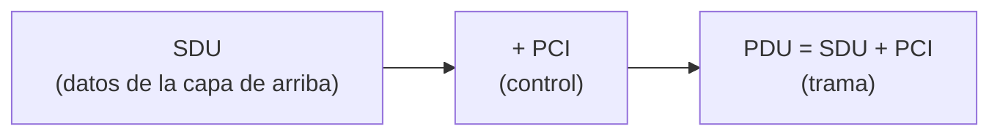
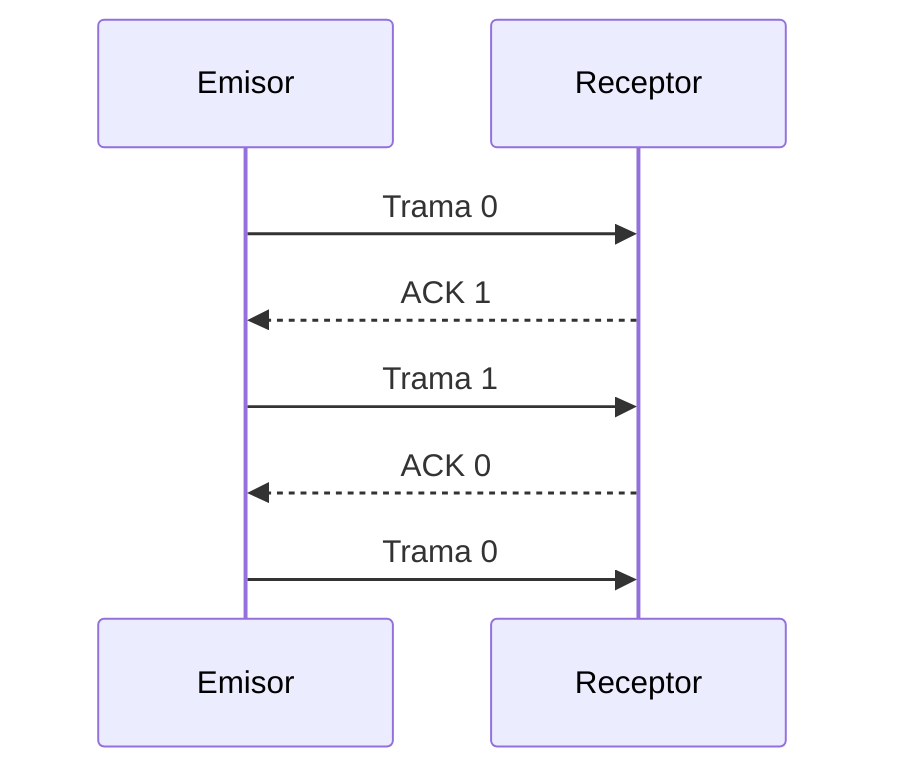

# 9. Nivel 2: funciones, PDU y entramado

> [!info] Al terminar este capítulo tenés que poder
> - Enumerar las funciones de la capa de enlace.
> - Explicar PDU, SDU y PCI.
> - Describir el entramado y el relleno de bits.
> - Diferenciar detección de corrección de errores.

> [!abstract] Qué debés saber (nivel 1)
> - Capa 2 transmite **tramas** entre nodos **adyacentes**.
> - Funciones: entramado, direccionamiento, control de errores, control de flujo, acceso al medio.
> - **PDU = SDU + PCI**.
> - Entramado por: contador, carácter, bit.
> - Detección: paridad, checksum, CRC. Corrección: FEC o retransmisión (ARQ).
> - ARQ: stop-and-wait, go-back-N, selective repeat.

## 9.1 Funciones de la capa de enlace

| Función | Qué hace |
|---|---|
| **Entramado** | Delimita el inicio y fin de cada trama |
| **Direccionamiento** | Usa direcciones físicas (MAC) |
| **Control de errores** | Detecta y, a veces, corrige |
| **Control de flujo** | Evita que el receptor se sature |
| **Control de acceso al medio** | Decide quién transmite en un medio compartido |
| **Segmentación** | Divide bloques grandes en unidades manejables |

> [!important] Alcance
> La capa 2 comunica **nodos vecinos** (salto a salto), no extremos. El extremo a extremo es capa 4.

## 9.2 PDU, SDU y PCI



| Concepto | Definición |
|---|---|
| **SDU** | Unidad de datos del servicio; los datos del usuario |
| **PCI** | Información de control del protocolo |
| **PDU** | Unidad de datos del protocolo: SDU + PCI |

> [!quote] Cátedra
> **Encapsulado:** incorporación de información de control (direcciones, tipo de trama, control de flujo y detección de errores).

## 9.3 Entramado

| Método | Cómo | Riesgo |
|---|---|---|
| **Contador de caracteres** | Un campo indica la longitud | Un error arruina todo el sincronismo |
| **Carácter de inicio/fin** | Delimitadores (p. ej. DLE STX / DLE ETX) | El delimitador puede aparecer en los datos → *byte stuffing* |
| **Bit de inicio/fin** | Bandera `01111110` | Puede aparecer en los datos → *bit stuffing* |

### Relleno de bits (bit stuffing)

Cuando el emisor encuentra **cinco 1 consecutivos** en los datos, inserta un 0. El receptor lo quita.

```text
Datos:      0 1 1 1 1 1 1 0
Con stuffing: 0 1 1 1 1 1 0 1 0
```

> [!important] Por qué se hace
> Para que la bandera `01111110` **nunca** aparezca dentro de los datos y el receptor no confunda el fin de trama.

## 9.4 Detección de errores

| Técnica | Detecta | Fuerza |
|---|---|---|
| **Paridad simple** | Número impar de bits erróneos | Baja |
| **Paridad vertical (VRC)** | Por carácter | Baja |
| **Paridad longitudinal (LRC)** | Por bloque | Media |
| **Checksum** | Suma de campos | Media |
| **CRC** | Polinomio generador | **Alta** |

> [!quote] Pregunta típica de UTN
> “Control de paridad vertical y longitudinal.” → VRC agrega un bit por carácter; LRC agrega un carácter de paridad al final del bloque. Se usan juntos para mejorar la detección.

### CRC

El emisor divide los datos por un polinomio y agrega el resto (FCS). El receptor repite la división: si el resto no es cero, hay error.

> [!warning] Detectar no es corregir
> La mayoría de las LAN **detectan** y **descartan** la trama; la retransmisión la hace una capa superior (TCP) o un ARQ.

## 9.5 Control de flujo y ARQ

| Técnica | Idea | Eficiencia |
|---|---|---|
| **Stop-and-wait** | Envía 1 y espera ACK | Baja |
| **Go-back-N** | Envía N; si falla una, retransmite desde ella | Media |
| **Selective repeat** | Retransmite solo la fallida | Alta |



> [!important] Ventana
> La **ventana** limita cuántas tramas puede tener sin confirmar. Es control de flujo y de errores a la vez.

## 9.6 Método: analizar una trama

| Paso | Pregunta |
|---|---|
| 1 | ¿Cómo se delimita? (bandera o contador) |
| 2 | ¿Qué dirección lleva? |
| 3 | ¿Qué control de errores usa? (CRC) |
| 4 | ¿Qué control de flujo? (ventana) |
| 5 | ¿Qué acceso al medio? (CSMA/CD, CSMA/CA) |

## Errores que suelen tomar

| Error | Corrección |
|---|---|
| Confundir PDU con SDU | PDU = SDU + PCI |
| Decir que capa 2 comunica extremos | Comunica vecinos |
| “CRC corrige errores” | Detecta; para corregir se retransmite |
| Bit stuffing con bytes | Es con bits; byte stuffing con caracteres |
| Confundir control de flujo con acceso al medio | Uno regula al receptor; el otro, el canal |
| Creer que paridad detecta todo | Solo impares simples |

## Ejercicios

> [!example]- 1. PDU
> **Enunciado:** ¿qué es la PCI?
> **Solución:** la información de control del protocolo que se agrega a la SDU.

> [!example]- 2. Stuffing
> **Enunciado:** ¿cuándo se inserta un 0?
> **Solución:** tras cinco 1 consecutivos en los datos.

> [!example]- 3. Errores
> **Enunciado:** ¿qué técnica usa Ethernet para detectar errores?
> **Solución:** CRC de 32 bits (FCS).

> [!example]- 4. ARQ
> **Enunciado:** ¿qué ARQ retransmite solo la trama perdida?
> **Solución:** selective repeat.

> [!example]- 5. a papel
> **Enunciado:** dibujá una trama genérica de capa 2 con sus campos.
> **Solución:** bandera | dirección | control | datos | FCS | bandera.

## Lo que sigue

[[cm10_protocolos-bit|Protocolos orientados al bit: HDLC y PPP]].

#libro4 #enlace
