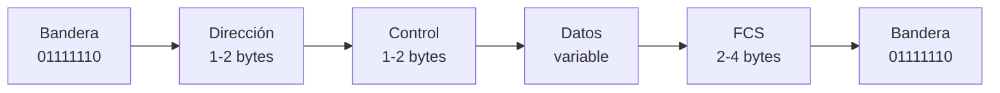

# 10. Protocolos orientados al bit: HDLC y PPP

> [!info] Al terminar este capítulo tenés que poder
> - Explicar qué es un protocolo orientado al bit.
> - Dibujar la trama HDLC y explicar sus campos.
> - Diferenciar HDLC de PPP.
> - Explicar el papel de LCP y NCP.

> [!abstract] Qué debés saber (nivel 1)
> - **Orientado al bit:** no depende de códigos de carácter; usa una bandera binaria.
> - **HDLC:** bandera `01111110`, relleno de bits, CRC, control de flujo y errores.
> - Campos: bandera, dirección, control, datos, FCS, bandera.
> - **PPP:** enlace punto a punto; encapsula IP; LCP negocia, NCP configura.
> - PPP **no** corrige errores: descarta y deja la retransmisión a capas superiores.

## 10.1 Qué significa “orientado al bit”

El protocolo no interpreta caracteres: trata la trama como una secuencia de bits y usa una **bandera** para delimitar.

| Concepto | Detalle |
|---|---|
| Bandera | `01111110` |
| Transparencia | Relleno de bits (tras cinco 1) |
| Detección | FCS (CRC) |
| Control | Ventana deslizante |

> [!important] Por qué es “orientado al bit”
> Porque puede transportar **cualquier** combinación de bits, sin depender de un código de caracteres como ASCII. Eso lo hace apto para datos binarios.

## 10.2 Trama HDLC

| Campo | Función |
|---|---|
| **Bandera** | Inicio y fin de trama |
| **Dirección** | Estación secundaria (en configuración normal) |
| **Control** | Tipo de trama, secuencia, ACK, ventana |
| **Datos** | Información |
| **FCS** | CRC para detección |

### Tipos de trama

| Tipo | Nombre | Uso |
|---|---|---|
| **I** | Información | Datos con numeración |
| **S** | Supervisión | ACK, NAK, control de flujo |
| **U** | No numerada | Control, conexión, desconexión |

### Modos de operación

| Modo | Significado |
|---|---|
| **NRM** | Normal: primaria y secundarias |
| **ABM** | Balanceado asíncrono: ambos pueden iniciar |
| **ARM** | Balanceado asíncrono con respuesta |

> [!tip] La pregunta de oral
> “HDLC es un protocolo de propósito general de capa 2 que ofrece recuperación de errores y comunicación confiable, orientado al bit, con bandera y relleno de bits.”

## 10.3 PPP

**PPP** (*Point-to-Point Protocol*) se usa en enlaces dedicados: acceso telefónico, DSL, túneles.

| Componente | Función |
|---|---|
| **Encapsulamiento** | Mete el paquete en una trama PPP |
| **LCP** | Negocia opciones del enlace (MTU, compresión, autenticación) |
| **NCP** | Configura el protocolo de red (por ejemplo, IPCP para IP) |
| **Autenticación** | PAP (texto) o CHAP (desafío) |

### Trama PPP

| Campo | Detalle |
|---|---|
| Bandera | `01111110` |
| Dirección | `11111111` (constante) |
| Control | `00000011` (constante) |
| Protocolo | Indica qué transporte (IP, IPv6, LCP) |
| Datos | Payload |
| FCS | CRC |

> [!warning] PPP no corrige errores
> Detecta con FCS y **descarta** la trama. La retransmisión la hace TCP o la aplicación. Es una diferencia clave con HDLC, que sí puede recuperar.

## 10.4 Comparación

| Aspecto | HDLC | PPP |
|---|---|---|
| Delimitación | Bandera + bit stuffing | Bandera + bit stuffing |
| Detección | FCS | FCS |
| Corrección | Sí (ARQ) | **No** |
| Autenticación | No estándar | PAP/CHAP |
| Negociación | Limitada | LCP/NCP |
| Uso típico | Enlaces WAN dedicados | Acceso a Internet, túneles |

> [!important] La frase que distingue
> “HDLC es confiable y orientado a la conexión; PPP es simple, autentica y encapsula, pero delega la confiabilidad a las capas superiores.”

## 10.5 Método: leer una trama HDLC/PPP

| Paso | Pregunta |
|---|---|
| 1 | ¿Dónde empieza y termina? (bandera) |
| 2 | ¿Hay bits rellenados? (quitar tras cinco 1) |
| 3 | ¿Qué tipo de trama es? (I/S/U en HDLC) |
| 4 | ¿Qué protocolo transporta? (PPP) |
| 5 | ¿El FCS es correcto? |

## Errores que suelen tomar

| Error | Corrección |
|---|---|
| Decir que HDLC es orientado al carácter | Es orientado al bit |
| Confundir bandera con delimitador de carácter | La bandera es binaria |
| “PPP corrige errores” | Solo detecta y descarta |
| Confundir LCP con NCP | LCP negocia el enlace; NCP configura la red |
| Decir que PPP es solo para dial-up | También DSL, VPN y túneles |
| Olvidar el bit stuffing | Es lo que da transparencia |

## Ejercicios

> [!example]- 1. Bandera
> **Enunciado:** ¿qué secuencia delimita una trama HDLC?
> **Solución:** `01111110`.

> [!example]- 2. Stuffing
> **Enunciado:** datos `01111110`. ¿Qué hace el emisor?
> **Solución:** inserta un 0 tras los cinco 1 para que no parezca bandera.

> [!example]- 3. Trama
> **Enunciado:** ¿qué campo indica el tipo y la secuencia?
> **Solución:** control.

> [!example]- 4. PPP
> **Enunciado:** ¿qué protocolo negocia la autenticación?
> **Solución:** LCP (y PAP/CHAP como métodos).

> [!example]- 5. a papel
> **Enunciado:** dibujá la trama HDLC con sus seis campos.
> **Solución:** ver 10.2.

## Lo que sigue

[[cm11_llc-mac-802|Subcapas LLC/MAC e IEEE 802.x]].

#libro4 #hdlc #ppp
