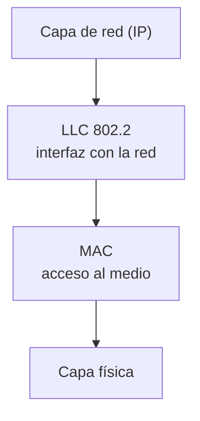
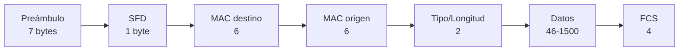
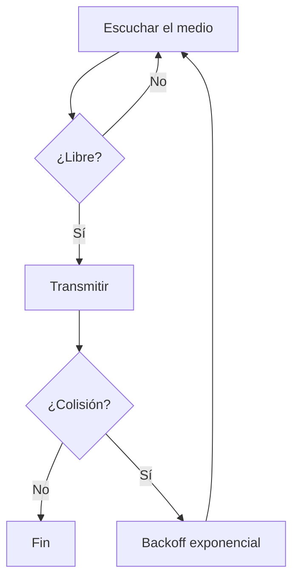

# 11. Subcapas LLC/MAC e IEEE 802.x

> [!info] Al terminar este capítulo tenés que poder
> - Explicar por qué la capa 2 se divide en LLC y MAC.
> - Describir una dirección MAC.
> - Dibujar la trama Ethernet y calcular su tamaño.
> - Explicar CSMA/CD y CSMA/CA.

> [!abstract] Qué debés saber (nivel 1)
> - **LLC (802.2):** relación con la capa de red; independiente del medio.
> - **MAC:** direccionamiento físico, entramado, CRC y acceso al medio.
> - MAC: **48 bits**, única, con OUI del fabricante.
> - Ethernet: trama de **64 a 1518 bytes** (sin VLAN).
> - **CSMA/CD:** escucha, transmite, detecta colisión, retrocede.
> - **CSMA/CA:** evita colisiones (Wi-Fi).

## 11.1 Por qué dos subcapas

| Subcapa | Función | Ventaja |
|---|---|---|
| **LLC** | Multiplexa protocolos de red, control de errores y flujo | Independiza del medio |
| **MAC** | Dirección, entramado, CRC, acceso | Adapta a cada tecnología |

> [!important] La razón de ser
> LLC permite que IP use Ethernet, Wi-Fi o Token Ring **sin cambiar** la capa de red. MAC resuelve lo específico de cada medio.

## 11.2 Dirección MAC

| Característica | Detalle |
|---|---|
| Tamaño | 48 bits (6 bytes) |
| Formato | `AA:BB:CC:DD:EE:FF` |
| Primeros 24 bits | OUI (fabricante) |
| Últimos 24 bits | Serie del fabricante |
| Tipos | Unicast, multicast, broadcast (`FF:FF:FF:FF:FF:FF`) |

> [!warning] La MAC no es jerárquica
> No indica ubicación ni red. Por eso no se enruta: solo sirve dentro del segmento local.

## 11.3 Trama Ethernet (802.3)

| Campo | Tamaño | Función |
|---|---|---|
| Preámbulo | 7 bytes | Sincronismo |
| SFD | 1 byte | Inicio de trama |
| MAC destino | 6 | Dirección de destino |
| MAC origen | 6 | Dirección de origen |
| Tipo/Longitud | 2 | Protocolo o longitud |
| Datos | 46–1500 | Payload |
| FCS | 4 | CRC |

### Tamaños

| Concepto | Valor |
|---|---|
| Trama mínima | **64 bytes** (sin preámbulo) |
| Trama máxima | **1518 bytes** (sin VLAN) |
| Con VLAN (802.1Q) | 1522 bytes |

> [!important] Por qué 64 bytes mínimo
> Para que la colisión se detecte antes de que el emisor termine de transmitir. Si la trama fuera más corta, podría terminar sin detectar la colisión.

### Relleno (padding)

Si los datos son menores a 46 bytes, se rellena. De ahí sale el mínimo de 64.

## 11.4 CSMA/CD

| Paso | Detalle |
|---|---|
| 1 | Escuchar (carrier sense) |
| 2 | Si está libre, transmitir |
| 3 | Detectar colisión mientras transmite |
| 4 | Detener, enviar jam |
| 5 | Esperar un tiempo aleatorio (backoff) |
| 6 | Reintentar |

> [!warning] CSMA/CD está en desuso
> Con switches y full-dúplex no hay colisiones. Se estudia por el examen y por la historia de Ethernet.

## 11.5 CSMA/CA (Wi-Fi)

| Diferencia | CSMA/CD | CSMA/CA |
|---|---|---|
| Detección | Detecta colisión | **Evita** colisión |
| Medio | Cable | Aire |
| Confirmación | No necesaria (full-duplex) | ACK por trama |
| Problema | — | Nodo oculto |

> [!important] Por qué no se puede detectar en Wi-Fi
> El equipo no puede escuchar mientras transmite (la señal propia es mucho más fuerte). Por eso se **evita**: espera aleatoria, ACK y, opcionalmente, RTS/CTS.

### 802.11: conceptos

| Concepto | Significado |
|---|---|
| **BSS** | Celda básica (un AP) |
| **ESS** | Varias BSS con el mismo SSID |
| **SSID** | Nombre de la red |
| **AP** | Punto de acceso |
| **Nodo oculto** | Dos hosts que no se oyen entre sí |

## 11.6 Otros estándares 802

| Estándar | Tema |
|---|---|
| 802.1 | Arquitectura, bridging, STP y administración de LAN/MAN |
| 802.1Q | VLAN: etiqueta de 4 bytes que viaja en el trunk |
| 802.2 | LLC: subcapa lógica del enlace |
| 802.3 | Ethernet (802.3u Fast, 802.3ab Gigabit, 802.3ae 10G) |
| 802.3af/at | PoE: alimentación por el mismo cable de datos |
| 802.5 | Token Ring (histórico) |
| 802.11 | Wi-Fi (a/b/g/n/ac/ax/be) |
| 802.15 | Bluetooth y otras WPAN |
| 802.16 | WiMAX (acceso metropolitano) |

> [!tip] VLAN en una frase
> “802.1Q agrega una etiqueta a la trama para separar dominios de broadcast de forma lógica, sin cambiar el cableado.”

### Bucles de capa 2: STP

> [!important] El problema que resuelve
> Dos switches unidos por dos cables forman un **bucle**: una trama de broadcast gira para siempre y satura la LAN (tormenta de broadcast). **STP (802.1D)** elige un switch raíz, bloquea los puertos redundantes y los habilita si el enlace activo falla. **RSTP (802.1w)** converge en segundos.

> [!tip] Trunk
> Un **trunk** es un enlace que transporta varias VLAN a la vez, etiquetadas con 802.1Q. Sin trunk, cada VLAN necesitaría su propio cable entre switches.

## 11.7 Método: leer una trama Ethernet

| Paso | Pregunta |
|---|---|
| 1 | ¿A quién va dirigida? (MAC destino) |
| 2 | ¿Quién la envía? (MAC origen) |
| 3 | ¿Qué protocolo transporta? (tipo) |
| 4 | ¿El tamaño es válido? (64–1518) |
| 5 | ¿El FCS es correcto? |

## Errores que suelen tomar

| Error | Corrección |
|---|---|
| “MAC es de 32 bits” | 48 bits |
| “La MAC se enruta” | Solo se conmuta en el segmento |
| Confundir LLC con MAC | LLC con la red; MAC con el medio |
| “Ethernet mínimo 46 bytes” | La trama mínima es 64 (datos 46) |
| CSMA/CA detecta colisiones | Las evita |
| Creer que el switch usa CSMA/CD | Con full-dúplex no hay colisiones |

## Ejercicios

> [!example]- 1. MAC
> **Enunciado:** ¿cuántos bits tiene una MAC y qué indica el prefijo?
> **Solución:** 48 bits; el prefijo OUI identifica al fabricante.

> [!example]- 2. Trama
> **Enunciado:** ¿cuál es el tamaño mínimo de una trama Ethernet sin VLAN?
> **Solución:** 64 bytes.

> [!example]- 3. Subcapas
> **Enunciado:** ¿qué subcapa agrega el CRC?
> **Solución:** MAC.

> [!example]- 4. Acceso
> **Enunciado:** ¿por qué Wi-Fi usa CSMA/CA?
> **Solución:** porque no puede detectar colisiones mientras transmite; las evita con espera y ACK.

> [!example]- 5. a papel
> **Enunciado:** dibujá la trama Ethernet con tamaños.
> **Solución:** ver 11.3.

## Lo que sigue

[[cm_Cierre_parte3|Cierre de la Parte 3]].

#libro4 #ethernet #802
