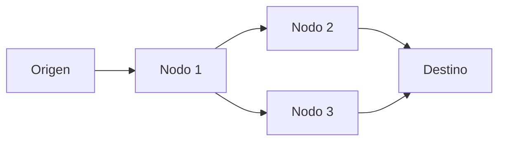
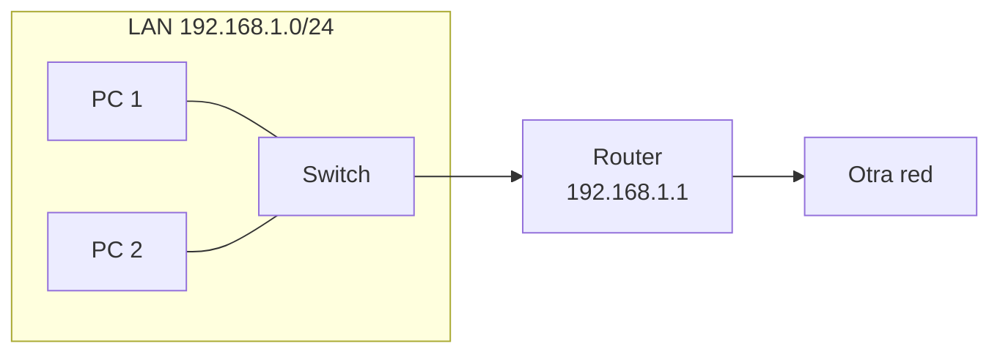
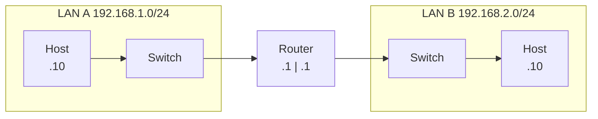

# 12. Redes, conmutación y topologías

> [!info] Al terminar este capítulo tenés que poder
> - Distinguir red de difusión de red conmutada.
> - Comparar conmutación de circuitos y de paquetes.
> - Describir topologías físicas y lógicas.
> - Clasificar redes por alcance.

> [!abstract] Qué debés saber (nivel 1)
> - **Red:** dispositivos vinculados por un medio para compartir recursos.
> - **Difusión:** todos comparten el medio y ven la información.
> - **Conmutada:** nodos interconectados que encaminan.
> - **Circuitos:** camino exclusivo durante la comunicación.
> - **Paquetes:** la información se divide y se encamina por separado.
> - Topologías: bus, estrella, anillo, malla, árbol.

## 12.1 Qué es una red

> [!quote] Cátedra
> **Red de comunicaciones:** grupo de dispositivos informáticos vinculados mediante cualquier medio de transmisión, guiado o no guiado, por donde circulan señales que transportan información para compartir recursos y servicios.

| Clasificación | Característica |
|---|---|
| **Red de difusión** | Todas las terminales comparten el medio; lo enviado es visto por las demás |
| **Red conmutada** | Nodos interconectados que encaminan la información entre origen y destino |

## 12.2 Conmutación

| Técnica | Cómo | Ventaja | Desventaja |
|---|---|---|---|
| **Circuitos** | Se reserva un camino físico exclusivo | Retardo constante | Desperdicia capacidad si no se usa |
| **Paquetes** | Se divide en paquetes con cabecera | Uso eficiente del enlace | Retardo variable y posible pérdida |
| **Mensajes** | Se envía el mensaje completo por nodos | Simple | Bloquea nodos |

### Datagrama vs. circuito virtual

| | Datagrama | Circuito virtual |
|---|---|---|
| Ruta | Cada paquete puede ir por distinto camino | Se establece una ruta |
| Orden | Puede llegar desordenado | Se mantiene |
| Ejemplo | IP | MPLS, Frame Relay |

> [!important] La idea
> En conmutación de paquetes, los nodos **almacenan y reenvían**. Cada paquete decide su salida según la tabla de reenvío.

## 12.3 Topologías

| Topología | Ventaja | Desventaja |
|---|---|---|
| **Bus** | Barata, simple | Una falla corta todo; colisiones |
| **Estrella** | Fácil de administrar | Depende del nodo central |
| **Anillo** | Orden y turno | Una falla puede cortar el anillo |
| **Malla** | Redundancia alta | Costo de enlaces |
| **Árbol** | Escalable | Depende de la raíz |
| **Doble anillo** | Si se corta un anillo, el otro sigue | Más cableado y costo |
| **Celular** | Movilidad y cobertura geográfica | Planificación de canales y handover |

### Física vs. lógica

| | Física | Lógica |
|---|---|---|
| Qué describe | Cómo se tienden los cables | Cómo circula la información |
| Ejemplo | Estrella con switch | Lógica de bus en un hub |

> [!important] La trampa
> Una red **físicamente en estrella** con un hub es **lógicamente un bus** (todos comparten el medio). Con un switch, la lógica es conmutada.

## 12.4 Clasificación por alcance

| Tipo | Alcance | Ejemplo |
|---|---|---|
| **PAN** | Metros | Bluetooth |
| **LAN** | Edificio/campus | Ethernet, Wi-Fi |
| **MAN** | Ciudad | Metro Ethernet |
| **WAN** | País/continente | MPLS, Internet |

## 12.5 Redes de área local (LAN)

> [!quote] Cátedra
> **LAN (red de área local):** red que cubre un área geográfica limitada —un edificio o un campus—, con alta velocidad, propiedad de la organización y medios normalmente guiados, aunque puede incluir tramos inalámbricos.

### Componentes

| Componente | Función |
|---|---|
| **Terminal** | PC, cámara, semáforo, impresora: origen o destino |
| **NIC** | Interfaz de red; tiene la dirección MAC |
| **Switch** | Conecta terminales y conmuta por MAC |
| **AP** | Une el tramo inalámbrico con el cableado |
| **Router** | Conecta la LAN con otras redes |
| **Cableado** | UTP/STP o fibra; el medio físico |

### Cableado estructurado

| Tramo | Qué une | Medio típico |
|---|---|---|
| **Horizontal** | Puesto ↔ cuarto de comunicaciones | UTP Cat 5e/6 (≤ 90 m + 10 m de patch) |
| **Vertical (backbone)** | Cuartos ↔ sala principal | Fibra o UTP de categoría alta |
| **Acceso** | Sala principal ↔ router/ISP | Fibra |

> [!tip] La regla de los 100 m
> El canal horizontal completo (puesto + patch + patch) no debe superar los **100 m**. Si hace falta más, se intercala un switch o se pasa a fibra.

### Dominios y segmentación

| Concepto | Lo delimita | Efecto |
|---|---|---|
| **Dominio de colisión** | Cada puerto del switch | Menos colisiones; full-dúplex las elimina |
| **Dominio de broadcast** | Router o VLAN | Acota el tráfico de difusión |
| **VLAN** | Configuración del switch (802.1Q) | Separa broadcast sin cambiar el cableado |
| **Bucle de capa 2** | STP/RSTP (802.1D/802.1w) | Bloquea el enlace redundante y evita la tormenta |

> [!important] La LAN no es solo “el cable”
> Es el conjunto de terminales, conmutación y direccionamiento de un mismo dominio. Dos equipos en la misma VLAN se ven por MAC; para salir de la VLAN necesitan un router.

### LAN inalámbrica

| Concepto | Significado |
|---|---|
| **BSS** | Celda de un punto de acceso |
| **ESS** | Varias BSS con el mismo SSID |
| **SSID** | Nombre de la red |
| **Roaming** | Paso de una BSS a otra sin cortar |

> [!warning] Wi-Fi comparte el medio
> Todos los clientes de una celda compiten por el mismo canal. Agregar AP no siempre suma capacidad: hay que planificar canales y potencia.

## 12.6 Interconexión de redes

Interconectar es unir dos redes que **no** comparten dominio. El dispositivo que lo hace en capa 3 es el router: tiene una interfaz (y una dirección) en cada red.

| Mecanismo | Qué resuelve |
|---|---|
| **Ruteo** | Decide por qué interfaz sale un paquete |
| **ARP** | Traduce IP a MAC en cada tramo |
| **NAT/PAT** | Traduce direcciones privadas a una pública |
| **Subinterfaces** | Varias VLAN por un solo puerto físico (router-on-a-stick) |
| **MTU y fragmentación** | Ajusta el tamaño cuando cambia el medio |

> [!important] Lo que cambia y lo que no
> La **IP** se mantiene de extremo a extremo; la **MAC** cambia en cada salto. El router descarta la trama recibida, decide la ruta y arma una trama nueva con la MAC del siguiente salto.

### Redes TCP/IP

La interconexión se apoya en la arquitectura del capítulo 3: IP direcciona y enruta, TCP o UDP transportan, y las aplicaciones usan puertos. Una LAN es un tramo de esa arquitectura; una WAN es la unión de muchos tramos.

| Pieza | Dónde vive | Qué aporta |
|---|---|---|
| IP | Capa 3 | Dirección lógica y ruta |
| TCP/UDP | Capa 4 | Extremo a extremo |
| Ethernet/Wi-Fi | Capas 1-2 | Transporte en cada tramo |
| DNS/DHCP | Aplicación | Nombres y configuración |

## 12.7 Dispositivos de interconexión

| Dispositivo | Capa | Función |
|---|---|---|
| Hub | 1 | Repite a todos |
| Switch | 2 | Conmuta por MAC |
| Router | 3 | Enruta por IP |
| Firewall | 3-7 | Filtra por reglas |
| AP | 2 | Une Wi-Fi y cable |

> [!tip] Segmentar mejora el rendimiento
> Un switch crea un **dominio de colisión** por puerto; un router crea un **dominio de broadcast** por interfaz. Una VLAN separa broadcast sin router.

## 12.8 Método: describir una red

| Paso | Pregunta |
|---|---|
| 1 | ¿Qué alcance tiene? (LAN/WAN) |
| 2 | ¿Qué topología física y lógica? |
| 3 | ¿Cómo conmuta? (circuitos/paquetes) |
| 4 | ¿Qué dispositivos la componen? |
| 5 | ¿Cómo se segmenta? (switch/VLAN/router) |

## Errores que suelen tomar

| Error | Corrección |
|---|---|
| Confundir topología física con lógica | Son planos distintos |
| “El router conmuta por MAC” | Enruta por IP |
| “La conmutación de circuitos es más eficiente” | Reserva capacidad; puede desperdiciarla |
| Decir que una LAN es WAN | El alcance las distingue |
| Creer que un hub segmenta | Repite; no segmenta |
| Olvidar el dominio de broadcast | Lo separa el router o la VLAN |

## Ejercicios

> [!example]- 1. Clasificar
> **Enunciado:** Internet, ¿difusión o conmutada?
> **Solución:** conmutada (paquetes).

> [!example]- 2. Conmutación
> **Enunciado:** ¿qué técnica reserva un camino exclusivo?
> **Solución:** conmutación de circuitos.

> [!example]- 3. Topología
> **Enunciado:** una oficina con switch central, ¿qué topología física y lógica?
> **Solución:** física en estrella; lógica conmutada.

> [!example]- 4. Dominio
> **Enunciado:** ¿qué separa un dominio de broadcast?
> **Solución:** un router o una VLAN.

> [!example]- 5. a papel
> **Enunciado:** dibujá una LAN en estrella con switch, router y firewall.
> **Solución:** PCs → switch → router → firewall → WAN.

## Lo que sigue

[[cm13_direccionamiento-ip|Direccionamiento IP y subnetting]].

#libro4 #redes
