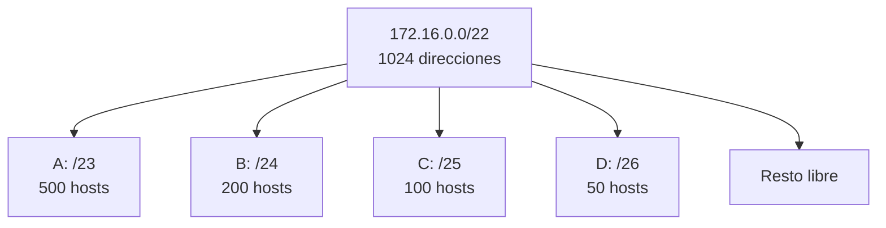

# 13. Direccionamiento IP y subnetting

> [!info] Al terminar este capítulo tenés que poder
> - Clasificar una IPv4 y decir si es pública o privada.
> - Calcular red, broadcast y rango de hosts a partir de IP + máscara.
> - Hacer subnetting clásico y VLSM paso a paso.
> - Explicar CIDR y dar una IPv6 válida.

> [!abstract] Qué debés saber (nivel 1)
> - IPv4: **32 bits**, cuatro octetos. Clases A/B/C/D/E.
> - **Privadas:** `10.0.0.0/8`, `172.16.0.0/12`, `192.168.0.0/16`. Loopback `127.0.0.0/8`. APIPA `169.254.0.0/16`.
> - **Máscara:** marca cuántos bits son red. `/n` = n bits en 1.
> - `hosts = 2^h − 2` (se restan red y broadcast).
> - **CIDR:** notación `/n` que reemplaza las clases.
> - **VLSM:** máscaras de distinto tamaño según la necesidad de cada subred.
> - IPv6: **128 bits**, hexadecimal, sin broadcast.

## 13.1 Estructura de una IPv4

```text
192 . 168 . 10 . 25
11000000 . 10101000 . 00001010 . 00011001
```

| Concepto | Detalle |
|---|---|
| Longitud | 32 bits (4 octetos) |
| Notación | Decimal punteada |
| Partes | Red + host (según la máscara) |
| Dirección de red | Todos los bits de host en 0 |
| Broadcast | Todos los bits de host en 1 |

> [!warning] La dirección de red y el broadcast no se asignan a hosts
> Por eso se restan 2: `hosts útiles = 2^h − 2`. En `/31` y `/32` hay excepciones (enlaces punto a punto y host único), pero en el examen se usa la fórmula clásica.

## 13.2 Clases (direccionamiento classful)

| Clase | Primer octeto | Bits de red | Máscara por defecto | Uso |
|---|---|---|---|---|
| **A** | 1–126 | 8 | `/8` = 255.0.0.0 | Redes enormes |
| **B** | 128–191 | 16 | `/16` = 255.255.0.0 | Redes medianas |
| **C** | 192–223 | 24 | `/24` = 255.255.255.0 | Redes chicas |
| **D** | 224–239 | — | — | Multicast |
| **E** | 240–255 | — | — | Experimental |

> [!important] El 127 no es clase A
> `127.0.0.0/8` está reservado para **loopback** (`localhost`). Por eso la clase A arranca en 1 y termina en 126.

## 13.3 Direcciones especiales

| Rango | Nombre | Para qué |
|---|---|---|
| `10.0.0.0/8` | Privada A | Redes internas grandes |
| `172.16.0.0/12` | Privada B | Redes internas medianas |
| `192.168.0.0/16` | Privada C | Hogar y pymes |
| `127.0.0.0/8` | Loopback | Pruebas locales |
| `169.254.0.0/16` | APIPA | Autoconfiguración cuando falla DHCP |
| `0.0.0.0` | Comodín | "Cualquier interfaz" / ruta por defecto |
| `255.255.255.255` | Broadcast limitado | Solo en la red local |

> [!important] Privadas y NAT
> Las privadas **no se enrutan en Internet**. Para salir se usa **NAT/PAT**: el router traduce las privadas a una IP pública. Es la razón por la que tu PC tiene `192.168.x.x` y aun así navega.

## 13.4 Máscara y cálculo de red

La máscara es una secuencia de 1 seguida de 0. Los 1 marcan la porción de red.

| Prefijo | Máscara | Bits host | Hosts útiles |
|---|---|---|---|
| `/8` | 255.0.0.0 | 24 | 16.777.214 |
| `/16` | 255.255.0.0 | 16 | 65.534 |
| `/24` | 255.255.255.0 | 8 | 254 |
| `/25` | 255.255.255.128 | 7 | 126 |
| `/26` | 255.255.255.192 | 6 | 62 |
| `/27` | 255.255.255.224 | 5 | 30 |
| `/28` | 255.255.255.240 | 4 | 14 |
| `/29` | 255.255.255.248 | 3 | 6 |
| `/30` | 255.255.255.252 | 2 | 2 |

> [!tip] Los valores que hay que memorizar
> En el último octeto: `/25`=128, `/26`=192, `/27`=224, `/28`=240, `/29`=248, `/30`=252. Y el **bloque** (tamaño de subred) es `256 − valor`: `/26` → 64, `/27` → 32, `/28` → 16, `/29` → 8, `/30` → 4.

### Cálculo con AND

```text
IP:      192.168.10.130   11000000.10101000.00001010.10000010
Máscara: 255.255.255.192  11111111.11111111.11111111.11000000
AND:     192.168.10.128   11000000.10101000.00001010.10000000
```

| Dato | Valor |
|---|---|
| Red | `192.168.10.128` |
| Broadcast | `192.168.10.191` |
| Primer host | `192.168.10.129` |
| Último host | `192.168.10.190` |
| Hosts útiles | 62 |

> [!important] El método del bloque
> Con `/26` el bloque es 64: las subredes empiezan en **0, 64, 128, 192**. `130` cae en la que arranca en `128`. Broadcast = `128 + 64 − 1 = 191`. Es más rápido que el AND y no te equivocás.

## 13.5 Subnetting paso a paso

**Enunciado:** la red `192.168.1.0/24` debe dividirse en **6 subredes**.

| Paso | Acción | Resultado |
|---|---|---|
| 1 | ¿Cuántos bits necesito? `2^n ≥ 6` | `n = 3` |
| 2 | Nuevo prefijo | `/24 + 3 = /27` |
| 3 | Nueva máscara | `255.255.255.224` |
| 4 | Bloque | `256 − 224 = 32` |
| 5 | Subredes | 0, 32, 64, 96, 128, 160, 192, 224 |
| 6 | Hosts por subred | `2^5 − 2 = 30` |

| # | Red | Rango de hosts | Broadcast |
|---|---|---|---|
| 1 | 192.168.1.0/27 | .1 – .30 | .31 |
| 2 | 192.168.1.32/27 | .33 – .62 | .63 |
| 3 | 192.168.1.64/27 | .65 – .94 | .95 |
| 4 | 192.168.1.96/27 | .97 – .126 | .127 |
| 5 | 192.168.1.128/27 | .129 – .158 | .159 |
| 6 | 192.168.1.160/27 | .161 – .190 | .191 |
| 7 | 192.168.1.192/27 | .193 – .222 | .223 |
| 8 | 192.168.1.224/27 | .225 – .254 | .255 |

> [!warning] Se generan más subredes de las pedidas
> Con 3 bits salen **8** subredes, no 6. Es correcto: se piden al menos 6 y se obtienen 8. No se puede obtener exactamente 6 con bits completos.

## 13.6 VLSM

**VLSM** (*Variable Length Subnet Mask*) usa máscaras distintas por subred. Se asignan **de mayor a menor** para no fragmentar el espacio.

**Enunciado:** `172.16.0.0/22` para cuatro áreas: 500, 200, 100 y 50 hosts.

| Área | Hosts | Bits host | Prefijo | Tamaño de bloque |
|---|---|---|---|---|
| A | 500 | 9 (`2^9−2=510`) | `/23` | 512 |
| B | 200 | 8 (`254`) | `/24` | 256 |
| C | 100 | 7 (`126`) | `/25` | 128 |
| D | 50 | 6 (`62`) | `/26` | 64 |

| Área | Red | Rango | Broadcast |
|---|---|---|---|
| A | 172.16.0.0/23 | 172.16.0.1 – 172.16.1.254 | 172.16.1.255 |
| B | 172.16.2.0/24 | 172.16.2.1 – 172.16.2.254 | 172.16.2.255 |
| C | 172.16.3.0/25 | 172.16.3.1 – 172.16.3.126 | 172.16.3.127 |
| D | 172.16.3.128/26 | 172.16.3.129 – 172.16.3.190 | 172.16.3.191 |

> [!important] La regla de oro del VLSM
> **Ordenar de mayor a menor** y asignar en bloques alineados al tamaño. Si empezás por la subred chica, después la grande no entra y hay que rehacer todo.



## 13.7 CIDR

**CIDR** (*Classless Inter-Domain Routing*) elimina las clases: se usan prefijos de cualquier longitud y se **agregan rutas** (sumarización).

| Red | Prefijo |
|---|---|
| 192.168.0.0 | /24 |
| 192.168.1.0 | /24 |
| 192.168.2.0 | /24 |
| 192.168.3.0 | /24 |
| **Resumen** | **192.168.0.0/22** |

> [!important] Cómo sumarizar
> Los prefijos deben ser **contiguos y alineados**. Cuatro `/24` consecutivos que empiezan en un múltiplo de 4 se resumen en un `/22`. Si no están alineados, no se pueden resumir en un solo prefijo.

## 13.8 IPv6 (breve)

| Característica | IPv4 | IPv6 |
|---|---|---|
| Bits | 32 | **128** |
| Notación | Decimal punteada | Hexadecimal con `:` |
| Broadcast | Sí | **No** (usa multicast) |
| NAT | Necesario | No necesario |
| Autoconfiguración | DHCP | SLAAC + DHCPv6 |
| Cabecera | Variable | Fija y simple |

```text
2001:0db8:0000:0000:0000:0000:0000:0001
2001:db8::1                      (forma comprimida)
```

> [!tip] Las reglas de compresión
> 1. Se quitan los ceros a la izquierda de cada grupo.
> 2. `::` reemplaza **un solo** bloque de grupos nulos consecutivos.
> No se puede usar `::` dos veces en la misma dirección.

| Tipo | Prefijo |
|---|---|
| Loopback | `::1` |
| Link-local | `fe80::/10` |
| Global unicast | `2000::/3` |
| Multicast | `ff00::/8` |
| Unique local | `fc00::/7` |

## 13.9 Método: resolver un ejercicio de subredes

| Paso | Pregunta | Acción |
|---|---|---|
| 1 | ¿Qué me dan? | IP + máscara, o red + cantidad de subredes/hosts |
| 2 | ¿Qué me piden? | Red, broadcast, rango, hosts |
| 3 | Calcular prefijo | `2^n ≥ subredes` o `2^h − 2 ≥ hosts` |
| 4 | Calcular bloque | `256 − último octeto de la máscara` |
| 5 | Ubicar la IP | Múltiplo del bloque |
| 6 | Calcular broadcast | `red + bloque − 1` |
| 7 | Verificar | Hosts = `2^h − 2` |

## Errores que suelen tomar

| Error | Corrección |
|---|---|
| Restar 2 también en `/31` | En `/31` hay 2 hosts válidos (punto a punto) |
| Confundir red con primer host | Red = `.0` del bloque; primer host = `.1` |
| Usar `172.16.0.0/8` | La privada B es `/12`: `172.16.0.0`–`172.31.255.255` |
| Sumarizar redes no contiguas | Deben ser contiguas y alineadas |
| En VLSM empezar por la subred chica | Empezar por la más grande |
| Decir que IPv6 tiene broadcast | Usa multicast |
| Usar `::` dos veces | Solo una vez por dirección |
| Olvidar que `169.254.x.x` es APIPA | No es una IP válida de red |

## Ejercicios

> [!example]- 1. Clase y tipo
> **Enunciado:** `10.20.30.40`, ¿clase y tipo?
> **Solución:** clase A por el primer octeto (10); es **privada** (`10.0.0.0/8`).

> [!example]- 2. Red y broadcast
> **Enunciado:** `192.168.5.100/26`. ¿Red, broadcast y hosts?
> **Solución:** bloque 64 → subredes 0, 64, 128, 192; `100` cae en `64`. Red `192.168.5.64`, broadcast `192.168.5.127`, hosts `.65`–`.126` (62 útiles).

> [!example]- 3. Subnetting
> **Enunciado:** `200.1.1.0/24` en 4 subredes iguales.
> **Solución:** `n=2` → `/26`, máscara `255.255.255.192`, bloque 64. Subredes: `.0`, `.64`, `.128`, `.192`, con 62 hosts cada una.

> [!example]- 4. VLSM
> **Enunciado:** `192.168.10.0/24` para 100, 50 y 20 hosts.
> **Solución:** 100 → `/25` (`192.168.10.0/25`); 50 → `/26` (`192.168.10.128/26`); 20 → `/27` (`192.168.10.192/27`). Orden: mayor a menor.

> [!example]- 5. CIDR
> **Enunciado:** sumarizar `10.0.0.0/24`, `10.0.1.0/24`, `10.0.2.0/24` y `10.0.3.0/24`.
> **Solución:** `10.0.0.0/22`.

> [!example]- 6. IPv6
> **Enunciado:** comprimí `2001:0db8:0000:0000:0000:0000:0000:0001`.
> **Solución:** `2001:db8::1`.

> [!example]- 7. a papel
> **Enunciado:** dibujá la tabla completa de `192.168.1.0/24` dividida en `/27`.
> **Solución:** ver 13.5.

## Lo que sigue

[[cm14_enrutamiento|Enrutamiento: enrutados vs. de enrutamiento]].

#libro4 #ip #subnetting
