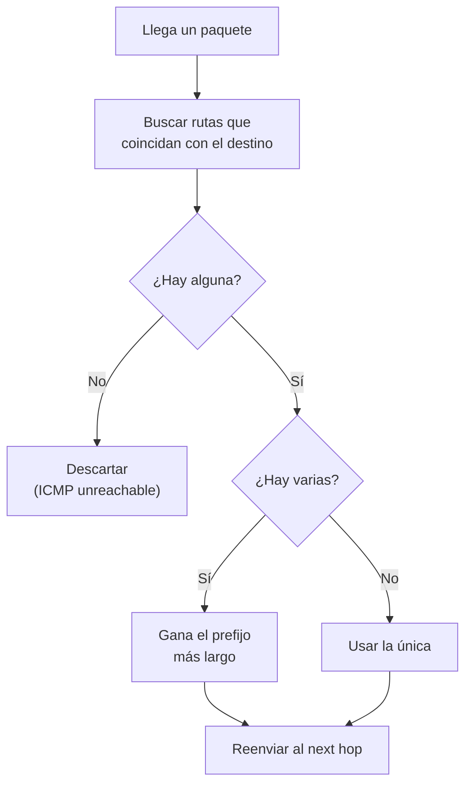
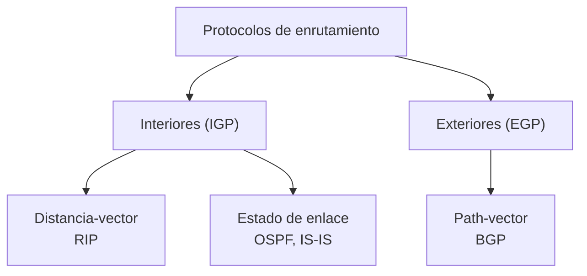
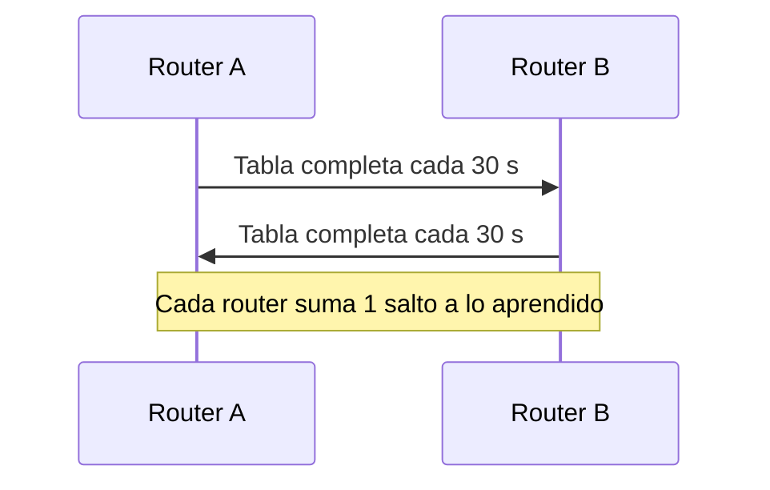
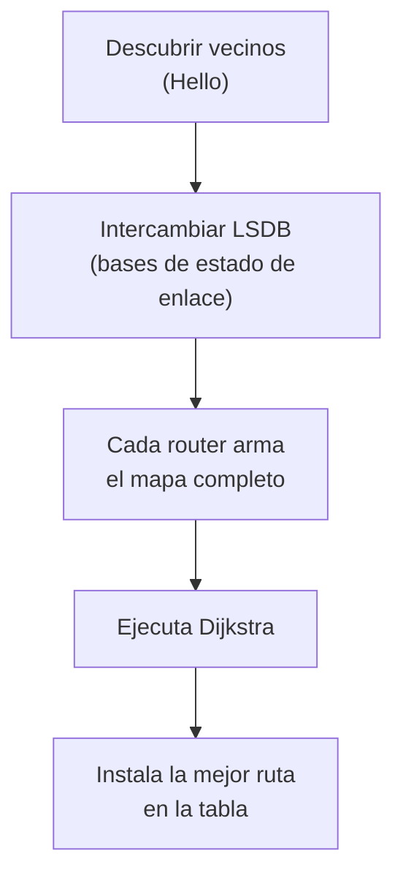

# 14. Enrutamiento: enrutados vs. de enrutamiento

> [!info] Al terminar este capítulo tenés que poder
> - Distinguir protocolo **enrutado** de protocolo **de enrutamiento**.
> - Leer una tabla de ruteo y aplicar longest match.
> - Comparar RIP, OSPF y BGP con sus métricas y alcances.
> - Explicar distancia-vector, estado de enlace y path-vector.
> - Diferenciar ruteo estático de dinámico.

> [!abstract] Qué debés saber (nivel 1)
> - **Enrutado:** transporta datos y lleva dirección de red (IP, IPX). Es el "pasajero".
> - **De enrutamiento:** intercambia información de rutas entre routers (RIP, OSPF, BGP). Es el "cartero".
> - **RIP:** distancia-vector, métrica = saltos, máximo **15**, UDP **520**, actualiza cada **30 s**.
> - **OSPF:** estado de enlace, métrica = **costo**, usa **áreas**, sobre IP protocolo 89.
> - **BGP:** path-vector, **entre AS**, métrica basada en atributos y políticas.
> - Tabla de ruteo: red destino, máscara, next hop, interfaz, métrica.

## 14.1 La distinción que se pregunta

| | Protocolo **enrutado** | Protocolo **de enrutamiento** |
|---|---|---|
| Función | Transportar los datos del usuario | Intercambiar rutas entre routers |
| Qué lleva | Dirección de red de origen y destino | Información de topología y métricas |
| Ejemplos | IP, IPv6, IPX | RIP, OSPF, BGP, EIGRP |
| Capa | Red (3) | Red (3), sobre IP o UDP |

> [!quote] Definición de cátedra
> **Protocolo enrutado:** protocolo que transporta datos y contiene la información necesaria para enrutar (dirección de red). **Protocolo de enrutamiento:** protocolo que permite a los routers intercambiar información de rutas y construir sus tablas.

> [!important] La analogía que sirve en el oral
> "IP es el **pasajero** que lleva la dirección en el bolsillo. RIP/OSPF son el **cartero** que reparte los mapas entre los routers." Sin protocolo de enrutamiento, el router solo conoce sus redes directamente conectadas.

## 14.2 La tabla de ruteo

| Campo | Significado |
|---|---|
| **Red destino** | Prefijo alcanzable |
| **Máscara** | Longitud del prefijo |
| **Next hop** | IP del siguiente router |
| **Interfaz** | Puerto de salida |
| **Métrica** | Costo de la ruta |

Ejemplo:

```text
Destino          Máscara          Next hop        Interfaz   Métrica
0.0.0.0          0.0.0.0          200.1.1.1       Gi0/0      10
192.168.1.0      255.255.255.0    192.168.1.2     Gi0/1      0
10.0.0.0         255.0.0.0        192.168.1.6     Gi0/1      2
```

> [!important] Longest match
> Si varias rutas coinciden, gana la de **prefijo más largo** (más específica), **no** la de menor métrica. `192.168.1.0/24` gana sobre `192.168.0.0/16` para un destino `192.168.1.50`. La métrica se compara solo entre rutas del **mismo prefijo**.

### Cómo decide el router



> [!important] La ruta por defecto es la última
> `0.0.0.0/0` coincide con todo, pero es el prefijo **más corto**: solo se usa si ninguna otra ruta coincide. Por eso “tener Internet” no impide que una ruta interna más específica gane.

### Ruta por defecto

`0.0.0.0/0` es la ruta por defecto: "si nada coincide, mandalo por acá". Es la que apunta a Internet.

## 14.3 Tipos de enrutamiento

| Tipo | Cómo aprende | Ventaja | Desventaja |
|---|---|---|---|
| **Estático** | Lo escribe el administrador | Predecible, sin tráfico de control | No se adapta a fallas |
| **Dinámico** | Lo aprenden los protocolos | Se adapta solo | Consume CPU, memoria y ancho de banda |
| **Por defecto** | Ruta comodín | Simple en redes stub | Puede crear bucles si está mal puesta |

> [!tip] Cuándo usar estático
> Redes chicas, enlaces punto a punto, rutas por defecto hacia el ISP y casos donde hace falta control fino. En redes grandes y cambiantes, dinámico.

### Clasificación de los dinámicos



| Categoría | Alcance | Ejemplos |
|---|---|---|
| **IGP** | Dentro de un AS | RIP, OSPF, EIGRP, IS-IS |
| **EGP** | Entre AS | BGP |

## 14.4 RIP

**RIP** (*Routing Information Protocol*) es el protocolo de enrutamiento clásico, simple y limitado.

| Característica | Valor |
|---|---|
| Tipo | Distancia-vector |
| Métrica | **Saltos** (routers atravesados) |
| Máximo | **15 saltos**; 16 = inalcanzable |
| Transporte | **UDP puerto 520** |
| Actualización | Cada **30 s** (tabla completa) |
| Convergencia | Lenta (minutos) |
| Versiones | RIPv1 (classful), RIPv2 (VLSM, autenticación) |

### Cómo funciona



| Regla | Detalle |
|---|---|
| Vecinos | Solo intercambia con routers directamente conectados |
| Aprendizaje | "Llego a X en n saltos" → el vecino aprende `n+1` |
| Mejor ruta | La de **menor cantidad de saltos** |
| Límite | 15 saltos: no sirve para redes grandes |

> [!warning] Por qué se dice que RIP "no escala"
> Porque cuenta **saltos**, no velocidad ni congestión, y porque **15 saltos** es un techo muy bajo. Un enlace de 1 Gbps y uno de 64 kbps valen lo mismo si son un salto.

### Problemas clásicos

| Problema | Qué pasa | Mitigación |
|---|---|---|
| **Cuenta a infinito** | Una ruta se propaga con métrica creciente | Split horizon, poison reverse, hold-down |
| **Convergencia lenta** | Tarda en estabilizarse | Timers más cortos, triggered updates |
| **Bucles** | Paquetes giran entre routers | Las tres técnicas anteriores |

> [!important] Split horizon en una frase
> "No anuncio una ruta por la misma interfaz por la que la aprendí." Evita devolverle a un vecino lo que él mismo me enseñó.

## 14.5 OSPF

**OSPF** (*Open Shortest Path First*) se creó para superar los límites de RIP.

| Característica | Valor |
|---|---|
| Tipo | Estado de enlace (link-state) |
| Métrica | **Costo** (normalmente inversamente proporcional al ancho de banda) |
| Algoritmo | Dijkstra (SPF) |
| Transporte | Directamente sobre **IP, protocolo 89** |
| Actualizaciones | Solo cambios (LSA), no la tabla completa |
| Jerarquía | **Áreas** (área 0 = backbone) |
| Convergencia | Rápida |

### Cómo funciona



| Concepto | Significado |
|---|---|
| **Hello** | Mensaje periódico para descubrir y mantener vecinos |
| **LSA** | Anuncio de estado de enlace |
| **LSDB** | Base de datos con todos los LSA del área |
| **Área** | Subconjunto de la red que comparte LSDB |
| **ABR** | Router de borde de área |
| **Costo** | Métrica; típicamente `10^8 / ancho de banda` |

> [!important] Por qué usa áreas
> Para que la LSDB no crezca sin límite. Todos los routers de un área conocen **toda** su área; el detalle de otras áreas se resume. El área 0 es la columna vertebral y todo debe conectarse a ella.

### Costo: ejemplo

| Enlace | Ancho de banda | Costo (`10^8/BW`) |
|---|---|---|
| Fast Ethernet | 100 Mbps | 1 |
| Ethernet | 10 Mbps | 10 |
| E1 | 2 Mbps | 50 |
| Enlace serial 64 kbps | 64 kbps | 1562 |

> [!tip] RIP vs. OSPF en una línea
> "RIP elige por **cantidad de saltos**; OSPF elige por **costo**, que refleja el ancho de banda. OSPF converge más rápido y escala con áreas."

## 14.6 BGP

**BGP** (*Border Gateway Protocol*) es el protocolo que sostiene Internet.

| Característica | Valor |
|---|---|
| Tipo | Path-vector |
| Alcance | **Entre sistemas autónomos (AS)** |
| Transporte | **TCP puerto 179** |
| Métrica | Atributos y **políticas** (no un costo simple) |
| Convergencia | Lenta, pero estable |
| Versión actual | BGP-4 |

| Concepto | Significado |
|---|---|
| **AS** | Sistema autónomo: conjunto de redes bajo una administración |
| **AS number** | Identificador del AS |
| **Path-vector** | Lista de AS por los que pasa la ruta |
| **eBGP** | BGP entre AS distintos |
| **iBGP** | BGP dentro del mismo AS |

> [!important] Por qué BGP no usa "el camino más corto"
> Porque en Internet las decisiones son **políticas y comerciales**: quién paga a quién, acuerdos de peering, preferencias. BGP permite aplicar esas políticas con atributos.

### Detección de bucles

El path-vector incluye la lista de AS. Si un router ve su propio AS en la lista, **descarta** la ruta. Eso evita bucles sin necesidad de contar saltos.

| Atributo | Función |
|---|---|
| **AS_PATH** | Lista de AS; base de la detección de bucles |
| **NEXT_HOP** | Siguiente salto |
| **LOCAL_PREF** | Preferencia local (iBGP) |
| **MED** | Métrica sugerida entre AS |

## 14.7 Comparación final

| | RIP | OSPF | BGP |
|---|---|---|---|
| Tipo | Distancia-vector | Estado de enlace | Path-vector |
| Métrica | Saltos | Costo | Atributos/políticas |
| Alcance | IGP pequeño | IGP grande | Entre AS |
| Transporte | UDP 520 | IP 89 | TCP 179 |
| Límite | 15 saltos | Áreas | Políticas |
| Convergencia | Lenta | Rápida | Lenta pero estable |
| Uso | Redes chicas, labs | Empresas | Internet |

> [!example] Pregunta típica de UTN
> "¿Qué protocolo de enrutamiento usaría en una red de 40 routers y por qué?" → **OSPF**: RIP no pasa de 15 saltos, converge lento y no considera el ancho de banda; OSPF usa costo, converge rápido y escala con áreas.

## 14.8 Método: diagnosticar un problema de ruteo

| Paso | Acción | Comando típico |
|---|---|---|
| 1 | ¿Hay conectividad local? | `ping` al gateway |
| 2 | ¿La interfaz está arriba? | `show ip interface brief` |
| 3 | ¿La red está en la tabla? | `show ip route` |
| 4 | ¿El next hop responde? | `ping` al next hop |
| 5 | ¿Hay ruta más específica? | Revisar longest match |
| 6 | ¿Hay bucles o rutas inconsistentes? | `traceroute` |
| 7 | ¿El protocolo converge? | `show ip protocols` |

## Errores que suelen tomar

| Error | Corrección |
|---|---|
| Confundir enrutado con de enrutamiento | Datos vs. rutas |
| "RIP elige la ruta más rápida" | Elige la de **menos saltos** |
| "RIP soporta 16 saltos" | Máximo 15; 16 = inalcanzable |
| "OSPF usa UDP" | Va directo sobre IP (protocolo 89) |
| "BGP elige el camino más corto" | Aplica políticas y atributos |
| Comparar métricas de distinto prefijo | Primero longest match |
| Decir que OSPF no tiene jerarquía | Usa áreas con área 0 |
| Creer que el estático se adapta | No se adapta a fallas |

## Ejercicios

> [!example]- 1. Clasificar
> **Enunciado:** ¿IP es protocolo enrutado o de enrutamiento?
> **Solución:** enrutado: transporta datos y lleva direcciones de red.

> [!example]- 2. RIP
> **Enunciado:** un destino está a 16 saltos. ¿Qué hace RIP?
> **Solución:** lo considera inalcanzable (16 = infinito).

> [!example]- 3. OSPF
> **Enunciado:** ¿qué algoritmo usa y sobre qué se transporta?
> **Solución:** Dijkstra (SPF); sobre IP, protocolo 89.

> [!example]- 4. BGP
> **Enunciado:** ¿cómo detecta bucles?
> **Solución:** con el atributo AS_PATH: si ve su propio AS, descarta la ruta.

> [!example]- 5. Longest match
> **Enunciado:** hay rutas `10.0.0.0/8` y `10.1.0.0/16`. ¿Cuál se usa para `10.1.2.3`?
> **Solución:** `10.1.0.0/16`, por ser el prefijo más específico.

> [!example]- 6. a papel
> **Enunciado:** dibujá una tabla de ruteo con ruta por defecto y explicá cada campo.
> **Solución:** ver 14.2.

## Lo que sigue

[[cm15_tcp-udp-congestion|TCP, UDP y control de congestión]].

#libro4 #enrutamiento
