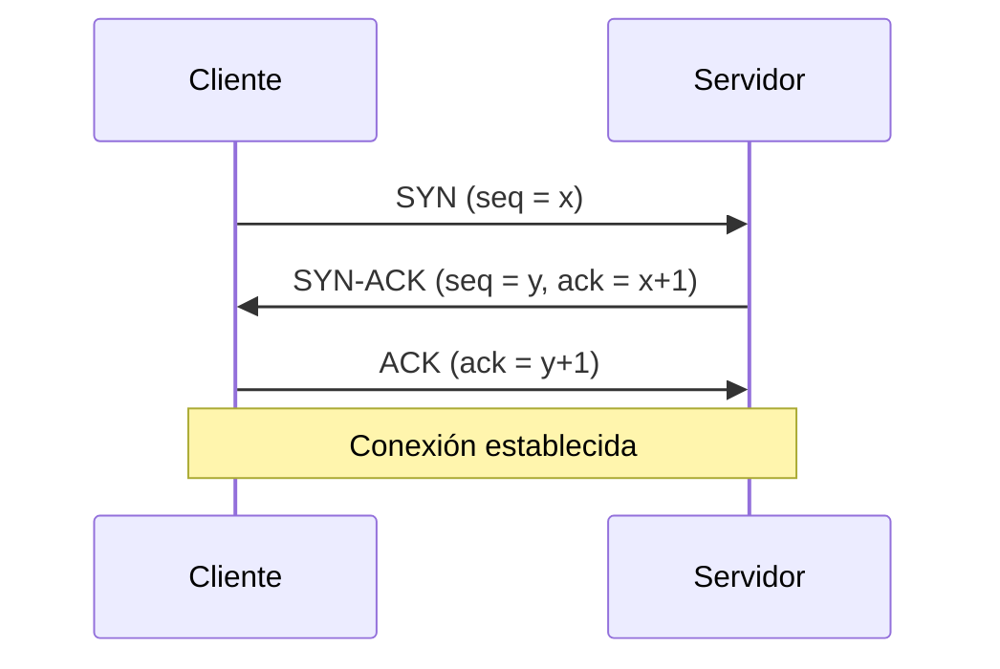
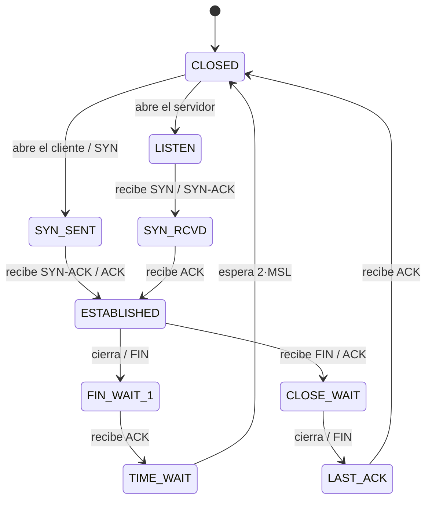
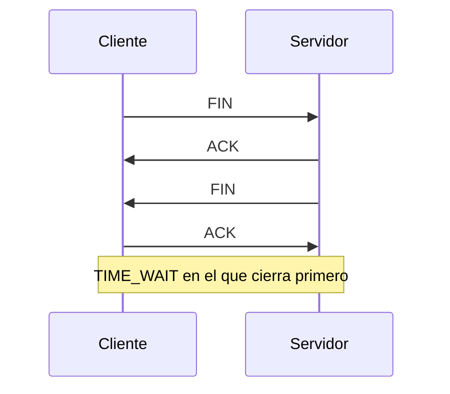
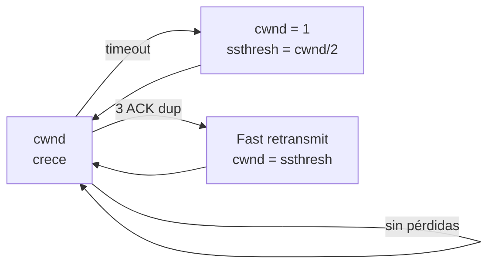

# 15. TCP, UDP y control de congestión

> [!info] Al terminar este capítulo tenés que poder
> - Explicar el three-way handshake y el cierre de conexión.
> - Describir secuencia, ACK y ventana.
> - Diferenciar control de flujo de control de congestión.
> - Explicar slow start, AIMD, fast retransmit y fast recovery.
> - Decidir entre TCP y UDP con criterios.

> [!abstract] Qué debés saber (nivel 1)
> - **TCP:** orientado a conexión, confiable, ordenado, con control de flujo y congestión.
> - **Handshake:** SYN → SYN-ACK → ACK.
> - Cierre: FIN → ACK → FIN → ACK (four-way).
> - **Ventana:** cuántos bytes puede haber sin confirmar.
> - **Control de flujo:** protege al **receptor**. **Control de congestión:** protege a la **red**.
> - **Slow start**, **AIMD**, **fast retransmit**.
> - **UDP:** sin conexión, sin garantías, mínimo overhead.

## 15.1 TCP: características

| Característica | Detalle |
|---|---|
| Orientado a conexión | Establece conexión antes de enviar |
| Confiable | ACK y retransmisión |
| Ordenado | Números de secuencia |
| Full-duplex | Ambos sentidos a la vez |
| Control de flujo | Ventana anunciada |
| Control de congestión | Ventana de congestión |
| Orientado a byte stream | No conserva "mensajes" |

### Cabecera TCP

| Campo | Función |
|---|---|
| Puerto origen / destino | Identifican la aplicación |
| Número de secuencia | Posición del primer byte del segmento |
| Número de ACK | Próximo byte esperado |
| Flags | SYN, ACK, FIN, RST, PSH, URG |
| Ventana | Espacio libre en el buffer del receptor |
| Checksum | Detección de errores |
| Opciones | MSS, window scaling, SACK |

> [!important] El número de ACK es acumulativo
> `ACK = 1001` significa "recibí todo hasta el byte 1000; espero el 1001". No es "recibí 1001 bytes".

## 15.2 Three-way handshake



| Paso | Qué hace | Qué sincroniza |
|---|---|---|
| 1 | Cliente envía SYN con su ISN | Su número inicial |
| 2 | Servidor responde SYN-ACK | Su ISN y confirma el del cliente |
| 3 | Cliente confirma | Ambos lados sincronizados |

> [!important] Por qué tres y no dos
> Porque cada lado debe **confirmar** el número inicial del otro. Con dos mensajes, uno de los dos no sabría si su ISN fue recibido.

### Los estados de la conexión



> [!important] `TIME_WAIT` no es un error
> Es el estado en el que el que cerró primero espera el doble del tiempo de vida del segmento para que no se confundan paquetes viejos con una conexión nueva. Verlo en `netstat` es normal.

### Cierre (four-way)



> [!tip] Por qué cuatro pasos
> Porque TCP es full-duplex: cada sentido se cierra por separado. El ACK del primer FIN no implica que el servidor ya no tenga datos para enviar.

## 15.3 Control de flujo

El receptor anuncia cuánto espacio libre tiene en su buffer (campo **ventana**).

| Situación | Efecto |
|---|---|
| Ventana grande | El emisor puede enviar más sin esperar ACK |
| Ventana 0 | El emisor se detiene (zero window) |
| Window scaling | Permite ventanas mayores a 64 KB |

> [!important] Control de flujo ≠ control de congestión
> **Flujo:** el receptor dice "no me mandes más, estoy lleno". **Congestión:** la red dice "hay demasiado tráfico" y el emisor baja el ritmo aunque el receptor tenga espacio.

## 15.4 Control de congestión

TCP mantiene una **ventana de congestión (cwnd)**. La ventana efectiva es:

```text
ventana efectiva = min(cwnd, ventana anunciada por el receptor)
```

### Slow start

| Etapa | Comportamiento |
|---|---|
| Inicio | `cwnd = 1 MSS` |
| Por cada ACK | `cwnd` se duplica (crecimiento exponencial) |
| Fin | Hasta el umbral `ssthresh` |

```text
cwnd: 1 → 2 → 4 → 8 → 16 → ...
```

> [!important] "Slow start" no es lento
> Arranca con 1 MSS, pero **duplica** por RTT: es crecimiento **exponencial**. El nombre es histórico: comparado con enviar toda la ventana de golpe, arranca despacio.

### Congestion avoidance (AIMD)

Después del umbral, el crecimiento pasa a ser **lineal** (+1 MSS por RTT).

| Fase | Crecimiento |
|---|---|
| Slow start | Exponencial |
| Congestion avoidance | Lineal (+1 MSS/RTT) |
| Pérdida por timeout | `ssthresh = cwnd/2`, `cwnd = 1` |
| Pérdida por 3 ACK dup | `ssthresh = cwnd/2`, `cwnd = ssthresh` |

**AIMD** = *Additive Increase, Multiplicative Decrease*: sube de a uno, baja a la mitad.



### Fast retransmit y fast recovery

| Evento | Qué hace |
|---|---|
| 3 ACK duplicados | Retransmite sin esperar timeout |
| Fast recovery | Baja `cwnd` a la mitad y sigue en avoidance |
| Timeout | Es más grave: vuelve a slow start |

> [!important] Por qué 3 ACK duplicados
> Un ACK duplicado puede ser reordenamiento. Tres seguidos indican con alta probabilidad que **se perdió** un segmento. Es la señal para retransmitir rápido sin esperar el temporizador.

### Algoritmos modernos

| Algoritmo | Idea |
|---|---|
| Tahoe | Slow start + fast retransmit |
| Reno | Agrega fast recovery |
| Cubic | Función cúbica; usado en Linux |
| BBR | Basado en ancho de banda y RTT medidos |

### Dónde nace la congestión: colas y utilización

La congestión aparece cuando la demanda supera, durante suficiente tiempo, la capacidad de los enlaces, de los procesadores o de los buffers. Las colas crecen, sube el retardo y, cuando el buffer se llena, se descartan paquetes; las retransmisiones pueden agravar el cuadro.

$$
\rho = \frac{\lambda}{\mu} \quad [\text{sin unidades}], \qquad \text{estable si } \lambda < \mu
$$

- `λ`: paquetes por segundo que llegan (media).
- `μ`: paquetes por segundo que el enlace puede servir.
- `ρ`: utilización. Si `ρ ≥ 1`, la cola crece sin límite.

> [!important] Por qué no se planifica al 100 %
> El retardo no crece lineal. En un modelo simple de cola, el tamaño promedio es `ρ/(1−ρ)`: con `ρ = 0,5` hay 1 paquete, con `0,8` hay 4 y con `0,9` hay 9. Por eso se deja margen de capacidad.

> [!tip] Síntomas y mitigación
> Señales: descartes en las interfaces, RTT y jitter en aumento, retransmisiones TCP y buffers llenos. Se mitiga con más capacidad, QoS (colas, shaping, policing), control de congestión de TCP y eliminación de bucles.

## 15.5 UDP

| Característica | Detalle |
|---|---|
| Sin conexión | No hay handshake |
| Sin confiabilidad | No hay ACK ni retransmisión |
| Sin orden | Los datagramas pueden llegar desordenados |
| Sin control de congestión | Envía al ritmo de la aplicación |
| Cabecera | 8 bytes (puertos, longitud, checksum) |
| Ventaja | Bajo overhead y baja latencia |

> [!important] UDP no es "TCP roto"
> Es la elección correcta cuando la **latencia importa más que la pérdida**: VoIP, video en vivo, DNS, juegos, QUIC (que agrega confiabilidad selectiva sobre UDP).

### Cuándo usar cada uno

| Criterio | TCP | UDP |
|---|---|---|
| ¿Se puede tolerar pérdida? | No | Sí |
| ¿Importa el orden? | Sí | No |
| ¿Latencia crítica? | No | Sí |
| ¿Muchos destinatarios? | No | Sí (multicast) |
| Ejemplos | HTTP, SSH, correo, FTP | DNS, VoIP, streaming, juegos |

## 15.6 Puertos

| Rango | Tipo |
|---|---|
| 0–1023 | Bien conocidos (well-known) |
| 1024–49151 | Registrados |
| 49152–65535 | Efímeros / dinámicos |

| Puerto | Servicio |
|---|---|
| 20/21 | FTP |
| 22 | SSH |
| 23 | Telnet |
| 25 | SMTP |
| 53 | DNS |
| 80 | HTTP |
| 110 | POP3 |
| 143 | IMAP |
| 443 | HTTPS |
| 3306 | MySQL |
| 3389 | RDP |

> [!tip] Una conexión se identifica con la 5-tupla
> `(IP origen, puerto origen, IP destino, puerto destino, protocolo)`. Por eso un servidor puede atender miles de conexiones en el puerto 443.

## 15.7 QoS (breve)

Cuando la red no puede dar todo a todos, se prioriza.

| Mecanismo | Qué hace |
|---|---|
| **Clasificación** | Marca los paquetes por clase |
| **Colas (queuing)** | Ordena la salida por prioridad |
| **Policing** | Descarta lo que excede el límite |
| **Shaping** | Retiene y suaviza el tráfico |
| **DiffServ** | Clases de servicio con DSCP |

| Tráfico | Requisito |
|---|---|
| Voz | Baja latencia y jitter |
| Video | Ancho de banda sostenido |
| Datos | Confiabilidad |

> [!important] QoS no crea ancho de banda
> Solo **reparte** el que hay. Si el enlace está saturado, alguien pierde.

## 15.8 Método: analizar una conexión

| Paso | Pregunta |
|---|---|
| 1 | ¿TCP o UDP? ¿Por qué? |
| 2 | ¿Qué puerto? ¿Qué servicio? |
| 3 | ¿Se completó el handshake? |
| 4 | ¿Qué ventana anuncia el receptor? |
| 5 | ¿Hay retransmisiones? (posible pérdida) |
| 6 | ¿El problema es de flujo, de congestión o de aplicación? |

## Errores que suelen tomar

| Error | Corrección |
|---|---|
| Confundir control de flujo con congestión | Receptor vs. red |
| "Slow start es lineal" | Es exponencial |
| "TCP baja la ventana de golpe siempre" | Multiplicativa (a la mitad) en pérdida por ACK dup |
| Decir que UDP es siempre más rápido | Tiene menos overhead, no garantiza nada |
| Confundir ACK con número de bytes recibidos | Es el **próximo byte esperado** |
| "El three-way handshake usa 2 mensajes" | Son 3 |
| Creer que el cierre es de 2 pasos | Es de 4 (full-duplex) |
| Decir que QoS agrega ancho de banda | Solo lo administra |

## Ejercicios

> [!example]- 1. Handshake
> **Enunciado:** ordená los mensajes del establecimiento.
> **Solución:** SYN → SYN-ACK → ACK.

> [!example]- 2. ACK
> **Enunciado:** el receptor envía `ACK = 5001`. ¿Qué significa?
> **Solución:** recibió hasta el byte 5000 y espera el 5001.

> [!example]- 3. Ventana
> **Enunciado:** `cwnd = 8 MSS` y ventana anunciada = `4 MSS`. ¿Cuánto puede enviar?
> **Solución:** 4 MSS: se toma el mínimo.

> [!example]- 4. Pérdida
> **Enunciado:** tres ACK duplicados. ¿Qué hace TCP?
> **Solución:** fast retransmit: retransmite el segmento perdido sin esperar timeout y aplica fast recovery.

> [!example]- 5. UDP
> **Enunciado:** ¿por qué DNS usa UDP para consultas?
> **Solución:** porque la consulta es corta y la latencia importa más que la garantía; la retransmisión la hace la aplicación.

> [!example]- 6. a papel
> **Enunciado:** dibujá el gráfico de cwnd en el tiempo con slow start, avoidance y una pérdida por timeout.
> **Solución:** subida exponencial hasta `ssthresh`, luego lineal, caída a 1 en el timeout y otra vez exponencial.

## Lo que sigue

[[cm16_wan-mpls-moviles|WAN, MPLS y comunicaciones móviles]].

#libro4 #tcp #udp #congestion
