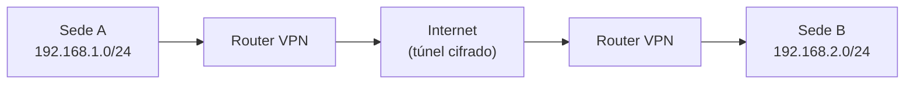
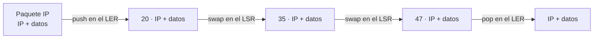
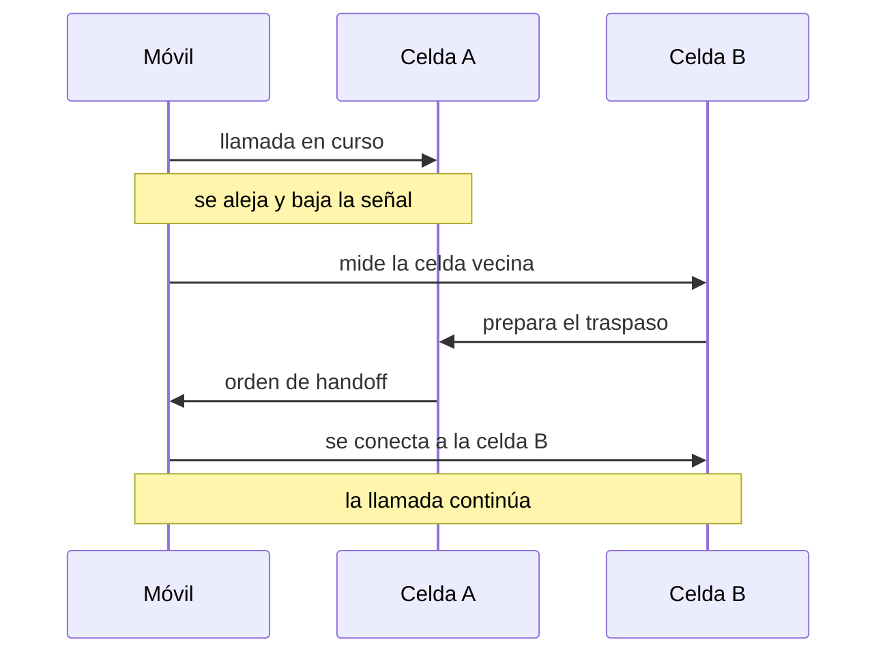

# 16. WAN, MPLS y comunicaciones móviles

> [!info] Al terminar este capítulo tenés que poder
> - Diferenciar LAN, MAN y WAN, y sus tecnologías.
> - Explicar qué es una VPN y para qué sirve.
> - Describir MPLS: etiquetas, LSR, LSP y beneficios.
> - Explicar handoff, roaming y generaciones celulares.
> - Mencionar las tendencias que cierran el programa.

> [!abstract] Qué debés saber (nivel 1)
> - **WAN:** red de gran alcance que interconecta sedes; usa enlaces del operador.
> - Tecnologías: leased line, Frame Relay, ATM, MPLS, Ethernet WAN, SD-WAN, Internet + VPN.
> - **VPN:** túnel cifrado sobre una red pública.
> - **MPLS:** conmutación por **etiquetas**, no por IP destino.
> - **LSR:** router que conmuta etiquetas. **LSP:** camino conmutado por etiquetas.
> - **Handoff:** traspaso de celda. **Roaming:** uso de otra red de operador.
> - Generaciones: 2G, 3G, 4G/LTE, 5G.

## 16.1 LAN, MAN y WAN

| | LAN | MAN | WAN |
|---|---|---|---|
| Alcance | Edificio/campus | Ciudad | País/continente |
| Propiedad | Propia | Propia o del operador | Operador |
| Velocidad | Muy alta | Alta | Variable |
| Tecnología | Ethernet, Wi-Fi | Metro Ethernet, fibra | MPLS, SD-WAN, VPN |
| Costo | Bajo por puerto | Medio | Alto por enlace |

> [!quote] Cátedra
> **WAN (red de área amplia):** red que cubre una extensa área geográfica y que generalmente utiliza enlaces provistos por operadores de telecomunicaciones para interconectar redes locales.

### Tecnologías WAN

| Tecnología | Naturaleza | Estado |
|---|---|---|
| **Línea dedicada** | Circuito punto a punto exclusivo | Cara, aún usada |
| **Frame Relay** | Conmutación de tramas, circuitos virtuales | Obsoleta |
| **ATM** | Celdas de 53 bytes, QoS | Obsoleta en acceso |
| **MPLS** | Conmutación por etiquetas con QoS | **Vigente en operadores** |
| **Ethernet WAN** | Ethernet sobre fibra del operador | En crecimiento |
| **SD-WAN** | Software que gestiona varios enlaces | **Tendencia** |
| **Internet + VPN** | Túnel cifrado sobre Internet | Común en pymes |

> [!important] La diferencia clave con una LAN
> En una WAN el usuario **alquila** infraestructura. No controla el medio ni el camino; por eso importan el SLA, la QoS y el cifrado.

## 16.2 VPN

Una **VPN** crea un túnel cifrado sobre una red que no es de confianza (habitualmente Internet).

| Tipo | Qué conecta | Uso |
|---|---|---|
| **Site-to-site** | Dos sedes | Empresas con sucursales |
| **Client-to-site (remote access)** | Un usuario remoto con la red | Teletrabajo |
| **IPsec** | Capa 3, túneles | Estándar en site-to-site |
| **SSL/TLS VPN** | Capa de aplicación | Acceso web, clientes livianos |

| Ventaja | Limitación |
|---|---|
| Cifrado y autenticación | Agrega overhead |
| Bajo costo (usa Internet) | Depende de la calidad de Internet |
| Acceso remoto simple | Configuración y gestión |

> [!important] VPN no es "una red privada física"
> Es un **túnel lógico** sobre infraestructura compartida. La privacidad viene del cifrado, no del aislamiento físico.

## 16.3 MPLS

**MPLS** (*Multiprotocol Label Switching*) reemplaza la búsqueda por IP destino por una **etiqueta** de longitud fija.

### Por qué aparece

El router tradicional hace *longest match* sobre la tabla de ruteo en cada salto. MPLS permite decidir **una vez** (en el borde) y luego conmutar por etiqueta, que es más rápido y permite ingeniería de tráfico y QoS.

### Componentes

| Elemento | Función |
|---|---|
| **LER** (Label Edge Router) | Router de borde: pone o quita la etiqueta |
| **LSR** (Label Switch Router) | Router del núcleo: conmuta por etiqueta |
| **LSP** (Label Switched Path) | Camino preestablecido por el que viaja el flujo |
| **LIB/LFIB** | Tablas de etiquetas de entrada/salida |
| **FEC** | Clase de equivalencia: paquetes que reciben el mismo tratamiento |

### La etiqueta

| Campo | Bits | Función |
|---|---|---|
| Label | 20 | Valor de la etiqueta |
| EXP | 3 | Clase de servicio (QoS) |
| S | 1 | Bottom of stack (fin de la pila) |
| TTL | 8 | Evita bucles |

### La pila de etiquetas en el paquete

> [!important] La IP no se toca en el núcleo
> El router del núcleo no mira la dirección destino: mira la etiqueta, la cambia por la de salida y reenvía. Eso es lo que hace que MPLS sea más simple de conmutar y permita decidir el camino por política y no por destino.

### Cómo funciona el reenvío

| Paso | Acción |
|---|---|
| 1 | El LER clasifica el paquete en una FEC y le asigna etiqueta |
| 2 | Cada LSR mira solo la etiqueta de entrada |
| 3 | Busca en su tabla: etiqueta de salida + interfaz |
| 4 | Reemplaza la etiqueta (*swap*) y reenvía |
| 5 | El LER de egreso quita la etiqueta y entrega el paquete IP |

Operaciones posibles: **push** (agregar), **swap** (reemplazar), **pop** (quitar).

> [!important] La diferencia con IP tradicional
> En IP cada router analiza la dirección destino y hace longest match. En MPLS el camino ya está definido: los routers del núcleo **no miran la IP**, solo la etiqueta.

### Beneficios

| Beneficio | Detalle |
|---|---|
| **Velocidad** | Búsqueda exacta en tabla, sin longest match |
| **Ingeniería de tráfico** | Se puede desviar tráfico por rutas elegidas |
| **QoS** | El campo EXP permite priorizar |
| **VPN de capa 3** | Separación de clientes por etiquetas (VRF) |
| **Multiprotocolo** | Transporta IP, Ethernet, ATM |
| **Convergencia** | Protección ante fallas con LSP alternativos |

> [!example] Pregunta típica de UTN
> "¿Qué ventaja tiene MPLS frente al ruteo IP tradicional?" → Conmuta por etiqueta de longitud fija (más simple y rápido), permite ingeniería de tráfico, QoS y VPN de capa 3 sobre una sola infraestructura.

### MPLS vs. IP

| | IP tradicional | MPLS |
|---|---|---|
| Decisión | Por paquete, en cada salto | Por flujo, en el borde |
| Clave | IP destino (longest match) | Etiqueta (exacta) |
| Camino | Emergente del ruteo | Predefinido (LSP) |
| QoS | Diferenciada por campo | Por etiqueta (EXP) |
| Facilidad de ingeniería | Baja | Alta |

## 16.4 Comunicaciones móviles

### Conceptos

| Concepto | Significado |
|---|---|
| **Celda** | Área de cobertura de una estación base |
| **Estación base (BTS/eNodeB/gNB)** | Antena y equipo de radio |
| **Handoff (handover)** | Traspaso de la conexión de una celda a otra |
| **Roaming** | Uso de la red de otro operador mediante acuerdo |
| **HLR/HSS** | Base de datos de abonados |
| **Espectro** | Recurso limitado que se licita |

> [!important] Handoff ≠ roaming
> **Handoff:** el usuario se mueve **dentro** de la red de su operador y cambia de celda. **Roaming:** el usuario usa la red de **otro** operador, generalmente en otra región o país.

### Handoff: tipos

| Tipo | Cuándo | Riesgo |
|---|---|---|
| **Hard handoff** | Se corta antes de conectar la nueva celda ("break before make") | Microcorte |
| **Soft handoff** | Se conecta la nueva antes de soltar la anterior | Más recursos |

> [!tip] La frase
> "El handoff mantiene la llamada mientras el usuario se desplaza; el soft handoff evita el corte porque usa dos celdas a la vez."

### Generaciones

| Generación | Tecnología | Datos | Hito |
|---|---|---|---|
| **1G** | AMPS | Analógico | Voz móvil |
| **2G** | GSM, CDMA | ~kbps | Digital, SMS |
| **2.5G** | GPRS, EDGE | ~100 kbps | Datos por paquetes |
| **3G** | UMTS, HSPA | Mbps | Datos móviles reales |
| **4G** | LTE | Decenas de Mbps | Todo IP, video |
| **5G** | NR | Gbps | Baja latencia, IoT |
| **5G-Advanced** | NR evolucionado (3GPP R18-R20) | Hasta ~10 Gbps | Automatización, IA/ML, nuevos casos |
| **IMT-2030 / 6G** | Marco en desarrollo (ITU-R M.2160) | — | Próxima generación, aún no comercial |

> [!important] Qué cambia en cada salto
> 2G digitaliza la voz; 3G agrega datos con conmutación de paquetes; 4G elimina la conmutación de circuitos (todo IP); 5G agrega latencia muy baja, densidad de dispositivos y *network slicing*.

### 5G: tres escenarios

| Escenario | Para qué |
|---|---|
| **eMBB** | Banda ancha móvil mejorada |
| **URLLC** | Ultra confiable y baja latencia |
| **mMTC** | Millones de dispositivos IoT |

### La radio: MIMO, beamforming y slicing

| Elemento | Qué aporta |
|---|---|
| **MIMO** | Varias antenas de transmisión y recepción: más capacidad con el mismo espectro |
| **Beamforming** | Dirige la energía hacia el usuario: más cobertura y menos interferencia |
| **Network slicing** | Varias redes lógicas con requisitos distintos sobre la misma infraestructura |

> [!important] Cobertura no es capacidad
> Una celda puede cubrir mucha superficie y aun así saturarse: si el sector tiene muchos usuarios, la velocidad baja aunque la señal sea fuerte. Se resuelve con más celdas, más espectro o sectorización.

## 16.5 Tendencias

| Tendencia | Idea |
|---|---|
| **SD-WAN** | Gestionar varios enlaces (MPLS, Internet, LTE) por software |
| **SASE** | Seguridad y red como servicio en el borde |
| **Wi-Fi 6/6E/7** | Canales de hasta 320 MHz, multienlace (MLO) y más eficiencia en entornos densos |
| **Edge computing** | Procesar cerca del usuario: menos latencia y menos tráfico hacia la nube |
| **SDN/NFV** | Control centralizado y funciones de red virtualizadas |
| **Satélites LEO** | Órbita baja: menor latencia que GEO y cobertura amplia |
| **Network slicing** | Redes lógicas dedicadas sobre 5G |
| **IoT** | Sensores y dispositivos conectados masivamente |
| **IPv6** | Agotamiento de IPv4 y NAT |
| **Zero Trust** | No confiar por ubicación, sino por identidad |

> [!important] Cómo cerrar el oral
> "La tendencia es converger: la WAN se gestiona por software, la seguridad se integra en el borde y la red se segmenta lógicamente por servicio, no por cable."

## 16.6 Método: diseñar la conectividad de una sede

| Paso | Pregunta | Decisión |
|---|---|---|
| 1 | ¿Cuántas sedes y qué tráfico? | Dimensionar enlaces |
| 2 | ¿Se requiere QoS? | MPLS o SD-WAN con QoS |
| 3 | ¿Hay datos sensibles? | VPN/IPsec |
| 4 | ¿Presupuesto? | Internet + VPN vs. MPLS |
| 5 | ¿Movilidad? | LTE/5G como respaldo |
| 6 | ¿Redundancia? | Dos enlaces de distintos proveedores |

## Errores que suelen tomar

| Error | Corrección |
|---|---|
| "MPLS es un protocolo de enrutamiento" | Es una técnica de conmutación por etiquetas |
| "MPLS reemplaza a IP" | Transporta paquetes IP; no los reemplaza |
| Confundir LER con LSR | Borde (pone/quita) vs. núcleo (conmuta) |
| "Handoff es roaming" | Celda vs. otra red de operador |
| "Más generaciones = solo más velocidad" | Cambian arquitectura y latencia |
| "VPN es una línea privada" | Es un túnel cifrado sobre red pública |
| "5G es solo 4G más rápido" | Agrega URLLC, mMTC y slicing |
| Decir que Frame Relay sigue vigente | Está obsoleto |

## Ejercicios

> [!example]- 1. Clasificar
> **Enunciado:** una empresa conecta sus 12 sucursales en el país. ¿LAN, MAN o WAN?
> **Solución:** WAN.

> [!example]- 2. VPN
> **Enunciado:** ¿qué ventaja da una VPN site-to-site sobre una línea dedicada?
> **Solución:** menor costo al usar Internet, con cifrado y autenticación; la desventaja es depender de la calidad de Internet.

> [!example]- 3. MPLS
> **Enunciado:** ¿qué hace un LSR al recibir un paquete?
> **Solución:** mira la etiqueta de entrada, busca en su tabla, reemplaza la etiqueta (swap) y lo envía por la interfaz indicada.

> [!example]- 4. MPLS
> **Enunciado:** ¿por qué MPLS es más rápido que el ruteo IP por salto?
> **Solución:** porque usa búsqueda exacta de etiqueta en lugar de longest match sobre la IP, y el camino está predefinido.

> [!example]- 5. Móviles
> **Enunciado:** ¿qué diferencia hay entre handoff y roaming?
> **Solución:** handoff es el cambio de celda dentro de la misma red; roaming es usar la red de otro operador.

> [!example]- 6. a papel
> **Enunciado:** dibujá un LSP con dos LSR y mostrá el swap de etiquetas.
> **Solución:** LER(20) → LSR(20→35) → LSR(35→47) → LER(quita).

## Lo que sigue

[[cm_Cierre_parte4|Cierre de la Parte 4]].

#libro4 #wan #mpls #moviles
